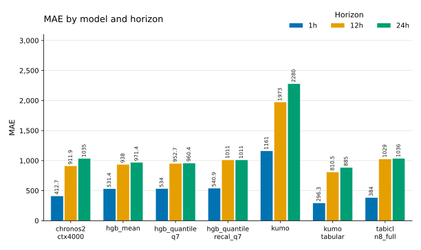
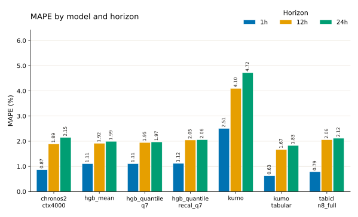
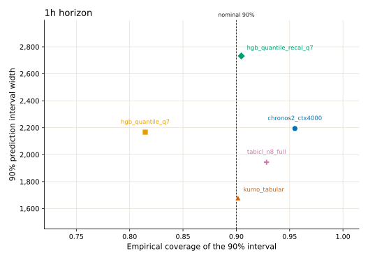
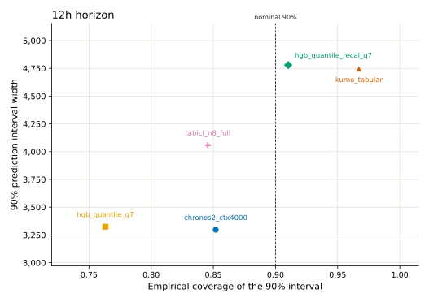
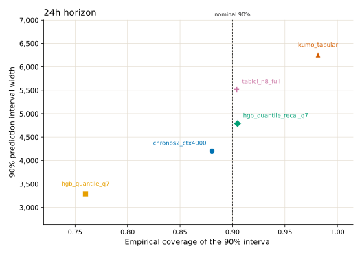
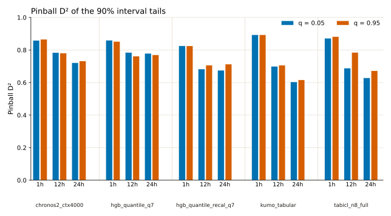

# Walk-forward CV metric plots

These figures restate the pooled metrics from the [walk-forward CV comparison](https://probabl-ai.github.io/skore-example-electricity-load/model-comparison/cv_comparison/report.html). Each number pools every row across the 8 CV folds. MAE and MAPE use the median prediction where the model has quantiles. Coverage, interval width, and pinball D² use the published quantiles. `hgb_mean` and `kumo` have no quantiles in that table, so they appear only in the point-error plots.

The plots show the 1h, 12h, and 24h horizons. The source table also reports an average slice; those values are in the tables below.

MAE and interval width are in the load units of the source table. The MAPE figure shows percent; the table keeps the source fractions.

## Point error

`kumo_tabular` has the lowest MAE and MAPE at 1h, 12h, and 24h. At 1h its MAE is 296.3, ahead of `tabicl_n8_full` (384) and `chronos2_ctx4000` (412.7). The three histogram gradient boosting models sit together at 1h (531.4 to 540.9). `kumo` is about twice that, at 1161.

At 24h the field behind `kumo_tabular` tightens. Its MAE is 885, then `hgb_quantile_q7` at 960.4, `hgb_mean` at 971.4, and `hgb_quantile_recal_q7` at 1011. `chronos2_ctx4000` (1035) and `tabicl_n8_full` (1036) are next to each other. `kumo` is 2280.

Recalibrating the quantile model raises MAE at every horizon: `hgb_quantile_recal_q7` versus `hgb_quantile_q7` is 540.9 versus 534 at 1h, 1011 versus 952.7 at 12h, and 1011 versus 960.4 at 24h.

MAPE ranks the models in the same order as MAE at each of these horizons.





### MAE

| model | 1h | 12h | 24h | average |
| --- | ---: | ---: | ---: | ---: |
| chronos2_ctx4000 | 412.7 | 911.9 | 1035 | 786.6 |
| hgb_mean | 531.4 | 938 | 971.4 | 813.6 |
| hgb_quantile_q7 | 534 | 952.7 | 960.4 | 815.7 |
| hgb_quantile_recal_q7 | 540.9 | 1011 | 1011 | 854.2 |
| kumo | 1161 | 1973 | 2280 | 1805 |
| kumo_tabular | 296.3 | 810.5 | 885 | 664 |
| tabicl_n8_full | 384 | 1029 | 1036 | 816.2 |

### MAPE

| model | 1h | 12h | 24h | average |
| --- | ---: | ---: | ---: | ---: |
| chronos2_ctx4000 | 0.008655 | 0.01892 | 0.02148 | 0.01635 |
| hgb_mean | 0.01107 | 0.01917 | 0.01993 | 0.01672 |
| hgb_quantile_q7 | 0.01108 | 0.01948 | 0.01971 | 0.01676 |
| hgb_quantile_recal_q7 | 0.01119 | 0.02046 | 0.0206 | 0.01742 |
| kumo | 0.02506 | 0.04098 | 0.04723 | 0.03776 |
| kumo_tabular | 0.006284 | 0.01667 | 0.0183 | 0.01375 |
| tabicl_n8_full | 0.007879 | 0.02057 | 0.02117 | 0.01654 |

## Interval width and coverage

On these plots a calibrated sharp 90% interval sits on the dashed line and low on the width axis. Each panel has its own width scale, because interval width grows with the horizon.

At 1h, `kumo_tabular` is on the nominal coverage (0.9015) with the narrowest interval (1680). `tabicl_n8_full` is somewhat conservative (0.9283) and still narrower than Chronos-2 and both HGB quantile models. `hgb_quantile_q7` undercovers (0.8146) at a width close to Chronos-2 (2167 versus 2194). Recalibration moves that model to 0.9047 and widens the interval to 2732. Chronos-2 overcovers (0.9549) at width 2194.

At 12h, `hgb_quantile_q7` and `chronos2_ctx4000` have the narrowest intervals (3325 and 3297) and both undercover (0.7631 and 0.8519). `tabicl_n8_full` undercovers as well (0.8456) at width 4059. Recalibration reaches 0.9102 at width 4780, next to `kumo_tabular`, which overcovers (0.9671) at width 4747.

At 24h, `hgb_quantile_q7` is again the narrowest (3288) and the furthest under the nominal coverage (0.7599). Chronos-2 is closer to the line (0.8804) at width 4204. Recalibration lands on 0.9048 at width 4789. `tabicl_n8_full` is on the nominal coverage (0.904) and wider (5519). `kumo_tabular` overcovers (0.9816) with the widest interval (6256).







### Coverage of the 90% interval

| model | 1h | 12h | 24h | average |
| --- | ---: | ---: | ---: | ---: |
| chronos2_ctx4000 | 0.9549 | 0.8519 | 0.8804 | 0.8957 |
| hgb_quantile_q7 | 0.8146 | 0.7631 | 0.7599 | 0.7792 |
| hgb_quantile_recal_q7 | 0.9047 | 0.9102 | 0.9048 | 0.9066 |
| kumo_tabular | 0.9015 | 0.9671 | 0.9816 | 0.9501 |
| tabicl_n8_full | 0.9283 | 0.8456 | 0.904 | 0.8927 |

### Width of the 90% interval

| model | 1h | 12h | 24h | average |
| --- | ---: | ---: | ---: | ---: |
| chronos2_ctx4000 | 2194 | 3297 | 4204 | 3232 |
| hgb_quantile_q7 | 2167 | 3325 | 3288 | 2926 |
| hgb_quantile_recal_q7 | 2732 | 4780 | 4789 | 4100 |
| kumo_tabular | 1680 | 4747 | 6256 | 4228 |
| tabicl_n8_full | 1944 | 4059 | 5519 | 3841 |

## Pinball D² of the 90% interval

Pinball D² at q = 0.05 and q = 0.95 scores the two tails that bound the 90% interval. Higher is better. Bars are grouped by model, then by horizon, then by that quantile pair. The median quantile (q = 0.5) is a point-forecast score; its values are in the table and are left off the figure.

At 1h, `kumo_tabular` leads both tails (0.8932 and 0.8933). At 12h, `chronos2_ctx4000` (0.7833 and 0.7807) and `hgb_quantile_q7` (0.784 and 0.7615) lead, and `kumo_tabular` falls to about 0.70. At 24h, `hgb_quantile_q7` leads both tails (0.7789 and 0.7696), ahead of Chronos-2 (0.7211 and 0.7318). `kumo_tabular` is last at 24h (0.6036 and 0.6158).

`tabicl_n8_full` is uneven at 12h: q = 0.95 is 0.7847, in line with the leaders, while q = 0.05 is 0.6884.

Recalibration lowers pinball D² relative to `hgb_quantile_q7` at every horizon and both tails. The coverage plots show the corresponding change: empirical coverage moves from about 0.76–0.81 onto 0.90, and the interval gets wider.



### Tail pinball D² (q = 0.05 and q = 0.95)

| model | 1h 0.05 | 1h 0.95 | 12h 0.05 | 12h 0.95 | 24h 0.05 | 24h 0.95 | avg 0.05 | avg 0.95 |
| --- | ---: | ---: | ---: | ---: | ---: | ---: | ---: | ---: |
| chronos2_ctx4000 | 0.8582 | 0.8652 | 0.7833 | 0.7807 | 0.7211 | 0.7318 | 0.8523 | 0.903 |
| hgb_quantile_q7 | 0.8594 | 0.8519 | 0.784 | 0.7615 | 0.7789 | 0.7696 | 0.8295 | 0.8759 |
| hgb_quantile_recal_q7 | 0.8252 | 0.8246 | 0.6825 | 0.7064 | 0.6747 | 0.7125 | 0.8405 | 0.8852 |
| kumo_tabular | 0.8932 | 0.8933 | 0.6993 | 0.7063 | 0.6036 | 0.6158 | 0.8578 | 0.9057 |
| tabicl_n8_full | 0.8719 | 0.882 | 0.6884 | 0.7847 | 0.6285 | 0.6718 | 0.8416 | 0.9006 |

### Median pinball D² (q = 0.5)

| model | 1h | 12h | 24h | average |
| --- | ---: | ---: | ---: | ---: |
| chronos2_ctx4000 | 0.9487 | 0.8866 | 0.8712 | 0.9021 |
| hgb_quantile_q7 | 0.9336 | 0.8815 | 0.8805 | 0.8985 |
| hgb_quantile_recal_q7 | 0.9327 | 0.8743 | 0.8742 | 0.8937 |
| kumo_tabular | 0.9631 | 0.8992 | 0.8899 | 0.9174 |
| tabicl_n8_full | 0.9522 | 0.8721 | 0.8711 | 0.8985 |

## Reading the three views together

`kumo_tabular` is the best point forecast at 1h, 12h, and 24h. Its 1h interval is on the nominal 90% coverage, the narrowest of the five quantile models, and the best 1h tail D². At 24h the same model has the widest interval, coverage 0.982, and the lowest tail D².

`hgb_quantile_q7` is a middling point forecast at 1h and the strongest 24h interval on tail D², with the narrowest 24h band and coverage near 0.76. `hgb_quantile_recal_q7` is the model whose coverage stays near 0.90 at all three horizons. That calibration comes with higher MAE and lower tail D² than `hgb_quantile_q7`.

## Reproduce

From `electricity_load_cv_plots`, with [pixi](https://pixi.sh):

```bash
pixi run plot
```

The script reads `data/cv_metrics.json`, which was copied from the published table, and writes the SVG figures next to this report.
