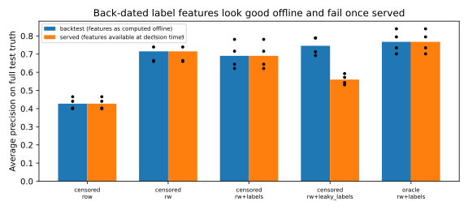

# 003 — skrub DataOps, lag-aware label features and leakage

## What changed

- **Feature engineering as a skrub DataOp** (`fraud_sim.pipeline.feature_store_dataop`). The raw public event log is a `skrub.var("log")`. Window aggregates (`groupby().rolling(window, closed="left")`) and label aggregates (`merge_asof` on label *arrival* time) are applied with `.skb.apply_func`. The `AggJoiner` documentation itself recommends DataOps with a dataframe library for this, because `AggJoiner` has no time window.
- The feature DataOp runs **once on the whole log**, like a streaming feature store. This is correct because every feature is point-in-time, and it is *necessary*: computing windows inside each split would erase the history that precedes the first test rows.
- **Learner DataOp** (`learner_dataop`). `X` is a subset of the feature store. `y` is derived *inside the DataOp* from a second variable, `skrub.var("cutoff")`, through `label_as_known_at`. A `TableVectorizer` maps shop identifiers and categories to native categoricals (`ToCategorical`, then HGB with `categorical_features="from_dtype"`), and `DatetimeEncoder` provides circular hour and weekday features. Year, month and day-of-month are dropped with a skrub selector: with six months of history they would only let the trees memorise the period.
- **Backtest with `skrub.cross_validate`.** There is one call per retraining cutoff, because the label known at a cutoff depends on the cutoff (chargebacks keep arriving). Within a fold, train rows are those with a known label; test rows are the 21 days after the cutoff.
- **Target frame trick.** The DataOp's `y` is a dataframe. The model fits on its `y_train` column; the scorers read the private `is_fraud` of the test rows (possible only in simulation) and, for the leakage study, the lag-aware feature values.
- New features: `legacy_score` (available at decision time) and shop identity. Lag-aware label aggregates (`known_*`): fraud rate of the shop over 30 days, fraud labels on the card over 7 days and on the device over 90 days. Each has a `leaky_*` twin with labels back-dated to the payment time.

## Results

Mean (std) over 4 folds. Every model is scored on the full private truth of the test window. "Served" replaces `leaky_*` inputs by the values that exist at decision time; for the other models it is identical to the backtest.

| Training labels | Features | AP (backtest) | AP (served) | ROC AUC | Predicted / actual frauds |
| --- | --- | ---: | ---: | ---: | ---: |
| censored | row | 0.427 (0.031) | 0.427 | 0.909 | 1.23 |
| censored | row + window | **0.715** (0.066) | **0.715** | 0.950 | 1.17 |
| censored | row + window + lag-aware labels | 0.691 (0.073) | 0.691 | 0.934 | 1.34 |
| censored | row + window + back-dated labels | 0.746 (0.051) | 0.560 (0.028) | 0.965 → 0.931 | 1.27 |
| oracle | row + window + lag-aware labels | 0.768 (0.061) | 0.768 | 0.976 | 0.79 |

Paired per-fold AP differences (min to max over the 4 folds):

| Comparison | Mean | Range |
| --- | ---: | --- |
| + lag-aware label features vs row + window | −0.025 | −0.044 to −0.015 |
| + back-dated label features, backtest vs row + window | +0.030 | −0.047 to +0.129 |
| + back-dated label features, served vs row + window | **−0.155** | −0.226 to −0.067 |
| oracle labels vs censored labels (same features) | **+0.077** | +0.057 to +0.114 |

Raw values: [`fold_metrics.csv`](https://github.com/ogrisel/cursor-sandbox/tree/cursor/fraud-platform-simulator-06f6/experiments/fraud_platform/journal/003-skrub-dataops/fold_metrics.csv). Runtime: 27 s in total (feature store 4.6 s, then 4–6 s per configuration for 4 folds).

## Analysis in light of the educational goal

1. **System lag makes label features weak, and back-dating them is actively harmful.** Fraud campaigns last hours, while chargebacks take weeks. At decision time almost no label of the ongoing campaign exists, so lag-aware aggregates carry little signal and consistently cost a little AP (noise from friendly-fraud disputes on real devices). The back-dated version "knows" that the card-testing micro-payments made minutes earlier will be charged back. It wins in the offline backtest in two folds out of four, then loses 0.07–0.23 AP once deployed. This is the most transferable lesson of this iteration: **a backtest only measures the deployed model if every feature is computed as it will be served.**
2. **Censoring costs about 0.08 AP**, even with identical features. The oracle sees declined attempts and fresh labels; the censored model sees neither the declined region nor the last 45 days of approved traffic.
3. **The censored model is not calibrated.** Its training set is enriched in fraud (0.56% versus 0.43–0.46% in reality), because analyst reviews over-sample risky attempts and the declined attempts (which are mostly legitimate in volume, but carry 21% of fraud) disappear. It over-predicts the number of frauds by 17–34%. This matters for a cost-based decision threshold, which is what iteration 004 evaluates.
4. Fold-to-fold standard deviations (0.03–0.07 AP) are larger than several effects. Paired differences across folds are consistent in sign and are the right way to read this table.

Decision for iteration 004: keep **row + window** as the candidate feature set, with censored training labels, and use the oracle with the same features as the upper bound. The label features stay available in the code for teaching purposes.

Previous: [002](../002-realistic-dgp/report.md). Next: [004](../004-business-evaluation/report.md).
