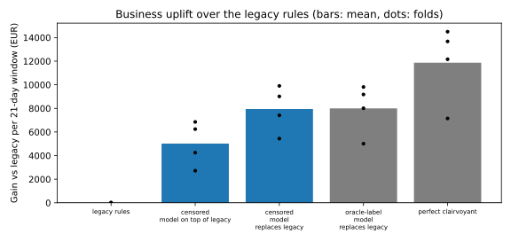
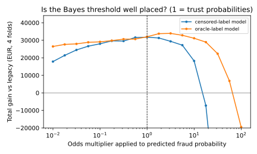

# 004 — Business evaluation, evaluation bias and calibration

## Method

**Gain matrix** (`fraud_sim.business`). It extends the instance-dependent cost matrix of the [probabl calibration and cost-sensitive learning tutorial](https://probabl-ai.github.io/calibration-cost-sensitive-learning/content/notebooks/cost_sensitive_learning.html) (also [Correa Bahnsen et al. 2013](https://doi.org/10.1109/ICMLA.2013.68); [Vanderschueren et al. 2022](https://doi.org/10.1016/j.ejor.2021.05.028)) with the analyst review action that the legacy system already uses:

| Action | Legitimate payment | Fraudulent payment |
| --- | --- | --- |
| approve | +2% of amount (commission) | −amount − €20 (chargeback handling) |
| decline | −€10 (support, churn) | 0 |
| review (≤ 20 per day) | +2% of amount − €5 | −€5 |

**Decision rule.** Each model policy picks the action with the highest expected gain given its predicted probability (a Bayes decision with an amount-dependent threshold). The daily review capacity goes to the attempts where reviewing adds the most expected value. Nothing is tuned on test labels.

**Policies compared** on the same four 21-day test windows (97,939 attempts, 375 frauds), all scored on the private truth:

- *approve all*;
- *legacy rules* (the recorded decisions, including the analyst queue);
- *censored model on top of legacy*: legacy declines and reviews are kept, and the model can only add declines. This is the cautious way to deploy a model trained on censored data, because it never approves what the legacy rules declined;
- *censored model replaces legacy*: the model controls all three actions;
- *oracle-label model replaces legacy*: same features and decision rule, but trained on the private labels of every past attempt;
- *perfect clairvoyant*: declines exactly the frauds. This is the ceiling.

## Results

Totals over the 4 test windows (84 days, about €7.8M attempted volume):

| Policy | Gain (€) | Uplift vs legacy (€) | Uplift range per fold (€) | Share of perfect uplift | Fraud value stopped | Legit declined | Reviews |
| --- | ---: | ---: | --- | ---: | ---: | ---: | ---: |
| approve all | 104,889 | −9,490 | −3,878 to −685 | −20% | 0% | 0 | 0 |
| legacy rules | 114,379 | 0 | — | 0% | 37% | 204 | 1,680 |
| censored model on top of legacy | 134,438 | +20,059 | +2,717 to +6,851 | 42% | 76% | 319 | 1,680 |
| **censored model replaces legacy** | **146,149** | **+31,770** | +5,437 to +9,906 | **67%** | 79% | 7 | 462 |
| oracle-label model replaces legacy | 146,382 | +32,003 | +5,005 to +9,810 | 67% | 76% | 11 | 212 |
| perfect clairvoyant | 161,859 | +47,480 | +7,147 to +14,497 | 100% | 100% | 0 | 0 |

Paired per-fold differences:

- oracle-label model minus censored model: +€602, +€160, −€432, −€97, i.e. **indistinguishable**;
- replacing minus layering on top of legacy: +€3,161, +€2,166, +€2,720, +€3,664, i.e. consistently positive.

Share of fraud *attempts* stopped, by modus operandi (mean over folds):

| Policy | Card testing | Cash-out | Stealth takeover |
| --- | ---: | ---: | ---: |
| legacy rules | 47% | 29% | 0% |
| censored model replaces legacy | 79% | 67% | 3% |
| oracle-label model replaces legacy | 80% | 67% | 1% |

### What a practitioner would have measured

A real platform can only evaluate on *observable* labels: declined attempts are dropped, approved payments without a chargeback count as legitimate, and friendly-fraud disputes count as fraud. Under that evaluation the censored model's uplift over the legacy rules is estimated at **€23,469 instead of the true €31,770, i.e. 26% too low**. The bias comes from the attempts that the legacy rules declined (mostly legitimate customers whose false declines are never counted against the legacy policy) and from unreported fraud. Here the bias is conservative, but its sign depends on the policy: an evaluation that drops declined attempts cannot see the fraud a new model would approve in that region.

### Calibration and threshold

Ratio of predicted to actual frauds on test: censored 1.17 (over-predicts, because its training labels are enriched by reviews), oracle 0.81 (under-predicts, because fraudsters drift towards less detectable behaviour after the training period). The sweep below multiplies the predicted odds by a constant. It is a *diagnostic computed in hindsight*, not a tuning procedure.

- Gain is flat for multipliers between about 0.2 and 3. The value comes from stopping high-amount fraud, where decisions are insensitive to moderate miscalibration.
- The oracle-label model would gain about €2k more with a 2–3× more aggressive threshold, which matches its under-prediction. At the plug-in threshold its better ranking (AP 0.765 vs 0.715) is not converted into money.
- Over-blocking is catastrophic: false declines cost €10 each across 100k legitimate attempts. Past a multiplier of about 10, the censored model loses more than the legacy rules.

Raw values: [`policy_summary.csv`](https://github.com/ogrisel/cursor-sandbox/tree/cursor/fraud-platform-simulator-06f6/experiments/fraud_platform/journal/004-business-evaluation/policy_summary.csv), [`policy_fold_metrics.csv`](https://github.com/ogrisel/cursor-sandbox/tree/cursor/fraud-platform-simulator-06f6/experiments/fraud_platform/journal/004-business-evaluation/policy_fold_metrics.csv), [`threshold_sweep.csv`](https://github.com/ogrisel/cursor-sandbox/tree/cursor/fraud-platform-simulator-06f6/experiments/fraud_platform/journal/004-business-evaluation/threshold_sweep.csv), [`ranking_metrics.csv`](https://github.com/ogrisel/cursor-sandbox/tree/cursor/fraud-platform-simulator-06f6/experiments/fraud_platform/journal/004-business-evaluation/ranking_metrics.csv). Collected history (201,204 attempts, all columns including the private ones): [`transactions.parquet`](https://github.com/ogrisel/cursor-sandbox/tree/cursor/fraud-platform-simulator-06f6/experiments/fraud_platform/journal/004-business-evaluation/transactions.parquet). Runtime: 19 s.

## Analysis in light of the educational goal

1. **Ranking metrics and money disagree.** The 0.05 AP gap between censored and oracle labels, which was very visible in iteration 003, is worth about nothing at the deployed threshold and at most about €2k after an oracle-only re-tuning. Model comparisons for fraud should be reported in euros, with a stated cost matrix.
2. **Deployment design matters as much as the model.** On these data, layering the model on top of the legacy rules leaves €11.7k on the table, because the legacy rules waste the analyst queue (1,680 reviews) and decline 204 legitimate customers. The model replacing the rules reviews 462 attempts and declines 7 legitimate ones.
3. **The safe-looking choice is only measurable in simulation.** "Replace" approves attempts that the legacy rules declined, a region where the censored model has *never seen a label*. In this simulator that extrapolation happens to be benign. A real platform could not know this from its history; it needs exploration (e.g. approving a small random fraction of would-be declines) and off-policy estimators.
4. **Some fraud is invisible to every model.** Stealth takeovers on the victim's own device are almost never stopped. That is a feature-availability problem (for example behavioural biometrics or strong customer authentication), not a modelling problem, and it is the largest share of the remaining gap to the clairvoyant.

## Re-analysis of the code base after iterations 002–004 and next steps

| Area | State after 004 | Proposed next step | Value / cost |
| --- | --- | --- | --- |
| Feedback loop | Open loop: the legacy policy generated the whole history and the models are only evaluated on it. | Closed-loop simulation where each retrained model makes the decisions of the next window and generates its own censored labels, with optional ε-exploration. Compare the degradation with and without exploration, and inverse-propensity estimates of policy value against the truth. | Highest educational value; needs the simulator to be split into "attempts" and "decisions + feedback", which the current structure already permits. |
| Uncertainty | One seed, 4 folds. Fold signs are consistent, but magnitudes vary 2×. | Run 3–5 seeds (about 20 s each) and report paired differences with intervals. | Cheap. |
| Calibration | Plug-in probabilities. | Calibrate on the most recent *matured* window, and show that calibration on censored labels inherits the selection bias. | Moderate. |
| Realism | Single currency, no strong customer authentication or 3-D Secure, no merchant-level liability shift, constant legitimate traffic. | Add a step-up authentication action (3-D Secure challenge: friction cost, blocks most non-stealth fraud) and seasonal peaks. | Moderate; 3-D Secure is the dominant mechanism in the EEA under PSD2. |
| Fraud rate | About 10× the EU average realized card-fraud rate, so that the folds have enough positives. | Scale prevalence down with more days per fold once runtime allows. | Runtime cost. |

Previous: [003](../003-skrub-dataops/report.md).
