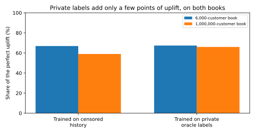

# 005 — A million-customer book

## Why this scale

Iterations 002–004 use 6,000 registered customers and about 1,200 attempts a day. That is small enough to iterate in seconds, and too small to look like a production book: almost every customer is active, histories are dense, and fraud is 0.43% of attempts.

`mature_config` keeps the same mechanisms and raises the book:

| | Teaching book | This iteration |
| --- | ---: | ---: |
| Registered customers | 6,000 | 1,000,000 |
| Active in 180 days | (almost all) | 123,469 (12.3%) |
| Shops | 40 | 200 |
| Attempts / day | ~1,200 | 7,408 |
| Attempted-fraud rate | 0.43% | 0.112% |
| Realized fraud, count / value | 0.24% / 0.37% | 0.076% / 0.106% |
| Median account age | months to a few years | 4.8 years |
| Analyst reviews / day | 20 | 50 |
| Daily volume | ~€93k | €601k |

85% of accounts are dormant, so the activity distribution is the heavy tail of a mature book rather than a rescaling of the same 6,000 people. Fraudsters draw victims from active accounts. The analyst queue does not grow with the book (20 → 50 while attempts grow about 6×), which is the production constraint. The attempt rate is still a few times the 0.015% all-card figure in the [EBA–ECB 2025 report](https://www.ecb.europa.eu/press/intro/publications/pdf/ecb.ebaecb202512.en.pdf); it is card-not-present only, and it leaves 740 frauds in the test windows.

The teaching book's random stream is unchanged: rerunning iteration 002 reproduces its fold metrics. Large-book favourite shops use a vectorised weighted sample so that drawing a million customers is not a Python loop.

## Same question as iteration 004

Four calendar folds, `row+window` features, `HistGradientBoostingClassifier` inside the skrub learner. Shop identifiers stay categorical (`cardinality_threshold=256`; the teaching runs keep 64). The model's review capacity is 50 per day, matching the legacy queue. No threshold is tuned on the test window.

Test windows: 650,213 attempts, 740 frauds, €52.7M.

| Policy | Uplift vs legacy | Share of perfect uplift | Uplift per fold |
| --- | ---: | ---: | --- |
| Censored model on top of legacy | +€33,986 | 30% | +€4.3k to +€13.4k |
| Censored model replaces legacy | +€66,136 | 59% | +€12.9k to +€21.1k |
| Oracle-label model replaces legacy | +€74,014 | 66% | +€13.7k to +€21.0k |
| Perfect clairvoyant | +€112,110 | 100% | — |

Paired per fold, oracle minus censored: **+€6,489, +€849, −€23, +€562**. Replacing the rules minus layering them: **+€6.5k to +€9.4k in every fold**.

Ranking on the full test truth, mean (std) over 4 folds:

| Training labels | AP | ROC AUC | Predicted / actual frauds |
| --- | ---: | ---: | ---: |
| Censored history | 0.577 (0.148) | 0.880 (0.038) | 1.97 |
| Private oracle | 0.655 (0.112) | 0.949 (0.026) | 0.71 |

A practitioner who scores only observable labels would put the censored model's uplift at €45,396 instead of €66,136, **31% too low**. On the small book that bias was 26%.

Raw tables: [`policy_summary.csv`](https://github.com/ogrisel/cursor-sandbox/blob/cursor/fraud-platform-simulator-06f6/experiments/fraud_platform/journal/005-mature-book/policy_summary.csv), [`policy_folds.csv`](https://github.com/ogrisel/cursor-sandbox/blob/cursor/fraud-platform-simulator-06f6/experiments/fraud_platform/journal/005-mature-book/policy_folds.csv), [`ranking.csv`](https://github.com/ogrisel/cursor-sandbox/blob/cursor/fraud-platform-simulator-06f6/experiments/fraud_platform/journal/005-mature-book/ranking.csv), and [`run_info.json`](run_info.json). Runtime: simulate 11 s, window features 32 s, both backtests 45 s, **90 s total**.

## What changes, and what does not

1. **Rarer fraud and thinner histories make ranking harder.** AP falls from 0.72 / 0.77 on the small book to 0.58 / 0.66 here, and the fold spread is wide (standard deviation 0.11–0.15). Average precision on a 0.1% class with a few hundred positives is a noisy summary; the euro figures move less.
2. **Private labels are worth a few points of uplift, not a different decision.** 59% versus 66% of the clairvoyant gain. The €7.9k gap is real in total and is mostly one fold. Deploying the censored model is still the right call on these data. Iteration 004's "nothing measurable" does not survive unchanged, and it does not reverse either.
3. **How the model is deployed matters more than the missing labels.** Letting it replace the legacy rules, instead of only adding declines on top, is worth about €32k in every interpretation of the folds. The legacy queue reviews 9,000 attempts over the half-year and the model, given the same daily capacity, spends those reviews differently.
4. **Selection bias in the labels got worse.** The censored model predicts twice as many frauds as occur (1.17× on the small book). Reviews are a smaller slice of a larger book, so the labelled training set is more enriched. Iteration 004's threshold curve was flat for odds multipliers up to about 3; that curve was not recomputed here.
5. **Observable-label evaluation is still biased low, by about 30%.**

Label-aggregate features and the back-dated leakage check were not rerun at this volume. They remain the result of [iteration 003](../003-skrub-dataops/report.md). Window features are still computed with `closed="left"` windows, and training labels are still those known at the cutoff.

Previous: [004](../004-business-evaluation/report.md).
