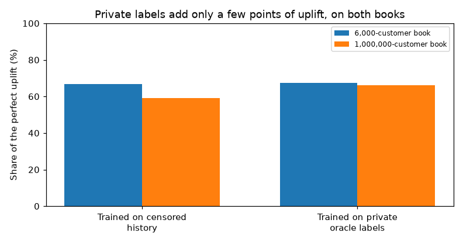
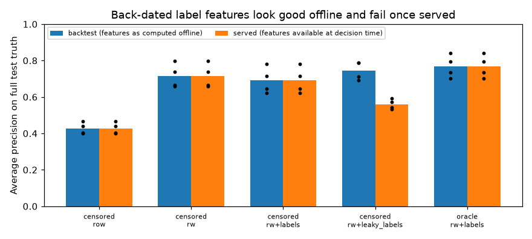
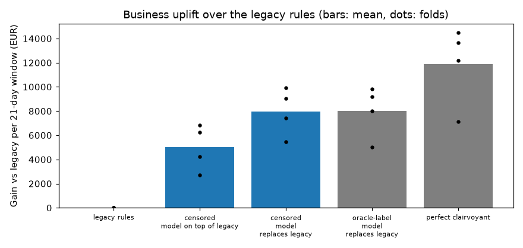

# Shared payment-platform fraud simulator

An educational simulator of card-not-present payments on one platform. A legacy rule engine is already deployed. Labels arrive late, cover only some attempts, and are censored by the engine's own declines. A `skrub` pipeline with point-in-time window features and `HistGradientBoostingClassifier` is backtested on calendar folds and scored in euros against the simulator's private truth.

The teaching book has 6,000 customers and runs in about 20 seconds. The production-scale book has 1,000,000 registered customers (123,000 active), 200 shops and about 7,400 attempts a day, and the same backtest runs in about 90 seconds.

## Highlight plots

Private labels add only a few points of the attainable uplift. Replacing the legacy rules matters more than training on the simulator's hidden truth. On the million-customer book the censored model keeps 59% of the perfect uplift and the oracle model 66%.



Back-dating fraud labels to the payment time makes a feature look better in an offline backtest. Served with only the labels that have arrived, that feature loses 0.07 to 0.23 average precision.



On the 6,000-customer book the euro gap between censored and oracle training is invisible. Fold-level gains are the dots.



## Code entry points

Links open the experiment sources on the `cursor/fraud-platform-simulator-06f6` branch.

| Piece | Where to start |
| --- | --- |
| Customer book, fraud campaigns, legacy rules, delayed feedback | [`mature_config`](https://github.com/ogrisel/cursor-sandbox/blob/cursor/fraud-platform-simulator-06f6/experiments/fraud_platform/src/fraud_sim/simulator.py#L103-L122) and [`simulate`](https://github.com/ogrisel/cursor-sandbox/blob/cursor/fraud-platform-simulator-06f6/experiments/fraud_platform/src/fraud_sim/simulator.py#L359-L383) |
| Window aggregates that cannot see the current attempt | [`add_window_features`](https://github.com/ogrisel/cursor-sandbox/blob/cursor/fraud-platform-simulator-06f6/experiments/fraud_platform/src/fraud_sim/features.py#L72-L91) |
| Label aggregates, and the back-dated twin used to measure leakage | [`arrived_label_count`](https://github.com/ogrisel/cursor-sandbox/blob/cursor/fraud-platform-simulator-06f6/experiments/fraud_platform/src/fraud_sim/features.py#L47-L69) |
| Which labels exist at a retraining cutoff | [`label_as_known_at`](https://github.com/ogrisel/cursor-sandbox/blob/cursor/fraud-platform-simulator-06f6/experiments/fraud_platform/src/fraud_sim/backtest.py#L26-L43) |
| skrub feature store and the cutoff-aware learner | [`feature_store_dataop`](https://github.com/ogrisel/cursor-sandbox/blob/cursor/fraud-platform-simulator-06f6/experiments/fraud_platform/src/fraud_sim/pipeline.py#L67-L69) and [`learner_dataop`](https://github.com/ogrisel/cursor-sandbox/blob/cursor/fraud-platform-simulator-06f6/experiments/fraud_platform/src/fraud_sim/pipeline.py#L85-L105) |
| Calendar backtest via `skrub.cross_validate` | [`backtest`](https://github.com/ogrisel/cursor-sandbox/blob/cursor/fraud-platform-simulator-06f6/experiments/fraud_platform/src/fraud_sim/pipeline.py#L113-L145) |
| Approve / decline / review gain and the decision rule | [`decide`](https://github.com/ogrisel/cursor-sandbox/blob/cursor/fraud-platform-simulator-06f6/experiments/fraud_platform/src/fraud_sim/business.py#L45-L62) and [`realised_gain`](https://github.com/ogrisel/cursor-sandbox/blob/cursor/fraud-platform-simulator-06f6/experiments/fraud_platform/src/fraud_sim/business.py#L81-L91) |
| Runs that produce the plots above | [`003`](https://github.com/ogrisel/cursor-sandbox/blob/cursor/fraud-platform-simulator-06f6/experiments/fraud_platform/journal/003-skrub-dataops/run.py), [`004`](https://github.com/ogrisel/cursor-sandbox/blob/cursor/fraud-platform-simulator-06f6/experiments/fraud_platform/journal/004-business-evaluation/run.py), [`005`](https://github.com/ogrisel/cursor-sandbox/blob/cursor/fraud-platform-simulator-06f6/experiments/fraud_platform/journal/005-mature-book/run.py) |

## Findings

| Question | Answer | Iteration |
| --- | --- | --- |
| Do window aggregates matter? | Yes. On the small book, AP 0.43 → 0.72 (legacy rule score alone: 0.11). | [003](003-skrub-dataops/report.md) |
| Do label features help despite the delay? | Not when they respect arrival time. They cost 0.015–0.044 AP in every fold. | [003](003-skrub-dataops/report.md) |
| What does back-dating labels do? | It can win offline, then loses 0.07–0.23 AP once served. | [003](003-skrub-dataops/report.md) |
| How much ranking quality does censoring cost? | 0.06–0.11 AP on the small book; about 0.08 AP on the million-customer book, with a wide fold spread. | [003](003-skrub-dataops/report.md), [005](005-mature-book/report.md) |
| How much money does censoring cost? | Nothing measurable on the small book (€32.0k vs €31.8k). On the large book, €7.9k of a €66k uplift, mostly one fold (59% vs 66% of the perfect uplift). | [004](004-business-evaluation/report.md), [005](005-mature-book/report.md) |
| How wrong is evaluation on observable labels? | It underestimates the uplift by 26% on the small book and 31% on the large one. | [004](004-business-evaluation/report.md), [005](005-mature-book/report.md) |
| Replace the rules or layer the model on top? | Replacing wins on both books (€11.7k and about €32k), and only the simulation can show that approving some legacy declines is safe. | [004](004-business-evaluation/report.md), [005](005-mature-book/report.md) |

## Iterations

- [001 — first simulator](001-simulator/report.md) (superseded: fraud was trivially separable)
- [002 — critical review and the mechanistic simulator](002-realistic-dgp/report.md)
- [003 — skrub DataOps, lag-aware label features and leakage](003-skrub-dataops/report.md)
- [004 — business evaluation on the 6,000-customer book](004-business-evaluation/report.md)
- [005 — the same comparison on a 1,000,000-customer book](005-mature-book/report.md)

## Reproduce

```bash
cd experiments/fraud_platform
pixi run test       # point-in-time, censoring, gain matrix, dormant book
pixi run iter004    # small book, about 20 s
pixi run iter005    # million-customer book, about 90 s
```

Event logs (`transactions.csv.gz`, `transactions.parquet`) are produced by those runs and gitignored. The publisher checks out markdown, plots, and the small summary tables only.
