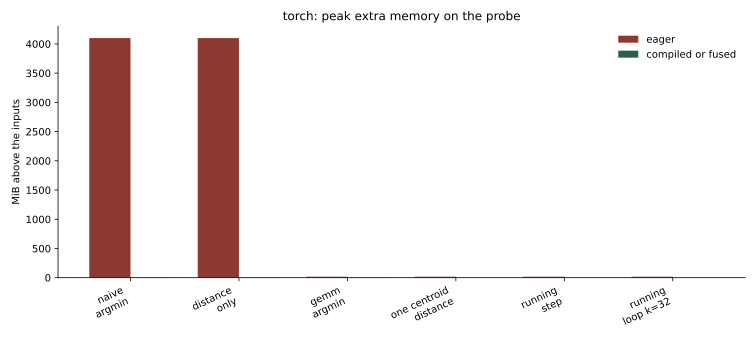
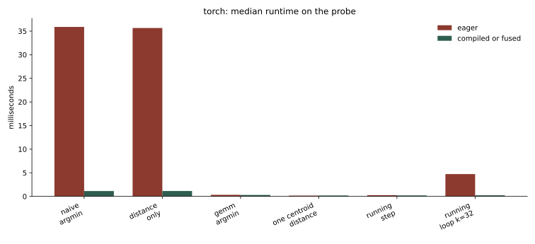
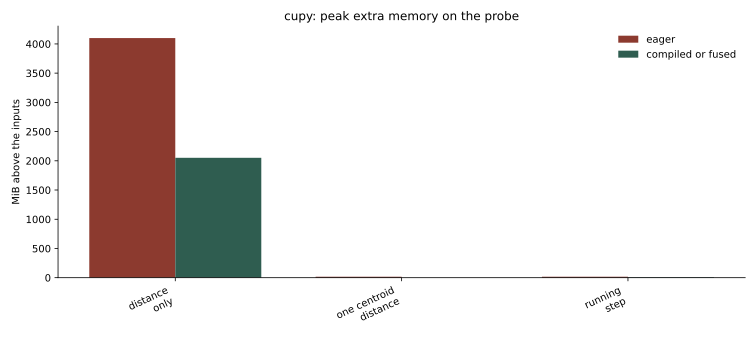
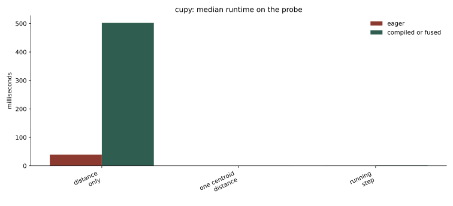

# Fusion probe

One medium problem, small enough that the naive broadcast tensor fits in GPU memory, so eager execution and the compilers can be compared directly.

The host is an NVIDIA L4 (23 GiB, driver 595.91). Software is PyTorch 2.14.1+cu130, CuPy 14.2.0, and array-api-compat 1.15.0. `NVIDIA_TF32_OVERRIDE=0` and `allow_tf32=False`, so matmul is IEEE float32. The memory self-test allocates a known 32 MiB block and reads it back within 1% on both libraries.

## Probe shape

| | |
| --- | --- |
| samples | 4096 |
| centroids | 256 |
| features | 512 |
| dtype | float32 |
| broadcast tensor `(n, k, d)` | 2048 MiB |
| distance matrix `(n, k)` | 4 MiB |
| one-centroid difference `(n, d)` | 8 MiB |
| labels `(n,)` int64 | 0.031 MiB |

Peak memory below is bytes allocated **above the inputs**, including temporaries that are freed before the call returns.

## PyTorch

| variant | eager time | eager peak | `torch.compile` time | `torch.compile` peak | what the compiler did |
| --- | --- | --- | --- | --- | --- |
| [naive argmin](https://github.com/ogrisel/cursor-sandbox/blob/cursor/kmeans-lloyd-fusion-8896/kmeans_lloyd/src/kmeans_lloyd/iteration.py#L188-L191) | 35.9 ms | 4100 MiB | 1.14 ms | 4.03 MiB | fused sub, square, and sum; argmin stays a second kernel |
| [distance only](https://github.com/ogrisel/cursor-sandbox/blob/cursor/kmeans-lloyd-fusion-8896/kmeans_lloyd/src/kmeans_lloyd/iteration.py#L235-L237) | 35.7 ms | 4100 MiB | 1.14 ms | 4.00 MiB | one reduction kernel, output is exactly the 4 MiB matrix |
| [gemm argmin](https://github.com/ogrisel/cursor-sandbox/blob/cursor/kmeans-lloyd-fusion-8896/kmeans_lloyd/src/kmeans_lloyd/iteration.py#L194-L197) | 0.34 ms | 16.0 MiB | 0.30 ms | 4.05 MiB | cuBLAS GEMM unchanged; argmin fused into the epilogue |
| [one-centroid distance](https://github.com/ogrisel/cursor-sandbox/blob/cursor/kmeans-lloyd-fusion-8896/kmeans_lloyd/src/kmeans_lloyd/iteration.py#L212-L219) | 0.17 ms | 16.0 MiB | 0.20 ms | 0.016 MiB | one kernel, output is exactly the 16 KiB vector |
| [running step](https://github.com/ogrisel/cursor-sandbox/blob/cursor/kmeans-lloyd-fusion-8896/kmeans_lloyd/src/kmeans_lloyd/iteration.py#L222-L232) | 0.27 ms | 16.0 MiB | 0.20 ms | 0.047 MiB | compare and `where` fused into the distance reduction |
| [running loop, k=8](https://github.com/ogrisel/cursor-sandbox/blob/cursor/kmeans-lloyd-fusion-8896/kmeans_lloyd/src/kmeans_lloyd/iteration.py#L106-L127) | 1.38 ms | 16.1 MiB | 0.21 ms | 0.031 MiB | the Python loop is one kernel; peak is the label vector |
| [running loop, k=32](https://github.com/ogrisel/cursor-sandbox/blob/cursor/kmeans-lloyd-fusion-8896/kmeans_lloyd/src/kmeans_lloyd/iteration.py#L106-L127) | 4.72 ms | 16.1 MiB | 0.23 ms | 0.031 MiB | still one kernel; eager launched each op 32 times |

Eager naive peak is two full broadcast buffers (difference and square), 4096 MiB, plus a small amount of allocator rounding. Compiled naive peak is 4.00 MiB for the distance matrix plus 32 KiB of labels (`4227072 - 4194304 = 32768`). The distance matrix is still there.

Kernel names from the profiler:

- Eager naive: separate `sub`/`add`, `mul`, `sum`, and `ArgMinOps` kernels. The mul kernel alone is about 18 ms.
- Compiled naive: `triton_red_fused_mul_sub_sum_unsqueeze_0` (0.97 ms) and `triton_per_fused_argmin_1` (0.004 ms).
- Compiled gemm: `ampere_sgemm_128x64_tn` at the same 88 µs as eager, then `triton_per_fused_add_argmin_mul_sub_transpose_2`. Argmin is fused with the epilogue that consumes the GEMM output. It is not fused into the GEMM, and the `(n, k)` matrix remains.
- Compiled running loop, k=32: a single `triton_per_fused_full_lift_fresh_lt_mul_select_sub_sum_where_zeros_0`. Eager issues that family of kernels 32 times.

`assign_running` compiled with `fullgraph=True` matches eager naive labels on a separate float32 problem (`n=512`, `k=17`, `d=64`).

## CuPy

`cupy.fuse` traces the function with an `_ArrayProxy`. `argmin` is not a method of that proxy, and `sum(..., keepdims=True)` (used by the Gram form) is explicitly unsupported. A Python `for` loop over centroids fails earlier, because `array_namespace` does not accept the proxy.

| variant | eager time | eager peak | `cupy.fuse` | fused peak | note |
| --- | --- | --- | --- | --- | --- |
| [elementwise `(a-b)*(a-b)`](https://github.com/ogrisel/cursor-sandbox/blob/cursor/kmeans-lloyd-fusion-8896/kmeans_lloyd/scripts/run_experiments.py#L487-L557) | 16.7 ms | 128 MiB | 0.90 ms | 64 MiB | positive control: one output buffer |
| [naive argmin](https://github.com/ogrisel/cursor-sandbox/blob/cursor/kmeans-lloyd-fusion-8896/kmeans_lloyd/src/kmeans_lloyd/iteration.py#L188-L191) | 34.6 ms | 4100 MiB | error | | `'_ArrayProxy' object has no attribute 'argmin'` |
| [broadcast distance](https://github.com/ogrisel/cursor-sandbox/blob/cursor/kmeans-lloyd-fusion-8896/kmeans_lloyd/src/kmeans_lloyd/iteration.py#L235-L237) | 39.5 ms | 4100 MiB | 503 ms | 2052 MiB | call returns, still materializes about 2 GiB, and is slower |
| [gemm argmin](https://github.com/ogrisel/cursor-sandbox/blob/cursor/kmeans-lloyd-fusion-8896/kmeans_lloyd/src/kmeans_lloyd/iteration.py#L194-L197) | 0.36 ms | 16.0 MiB | error | | `cupy.sum` does not support `keepdims` in fusion |
| [one-centroid distance](https://github.com/ogrisel/cursor-sandbox/blob/cursor/kmeans-lloyd-fusion-8896/kmeans_lloyd/src/kmeans_lloyd/iteration.py#L212-L219) | 0.10 ms | 16.0 MiB | 0.15 ms | 0.016 MiB | sub, square, and sum fused; output is the 16 KiB vector |
| [running step](https://github.com/ogrisel/cursor-sandbox/blob/cursor/kmeans-lloyd-fusion-8896/kmeans_lloyd/src/kmeans_lloyd/iteration.py#L222-L232) | 0.17 ms | 16.0 MiB | 1.73 ms | 8.06 MiB | an `(n, d)` temporary remains; slower than eager |
| [broadcast tile, any k](https://github.com/ogrisel/cursor-sandbox/blob/cursor/kmeans-lloyd-fusion-8896/kmeans_lloyd/src/kmeans_lloyd/iteration.py#L200-L203) | same as naive | | error | | same missing `argmin` |
| [running loop](https://github.com/ogrisel/cursor-sandbox/blob/cursor/kmeans-lloyd-fusion-8896/kmeans_lloyd/src/kmeans_lloyd/iteration.py#L106-L127) | eager ok | 16.1 MiB | error | | `array_namespace` rejects `_ArrayProxy` |

The one-centroid distance is the CuPy fusion that matches the question's distance half: no `(n, d)` temporary. Putting the running-argmin `where` in the same fused function does not remove that temporary. `argmin` over a full centroid axis is not expressible to this runtime.

## What this round established

- Both compilers fuse the elementwise part of a squared difference. The memory self-check and the elementwise control (128 MiB eager, 64 MiB fused) show the instrument can see that.
- `torch.compile` fuses broadcast sub, square, and `sum` into one reduction. It does **not** fuse the following `argmin` into that reduction. The `(n, k)` distance matrix is still written. A separate `triton_per_fused_argmin` kernel reads it.
- `torch.compile` fuses `argmin` into the GEMM **epilogue**, not into cuBLAS. The GEMM kernel and its `(n, k)` output remain. At this small size the GEMM was already 0.3 ms, so the epilogue fusion does not change runtime.
- Rewriting the assignment as a running minimum, one centroid at a time, lets `torch.compile` put the distance and the argmin update in one kernel. With the loop left inside the compiled function, k=8 and k=32 are each a **single** kernel whose only output is the label vector (32 KiB).
- `cupy.fuse` does the same for a single centroid's squared distance, and refuses `argmin`. The running-update `where` is accepted but does not remove the `(n, d)` buffer, and it is slower.

The next runs put these schedules on three larger shapes. The naive broadcast tensor does not fit there, which is the practical reason to care about the fusion.

Previous: [journal index](../index.md). Next: [large shape that ran out of memory](../002-large-shape-oom/report.md).
