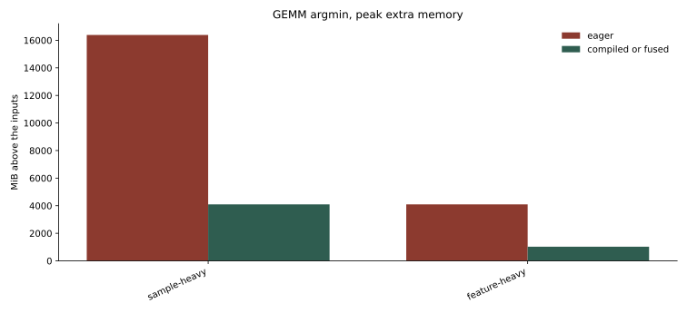
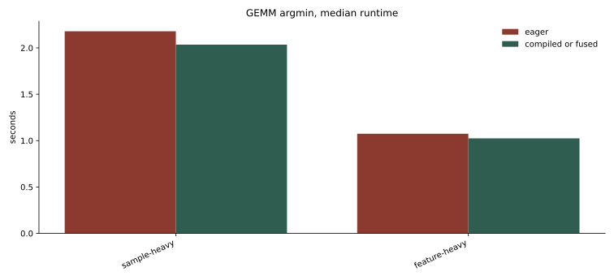
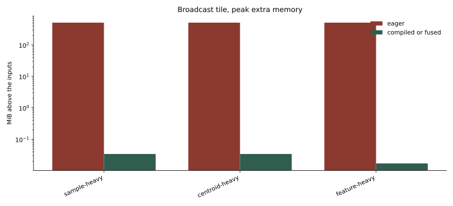
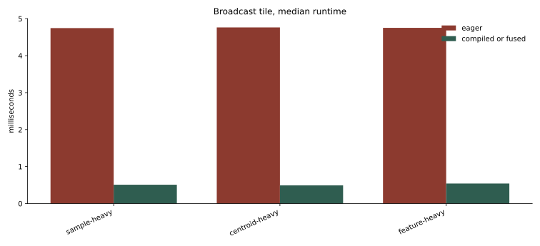
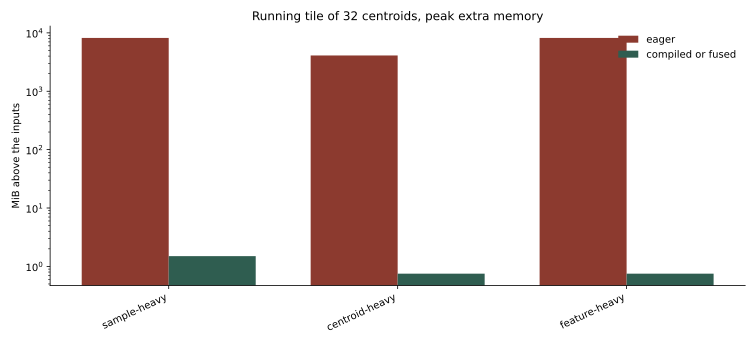
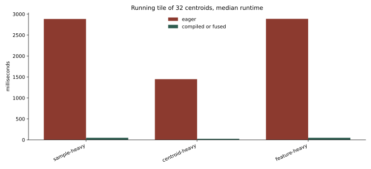

# Three shapes that fit an eager Gram assignment

The probe showed the kernel split on a problem small enough for the naive broadcast tensor. This round uses three larger float32 problems on the same NVIDIA L4 (23 GiB). Sample count, centroid count, and feature count each take a turn as the large axis. `NVIDIA_TF32_OVERRIDE=0` and `allow_tf32=False`. PyTorch 2.14.1+cu130, CuPy 14.2.0, array-api-compat 1.15.0.

Peak memory is bytes allocated above the inputs, including temporaries freed before the call returns. Times are medians after a warmup call, so they exclude `torch.compile`'s first trace. The full running assignment is one timed call of an already-compiled tile.

## Shapes

| case | samples | centroids | features | `X` | distance `(n, k)` | one-centroid diff `(n, d)` | broadcast `(n, k, d)` |
| --- | --- | --- | --- | --- | --- | --- | --- |
| sample-heavy | 131072 | 8192 | 8192 | 4 GiB | 4 GiB | 4 GiB | 32 TiB |
| centroid-heavy | 65536 | 16384 | 8192 | 2 GiB | 4 GiB | 2 GiB | 32 TiB |
| feature-heavy | 65536 | 4096 | 16384 | 4 GiB | 1 GiB | 4 GiB | 16 TiB |

The naive broadcast is skipped on every case. A single `(n, k, d)` tensor is 16–32 TiB. What is measured instead is one broadcast tile whose unfused tensor is 256 MiB, the full Gram assignment, a Gram tile, and a running argmin.

## Gram assignment

Source: [`gemm_distance_argmin`](https://github.com/ogrisel/cursor-sandbox/blob/cursor/kmeans-lloyd-fusion-8896/kmeans_lloyd/src/kmeans_lloyd/iteration.py#L194-L197).

`||x - c||^2 = ||x||^2 + ||c||^2 - 2 x·c`, then `argmin`. Eager PyTorch materializes `X * X` before the reduction, then the `(n, k)` product.

| case | eager | eager peak | `torch.compile` | compiled peak |
| --- | --- | --- | --- | --- |
| sample-heavy | 2.179 s | 16.00 GiB | 2.035 s | 4.00 GiB |
| centroid-heavy | out of memory in this slot | | 2.015 s | 4.00 GiB |
| feature-heavy | 1.074 s | 4.00 GiB | 1.025 s | 1.00 GiB |

Compiled peaks match the distance matrix: 4.00 GiB on the first two shapes (`n * k * 4`) and 1.00 GiB on feature-heavy (`65536 * 4096 * 4`). Sample-heavy eager peak is four times that matrix: the elementwise square of `X`, the GEMM output, and the epilogue that adds the norms. Feature-heavy eager peak equals `X * X` (4 GiB), which is larger than the 1 GiB distance matrix, so the classifier label `materialized_distance` on that row is the wrong name for the dominant buffer. The byte count is the evidence.

Kernel names on sample-heavy:

- Eager: `ampere_sgemm_128x128_tn` (1.97 s) plus separate add, mul, sum, and `ArgMinOps` kernels.
- Compiled: the same `ampere_sgemm_128x128_tn` (2.00 s), then `triton_red_fused_add_argmin_mul_sub_sum_transpose` (33 ms) and `triton_red_fused_mul_sum` (1 ms).

`argmin` is inside the epilogue that consumes the GEMM output. cuBLAS still writes the `(n, k)` matrix. Runtime barely moves because the GEMM is the whole call, about 8 TFLOP/s on the sample-heavy shape (`2 * n * k * d` over 2.18 s).

The centroid-heavy eager call failed while the process still held about 19 GiB from the previous case. The same eager Gram assignment, run later as a full Lloyd step on a fresh allocation of that shape, completed: assign 2.184 s, peak extra 16.00 GiB, inside a 3.853 s iteration. That 16 GiB is the same four-buffer eager pattern.

CuPy has no fused Gram path (`sum(..., keepdims=True)` is unsupported inside `cupy.fuse`, same as the probe). Eager CuPy on feature-heavy matches PyTorch: 1.057 s, peak extra 4.00 GiB. Sample-heavy and centroid-heavy eager CuPy GEMM both died allocating another 4 GiB after 14–18 GiB was already in use.

A Gram tile over the first 4096 samples, full centroid count, shows the same epilogue fusion at a smaller output:

| case | distance tile | eager | eager peak | `torch.compile` | compiled peak |
| --- | --- | --- | --- | --- | --- |
| centroid-heavy | 256 MiB | 132 ms | 1024 MiB | 119 ms | 256 MiB |
| feature-heavy | 64 MiB | 67.5 ms | 256 MiB | 60.3 ms | 64 MiB |

Compiled peak is the tile's distance matrix. Eager peak is four times that. CuPy eager tiles land on the same four-times peak (512 MiB, 1024 MiB, and 256 MiB for the three shapes).

## Broadcast tile

Source: [`tile_broadcast_argmin`](https://github.com/ogrisel/cursor-sandbox/blob/cursor/kmeans-lloyd-fusion-8896/kmeans_lloyd/src/kmeans_lloyd/iteration.py#L200-L203).

One tile of the naive formula, sized so the unfused `(tile_n, 32, d)` tensor is 256 MiB. Two copies of that tensor (difference and square) are 512 MiB.

| case | tile | eager | eager peak | `torch.compile` | compiled peak |
| --- | --- | --- | --- | --- | --- |
| sample-heavy | 256 × 32 | 4.75 ms | 512 MiB | 0.51 ms | 35 KiB |
| centroid-heavy | 256 × 32 | 4.76 ms | 512 MiB | 0.49 ms | 35 KiB |
| feature-heavy | 128 × 32 | 4.75 ms | 512 MiB | 0.54 ms | 17.5 KiB |

The compiled kernels are still two: `triton_red_fused_mul_sub_sum_unsqueeze` and `triton_per_fused_amin_argmin`. The 35 KiB peak is the 32 KiB distance tile (`256 * 32 * 4`) plus the label vector. On the feature-heavy tile the distance matrix is 16 KiB and the peak is 17.5 KiB. The reduction is fused. The argmin still reads the distance tile afterwards.

`cupy.fuse` on the same tile raises `AttributeError: '_ArrayProxy' object has no attribute 'argmin'` on all three shapes. Eager CuPy tiles match the 512 MiB peak and the 5 ms runtime.

## Running argmin, one centroid

Source: [`running_argmin_step`](https://github.com/ogrisel/cursor-sandbox/blob/cursor/kmeans-lloyd-fusion-8896/kmeans_lloyd/src/kmeans_lloyd/iteration.py#L222-L232).

`diff = X - centroid`, reduce, then `where` to keep the winner. Eager timing is four identical steps, so a single launch is not the whole measurement. Compiled and fused timings are one step.

| case | eager, 4 steps | eager peak | `torch.compile`, 1 step | compiled peak | `cupy.fuse`, 1 step | fused peak |
| --- | --- | --- | --- | --- | --- | --- |
| sample-heavy | 360 ms | 8.00 GiB | 16.7 ms | 1.50 MiB | 606 ms | 4.00 GiB |
| centroid-heavy | 180 ms | 4.00 GiB | 8.54 ms | 768 KiB | 293 ms | 2.00 GiB |
| feature-heavy | 360 ms | 8.00 GiB | 16.7 ms | 768 KiB | 585 ms | 4.00 GiB |

Eager peaks are two `(n, d)` buffers, difference and square. Compiled peaks are exactly `n * 12` bytes: int64 labels and the float32 winning distances. The kernel is one reduction, `triton_red_fused_lt_mul_sub_sum_where`. The comparison is inside the distance kernel. The `(n, d)` temporaries are gone, and so is any `(n, k)` matrix.

`cupy.fuse` accepts this function. Its peak equals one `(n, d)` buffer (`n * d * 4`): sample-heavy 4.00 GiB, centroid-heavy 2.00 GiB, feature-heavy 4.00 GiB. The square is fused away. The difference remains. One fused step is slower than four eager steps.

## Running tile of 32 centroids

Source: [`running_tile_distances`](https://github.com/ogrisel/cursor-sandbox/blob/cursor/kmeans-lloyd-fusion-8896/kmeans_lloyd/src/kmeans_lloyd/iteration.py#L130-L136), covering every centroid in [`assign_running_tiled`](https://github.com/ogrisel/cursor-sandbox/blob/cursor/kmeans-lloyd-fusion-8896/kmeans_lloyd/src/kmeans_lloyd/iteration.py#L139-L157).

The tile loops over 32 centroids inside one function and returns local labels and local distances. `torch.compile` turns that into a single kernel, `triton_red_fused_full_lift_fresh_lt_mul_select_sub_sum_where_zeros`.

| case | eager | eager peak | `torch.compile` | compiled peak |
| --- | --- | --- | --- | --- |
| sample-heavy | 2.884 s | 8.00 GiB | 49.2 ms | 1.50 MiB |
| centroid-heavy | 1.448 s | 4.00 GiB | 24.7 ms | 768 KiB |
| feature-heavy | 2.887 s | 8.00 GiB | 49.3 ms | 768 KiB |

Compiled peaks are again exactly `n * 12` bytes. A 32-column distance matrix would be 16 MiB on sample-heavy (`131072 * 32 * 4`) and is absent. This is the schedule that fuses nearest-centroid identification into the squared distance.

Covering every centroid with those tiles, merging with `where` in Python:

| case | tiles | full `torch.compile` assignment | peak extra |
| --- | --- | --- | --- |
| sample-heavy | 256 | 12.75 s | 5.13 MiB |
| centroid-heavy | 512 | 12.78 s | 2.56 MiB |
| feature-heavy | 128 | 6.13 s | 2.56 MiB |

The few extra MiB above `n * 12` are the Python merge (`where` outputs between tiles). The distance matrix for these problems is 1–4 GiB, and the broadcast tensor is tens of tebibytes. Neither appears.

That full pass is slower than the Gram GEMM (12.8 s against about 2 s on sample-heavy and centroid-heavy). Fusing argmin removes the big buffers. It does not beat cuBLAS on this card.

## Full Lloyd step

Source: [`lloyd_iteration`](https://github.com/ogrisel/cursor-sandbox/blob/cursor/kmeans-lloyd-fusion-8896/kmeans_lloyd/src/kmeans_lloyd/iteration.py#L21-L53) and [`update_centroids`](https://github.com/ogrisel/cursor-sandbox/blob/cursor/kmeans-lloyd-fusion-8896/kmeans_lloyd/src/kmeans_lloyd/iteration.py#L160-L171).

The update is a one-hot membership of shape `(n, k)` times `X`. Naive broadcast assignment is skipped by the headroom check on every case.

| case | library | result | assign | update | assign peak |
| --- | --- | --- | --- | --- | --- |
| sample-heavy | torch | out of memory | | | requested another 4 GiB with 20.5 GiB already held |
| sample-heavy | cupy | out of memory | | | 4 GiB request after 18 GiB already allocated |
| centroid-heavy | torch eager | 3.853 s | 2.184 s | 1.683 s | 16.00 GiB |
| centroid-heavy | cupy | out of memory | | | 4 GiB request after 14 GiB already allocated |
| feature-heavy | torch eager | 1.771 s | 1.087 s | 0.680 s | 4.00 GiB |
| feature-heavy | cupy eager | 1.735 s | 1.068 s | 0.665 s | 4.00 GiB |

Update peaks were 5.50 GiB (centroid-heavy) and 1.75 GiB (feature-heavy), which is the one-hot `(n, k)` matrix plus the summed samples. Where both libraries finished, assign time and assign peak match.

## What this round adds to the probe

- On these shapes `torch.compile` still fuses the broadcast reduction and still launches argmin as a second kernel. The distance tile is the compiled peak.
- On the Gram form, `torch.compile` folds `X * X`, the norm broadcast, and `argmin` into epilogue kernels. `ampere_sgemm` still writes `(n, k)`. Peak drops from 16 GiB to 4 GiB, or from 4 GiB to 1 GiB when `X` itself was the large temporary. Time stays on the GEMM.
- The running tile is the rewrite that puts argmin inside the distance kernel. One Triton kernel, peak `n * 12` bytes for 32 centroids, and a full assignment at 2.6–5.1 MiB. It is several times slower than the eager or compiled GEMM.
- `cupy.fuse` still cannot see `argmin`. On the one-centroid running update it removes the square and keeps the `(n, d)` difference, and that fused call is slower than eager.

Previous: [large shape that ran out of memory](../002-large-shape-oom/report.md). Index: [journal](../index.md).
