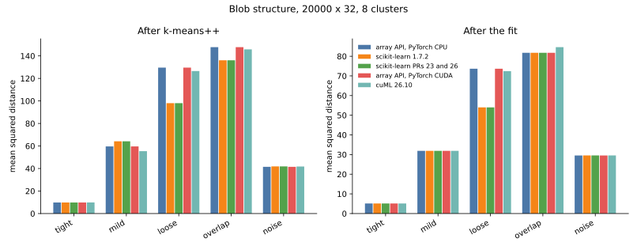
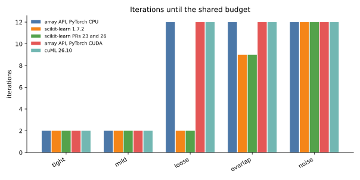
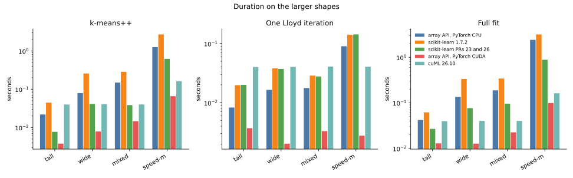
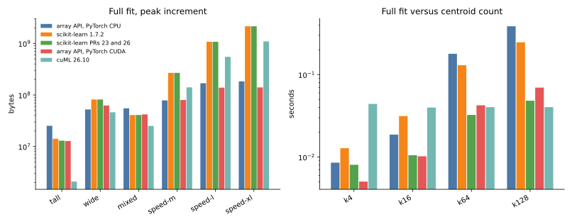

# 006 — blob structure, centroid count, and five implementations

Same budget for every full fit: at most 12 Lloyd iterations, or stop when the center shift falls under `1e-8` times the mean feature variance. Float32. The host is the L4 box (4 CPUs, 15 GiB RAM). The array-API code is eager PyTorch, CPU or CUDA, with no `torch.compile`. The request listed PyTorch CPU under the GPU heading; the GPU array-API run is PyTorch CUDA eager.

Scikit-learn 1.7.2 is the stock build. The optimized build is scikit-learn 1.10.dev0 from [cakedev0/scikit-learn#23](https://github.com/cakedev0/scikit-learn/pull/23) at `7e26a5c`, which also contains the chunked Lloyd kernel from [cakedev0/scikit-learn#26](https://github.com/cakedev0/scikit-learn/pull/26). cuML is 26.10.00. cuML has no public k-means++ function, so that row is `KMeans(max_iter=0, init="k-means++")`, which leaves the initial centers in place and then assigns labels. That assignment is included in the cuML init time.

Seeds are not a shared stream. The array-API draws use NumPy `Generator(0)`. Both scikit-learn builds use `random_state=0`. cuML uses `random_state=0` as well. CPU and CUDA array-API runs therefore match each other exactly, and the two scikit-learn builds match each other whenever the new sampler draws the same rows as the stock one.

Peak memory is an increment. PyTorch reports allocator bytes above the input. Scikit-learn reports the rise in `VmHWM` on the first call. cuML reports nvidia-smi, whose step is 1 MiB; a 2.0 MiB increment is that step, not a measured workspace. The two largest shapes are still running and are not in these tables.

## Cases

Blob data places `k` random centers, scales them by `separation`, and adds Gaussian noise of scale `std`. The ratio `separation / std` is the blob-iness. `noise` is standard normal. Lloyd timing always starts from the first `k` rows, so that duration is not mixed with the initializer.

| case | samples | features | clusters | structure |
| --- | --- | --- | --- | --- |
| tight | 20000 | 32 | 8 | separation 8, std 0.4 |
| mild | 20000 | 32 | 8 | separation 5, std 1 |
| loose | 20000 | 32 | 8 | separation 2.5, std 1.3 |
| overlap | 20000 | 32 | 8 | separation 1, std 1.6 |
| noise | 20000 | 32 | 8 | standard normal |
| tight-d128 | 20000 | 128 | 8 | separation 8, std 0.4 |
| noise-d128 | 20000 | 128 | 8 | standard normal |
| k4, k16, k64, k128 | 20000 | 32 | 4 to 128 | separation 5, std 1 |
| tall | 100000 | 16 | 8 | separation 5, std 1 |
| wide | 40000 | 256 | 16 | separation 5, std 1 |
| mixed | 80000 | 64 | 32 | separation 5, std 1 |
| speed-m | 65536 | 512 | 64 | separation 5, std 1 |

## Quality

Mean squared distance to the assigned center. For well separated blobs this lands on `features * std²` once every blob owns a center (32 for the mild family, 512 for speed-m).

Init, mean squared distance:

| case | API CPU | sklearn 1.7 | sklearn PRs | API CUDA | cuML |
| --- | --- | --- | --- | --- | --- |
| tight | 9.86 | 9.85 | 9.85 | 9.86 | 9.90 |
| mild | 59.63 | 64.18 | 64.18 | 59.63 | 55.41 |
| loose | 129.60 | 98.05 | 98.05 | 129.60 | 126.58 |
| overlap | 147.78 | 136.13 | 136.13 | 147.78 | 145.79 |
| noise | 41.50 | 41.88 | 41.88 | 41.50 | 41.80 |
| k16 | 62.68 | 61.88 | 61.88 | 62.68 | 96.51 |
| k64 | 70.94 | 71.75 | 71.75 | 70.94 | 62.94 |
| k128 | 75.60 | 70.06 | 70.06 | 75.60 | 62.65 |
| mixed | 126.76 | 189.29 | 189.29 | 126.76 | 128.37 |
| speed-m | 1335.12 | 1331.29 | 1336.85 | 1334.99 | 1016.84 |

Fit, mean squared distance and iterations actually run:

| case | API CPU | sklearn 1.7 | sklearn PRs | API CUDA | cuML |
| --- | --- | --- | --- | --- | --- |
| tight | 5.13, 2 it | 5.13, 2 it | 5.13, 2 it | 5.13, 2 it | 5.13, 2 it |
| mild | 31.89, 2 it | 31.89, 2 it | 31.89, 2 it | 31.89, 2 it | 31.89, 2 it |
| loose | 73.65, 12 it | 53.99, 2 it | 53.99, 2 it | 73.65, 12 it | 72.43, 12 it |
| overlap | 81.77, 12 it | 81.77, 9 it | 81.77, 9 it | 81.77, 12 it | 84.63, 12 it |
| noise | 29.54, 12 it | 29.55, 12 it | 29.55, 12 it | 29.54, 12 it | 29.56, 12 it |
| tight-d128 | 20.46, 2 it | 20.46, 2 it | 20.46, 2 it | 20.46, 2 it | 20.46, 2 it |
| noise-d128 | 125.25, 12 it | 125.24, 12 it | 125.24, 12 it | 125.25, 12 it | 125.24, 12 it |
| k4 | 32.02, 2 it | 32.02, 2 it | 32.02, 2 it | 32.02, 2 it | 32.02, 2 it |
| k16 | 31.94, 2 it | 31.94, 2 it | 31.94, 2 it | 31.94, 2 it | 52.76, 12 it |
| k64 | 38.45, 12 it | 36.90, 12 it | 36.90, 12 it | 38.45, 12 it | 31.96, 2 it |
| k128 | 38.63, 12 it | 36.52, 12 it | 36.03, 9 it | 38.63, 12 it | 31.73, 2 it |
| tall | 15.97, 2 it | 15.97, 2 it | 15.97, 2 it | 15.97, 2 it | 15.97, 2 it |
| wide | 255.97, 2 it | 255.97, 2 it | 255.97, 2 it | 255.97, 2 it | 255.97, 2 it |
| mixed | 63.99, 2 it | 94.62, 12 it | 94.62, 12 it | 63.99, 2 it | 63.99, 2 it |
| speed-m | 675.90, 12 it | 665.32, 11 it | 677.33, 7 it | 675.90, 12 it | 511.36, 2 it |

Where the table shows one inertia repeated across a row, the relative gap is under 0.1%. That happens for tight, mild, noise, tight-d128, noise-d128, k4, tall, and wide. On those, every implementation uses the same small iteration count when the blobs are separated, and the full budget of 12 when the data is noise.

**Disclaimer: several gaps are the initializer, and they are not all in one direction.** Extending the array-API run on `loose` from 12 to 40 iterations only moved the inertia from 73.65 to 73.64, so the extra iterations are not going to catch scikit-learn's 53.99. That fit started from a worse k-means++ draw (129.60 against 98.05). The same pattern, with the opposite winner:

- `k16`: cuML's init is 96.51 against about 62, and its fit stays at 52.76 while the others reach 31.94 in 2 iterations.
- `k64` and `k128`: cuML's init is better and its fit reaches the blob floor near 32, while the array API is still near 38 after 12 iterations.
- `mixed`: scikit-learn's init is 189 against about 127, and its fit stays at 94.62 while the array API and cuML reach 63.99 in 2 iterations.
- `speed-m`: cuML's init is 1017 against about 1334, and its fit reaches 511 (the `512 * std²` floor) in 2 iterations. The others are still near 670 after 7 to 12 iterations.
- `overlap`: cuML's fit is 84.63 against 81.77 for the other four, about 3.5% higher, after a full budget of 12 iterations.

Empty clusters are not the cause of the `loose` gap: the array-API labeling at iteration 12 used every center. The implementation still does not relocate an empty center, which scikit-learn does. That difference did not appear on the rows where the inertias match.

## Duration and memory

Calls below a few tens of milliseconds are real second-call times, but cuML's one-iteration measurement sits on a 40 ms floor on every small shape, so it is not resolved under that floor. The speed-m fit is the first row where several implementations take longer than a second.

k-means++, seconds and peak increment:

| case | API CPU | sklearn 1.7 | sklearn PRs | API CUDA | cuML |
| --- | --- | --- | --- | --- | --- |
| k64 | 0.078 s, 14.1 MiB | 0.109 s, 4.5 MiB | 0.015 s, 2.3 MiB | 0.028 s, 2.8 MiB | 0.041 s, 2.0 MiB |
| k128 | 0.158 s, 14.1 MiB | 0.221 s, 4.5 MiB | 0.028 s, 2.5 MiB | 0.055 s, 2.8 MiB | 0.039 s, 6.0 MiB |
| wide | 0.079 s, 43.7 MiB | 0.257 s, 10.4 MiB | 0.041 s, 4.1 MiB | 0.008 s, 40.2 MiB | 0.041 s, 44.0 MiB |
| mixed | 0.149 s, 24.3 MiB | 0.284 s, 8.3 MiB | 0.038 s, 5.9 MiB | 0.015 s, 20.3 MiB | 0.040 s, 24.0 MiB |
| speed-m | 1.256 s, 69.3 MiB | 2.696 s, 21.2 MiB | 0.620 s, 6.2 MiB | 0.066 s, 64.5 MiB | 0.163 s, 134.0 MiB |

One Lloyd iteration from the first `k` rows:

| case | API CPU | sklearn 1.7 | sklearn PRs | API CUDA | cuML |
| --- | --- | --- | --- | --- | --- |
| k128 | 0.017 s, 27.3 MiB | 0.010 s, 4.8 MiB | 0.010 s, 4.8 MiB | 0.002 s, 19.9 MiB | 0.040 s, 2.0 MiB |
| wide | 0.016 s, 11.3 MiB | 0.038 s, 77.8 MiB | 0.037 s, 78.0 MiB | 0.002 s, 5.6 MiB | 0.040 s, 2.0 MiB |
| speed-m | 0.090 s, 38.7 MiB | 0.141 s, 255.9 MiB | 0.142 s, 255.9 MiB | 0.003 s, 33.3 MiB | 0.040 s, 130.0 MiB |

Full fit:

| case | API CPU | sklearn 1.7 | sklearn PRs | API CUDA | cuML |
| --- | --- | --- | --- | --- | --- |
| k128 | 0.386 s, 41.3 MiB | 0.246 s, 7.9 MiB | 0.048 s, 5.3 MiB | 0.069 s, 20.6 MiB | 0.040 s, 6.0 MiB |
| wide | 0.135 s, 49.9 MiB | 0.335 s, 78.0 MiB | 0.077 s, 78.0 MiB | 0.013 s, 59.5 MiB | 0.040 s, 44.0 MiB |
| mixed | 0.188 s, 52.5 MiB | 0.342 s, 38.9 MiB | 0.096 s, 39.0 MiB | 0.023 s, 40.0 MiB | 0.040 s, 24.0 MiB |
| speed-m | 2.414 s, 74.9 MiB | 3.174 s, 255.7 MiB | 0.882 s, 255.9 MiB | 0.099 s, 76.1 MiB | 0.163 s, 134.0 MiB |

On speed-m the array-API CUDA fit is 0.099 s and one Lloyd step is 3 ms. cuML's fit is 0.163 s and reaches a better inertia, as noted above. On CPU, the PR 23 initializer is about twice as fast as the array API (0.620 s against 1.256 s) and about four times as fast as stock scikit-learn (2.696 s). The array-API Lloyd step is faster than both scikit-learn builds on that shape (90 ms against 141 ms) and uses less memory (39 MiB against 256 MiB). The PR builds' Lloyd step is the same code, so those two columns match.

A PyTorch CPU run on the next shape, 131072×1024×128, has already finished: init 8.86 s, one Lloyd step 0.59 s, fit 15.2 s for 10 iterations, peak increment about 160 MiB. The other implementations on that shape, and on 131072×2048×256, are still running.
