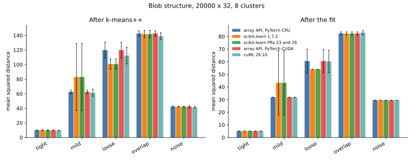
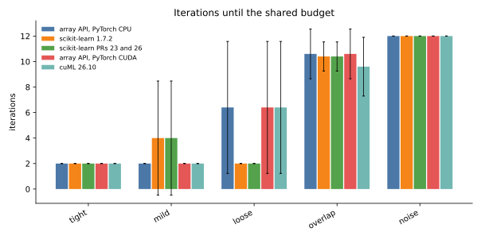
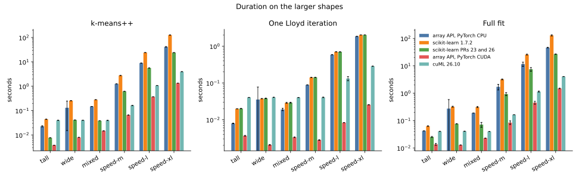
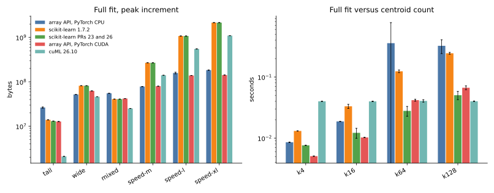
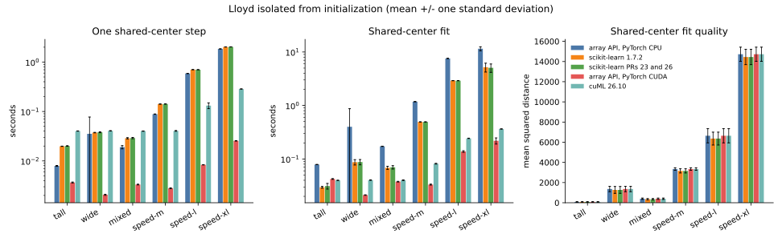

# 007 — repeated seeds and shared fixed centers

All 17 cases from [006](../006-breadth/index.html) were repeated with seeds 0 through 4: 1,700 successful worker runs and no failures. Values and error bars are the mean plus or minus one sample standard deviation over five runs.

This iteration separates two questions:

1. How much do k-means++ basin selection, fit quality, duration, and memory vary with the random seed?
2. When every implementation receives exactly the same starting centers, how do the Lloyd implementations compare?

For the second question, NumPy selects `k` rows from each dataset without replacement for each seed. Those float32 rows are saved once and passed unchanged to eager array-API PyTorch on CPU and CUDA, stock scikit-learn, scikit-learn with PRs 23 and 26, and cuML. Each implementation runs one Lloyd step and a full Lloyd-only fit. The full fit uses the same 12-iteration budget and variance-scaled tolerance as 006.

The array-API entry point for this path is `fit_lloyd`. `fit_kmeans` composes k-means++ with that same function, so the fixed-center and initialized tracks do not maintain separate iteration loops. The complete observations are in [results.json](results.json).

## k-means++ and full-fit variation

The single-seed winners in 006 are not stable. On `speed-l`, array-API CPU fit quality is 1,058 ± 79: one seed reaches the separated-blob floor near 1,024 in 2 iterations, while seed 0 ended at 1,199. cuML is unusually stable there at 1,193 ± 3 but does not reach the floor. On `speed-xl`, every implementation varies materially in fit quality; the standard deviation ranges from 95 to 155 mean-inertia units.

The `speed-xl` result, 131072 samples by 2048 features and 256 clusters:

| implementation | k-means++ seconds | init inertia | fit seconds | fit peak increment | fit inertia | iterations |
| --- | --- | --- | --- | --- | --- | --- |
| Array API - Torch CPU | 41.41 ± 1.07 | 4279 ± 181 | 46.06 ± 1.05 | 175.2 ± 1.5 MiB | 2149 ± 96 | 2.4 ± 0.5 |
| scikit-learn 1.7.2 | 126.80 ± 2.22 | 4602 ± 292 | 128.35 ± 6.01 | 2047.9 ± 0.0 MiB | 2322 ± 155 | 3.6 ± 1.1 |
| scikit-learn PRs 23+26 | 23.96 ± 0.05 | 4602 ± 365 | 26.60 ± 0.46 | 2047.9 ± 0.0 MiB | 2288 ± 154 | 3.0 ± 0.7 |
| Array API - Torch CUDA | 1.344 ± 0.001 | 4469 ± 269 | 1.484 ± 0.034 | 135.6 ± 0.0 MiB | 2252 ± 144 | 3.0 ± 1.0 |
| cuML | 3.966 ± 0.016 | 4207 ± 169 | 4.018 ± 0.018 | 1042.0 ± 0.0 MiB | 2113 ± 95 | 2.2 ± 0.4 |

The CUDA array API remains the fastest full fit. cuML has the best average inertia on this case, but its error bar overlaps array-API CPU. The patched scikit-learn initializer remains 5.3 times faster than stock scikit-learn. These are distributions over each implementation's own seeded sampler, not paired identical draws: the libraries consume random state differently, and CPU and CUDA array-API draws can diverge after floating-point rounding changes one weighted sample.

Peak increments still use different meters: the PyTorch allocator above the input, first-call process `VmHWM` for CPU libraries, and 1 MiB-resolution nvidia-smi sampling for cuML. Error bars quantify run variation within an implementation; absolute memory values across meter types remain approximate comparisons.

## Lloyd from shared centers

One Lloyd step is the cleanest isolation. The worst quality spread between implementations over all 85 case-seed pairs is 0.080%; it occurs on `tight-d128`, seed 3. On `speed-xl`, mean inertia after the step is about 17,696 for every implementation.

| implementation | one-step seconds | peak increment | inertia after step |
| --- | --- | --- | --- |
| Array API - Torch CPU | 1.848 ± 0.002 | 163.8 ± 0.4 MiB | 17695.58 ± 350.29 |
| scikit-learn 1.7.2 | 2.027 ± 0.004 | 2047.8 ± 0.1 MiB | 17695.64 ± 350.08 |
| scikit-learn PRs 23+26 | 2.030 ± 0.007 | 2047.9 ± 0.1 MiB | 17695.64 ± 350.08 |
| Array API - Torch CUDA | 0.025 ± 0.000 | 130.6 ± 0.0 MiB | 17695.02 ± 349.27 |
| cuML | 0.285 ± 0.000 | 1036.0 ± 0.0 MiB | 17695.58 ± 350.40 |

The array-API CPU step is 9% faster than both scikit-learn builds and uses about one twelfth their peak increment on `speed-xl`. The optimized scikit-learn patches accelerate initialization, not this Lloyd kernel at this shape. CUDA array API is 11.2 times faster than cuML for the isolated step.

### Full fixed-center fits expose an algorithmic difference

Shared starts remove k-means++ differences, but they do not force implementations to follow the same path after an empty cluster appears. Every selected center owns samples in the initial assignment for the examples below. During the second assignment, one or more clusters become empty. The array-API implementation deliberately keeps an empty center unchanged, as does cuML in these observations. Scikit-learn relocates empty clusters, then follows a different and often better path.

| case and seed | empty clusters at step 2 | API and cuML inertia | both sklearn inertias |
| --- | --- | --- | --- |
| k4, seed 0 | 1 | 249.50 | 32.02 |
| k16, seed 4 | 1 | 137.82 | 87.56 |
| wide, seed 2 | 1 | 1335.90 | 881.16 |
| mixed, seed 3 | 1 | 317.00 | 253.97 |
| speed-m, seed 2 | 5 | 3270.13 | 2874.95 |
| speed-l, seed 0 | 9 | 6629.01 | 6201.32 |
| speed-xl, seed 0 | 16 | 15456.99 | 15244.74 |

This is the main qualification on the full fixed-center timing. On `speed-xl`, Array API - Torch CUDA takes 0.219 ± 0.029 s and cuML 0.363 ± 0.001 s for their matching 14,725 ± 701 inertia result; Array API - Torch CPU takes 11.51 ± 0.98 s. Scikit-learn takes about 5.1 s but relocates empty centers and averages a different 14,451 ± 756 objective. The one-step table is the performance comparison without this semantic split.

## Conclusions

- Five seeds overturn several apparent quality rankings from the one-seed report. Runtime conclusions are much more stable than fit-quality conclusions.
- Shared centers make all five one-step Lloyd objectives agree within 0.080%, demonstrating that the large initialized-fit gaps come from basin selection rather than an incorrect assignment/update step.
- Longer shared-center fits identify a real semantic difference: scikit-learn relocates empty clusters, while the array API and cuML preserve them in these runs. Those timings must not be presented as equivalent work once paths diverge.
- On the largest case, eager array-API CUDA remains fastest for initialization, one Lloyd step, and a full initialized fit. The array-API CPU Lloyd step is also slightly faster and far lower-memory than both scikit-learn builds.
