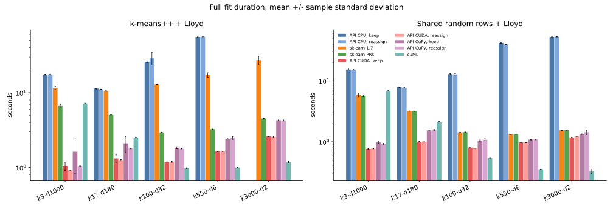
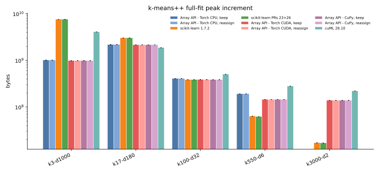
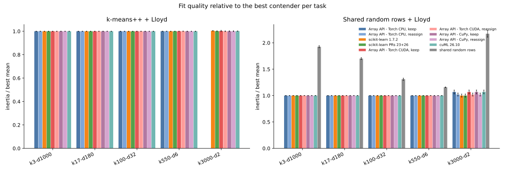
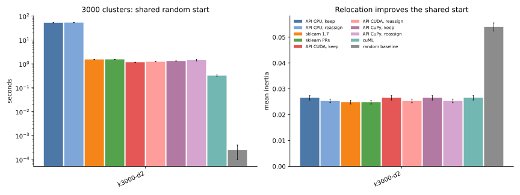

# 008 — stochastic empty-center relocation and bounded task mix

This iteration adds an opt-in empty-center policy to the eager Python array-API implementation and evaluates 285 bounded runs: five tasks, three seeds, two initialization tracks, nine Lloyd contenders, and a random-centroid baseline. Six runs hit the hard 60-second subprocess limit; all other workers succeeded. Complete observations are in [results.json](results.json).

## Empty-center policy

`reassign_empty=False` keeps the previous center, preserving reports 001 through 007. With `reassign_empty=True`, the tiled update:

1. detects zero-count centers;
2. computes each sample's squared distance from its assigned old center;
3. draws distinct replacement samples with probability proportional to squared error;
4. removes each selected sample from its donor sum and count; and
5. makes it the singleton member of the empty center before averaging.

Vanilla scikit-learn batch KMeans deterministically chooses the farthest samples. This option is a stochastic D² analogue. It preserves scikit-learn's donor accounting, but it is not the same selection rule. The random generator is explicit and the default remains disabled.

The CPU suite passes with 16 tests and 2 optional GPU skips. On the L4, all 20 expanded tests pass, including relocation on PyTorch CUDA and CuPy.

## Calibrated tasks

Cluster and feature counts follow inverse, approximately logarithmic ranges so both requested endpoints fit in memory. The first four tasks are standard Gaussian noise. The final task uses 300 Gaussian modes quantized to 0.05; the requested 3000 centers then exercise empty-center handling without reducing the requested cluster count. Sample counts were calibrated against stock scikit-learn 1.7.2 with one k-means++ start, 12 iterations, and `tol=1e-8`.

| task | samples | clusters | features | stock calibration |
| --- | --- | --- | --- | --- |
| k3-d1000 | 950000 | 3 | 1000 | 11.65 s |
| k17-d180 | 2100000 | 17 | 180 | 10.40 s |
| k100-d32 | 1500000 | 100 | 32 | 12.92 s |
| k550-d6 | 525000 | 550 | 6 | 16.34 s |
| k3000-d2 | 135000 | 3000 | 2 | 29.62 s |

Every task uses seeds 0 through 2. The implementation-specific k-means++ track is separate from the paired random-start track: NumPy samples dataset rows once per task and seed, and every Lloyd implementation receives exactly those rows. The random baseline stops there, with no Lloyd iterations.

Contenders are eager array API with PyTorch CPU, PyTorch CUDA, and CuPy, each with relocation disabled and enabled; stock scikit-learn; scikit-learn with PRs 23 and 26; and cuML. Times are mean plus or minus one sample standard deviation over three seeds.

## Duration and memory

The no-Lloyd random baseline is omitted from the duration and memory plots. It remains on the inertia plots, where its quality gap is visible.

K-means++ plus Lloyd:

| implementation | k3-d1000 | k17-d180 | k100-d32 | k550-d6 | k3000-d2 |
| --- | --- | --- | --- | --- | --- |
| API CPU, keep | 17.47 s | 11.35 s | 25.85 s | 55.56 s | timeout |
| API CPU, reassign | 17.59 s | 11.07 s | 28.85 s | 55.97 s | timeout |
| sklearn 1.7 | 11.54 s | 10.53 s | 12.89 s | 17.30 s | 27.26 s |
| sklearn PRs | 6.66 s | 5.04 s | 2.94 s | 3.25 s | 4.52 s |
| API CUDA, keep | 1.05 s | 1.32 s | 1.18 s | 1.64 s | 2.61 s |
| API CUDA, reassign | 0.91 s | 1.25 s | 1.19 s | 1.64 s | 2.58 s |
| API CuPy, keep | 1.62 s | 2.10 s | 1.84 s | 2.41 s | 4.28 s |
| API CuPy, reassign | 1.04 s | 1.79 s | 1.78 s | 2.50 s | 4.25 s |
| cuML | 7.18 s | 2.52 s | 0.98 s | 0.99 s | 1.18 s |

Only array-API CPU k-means++ at 3000 clusters times out: both policies for all three seeds, six timeouts. The shared-random-start CPU fits complete in 52.64 ± 0.04 s when empty centers are kept and 53.16 ± 0.24 s when they are reassigned.

CUDA PyTorch is faster than CuPy on four of the five k-means++ tasks and is the fastest contender at 3 and 17 clusters. cuML is fastest from 100 clusters upward. The empty policy has no systematic cost when no center empties; timing differences there are process-level variation.

Memory meters remain backend-specific. PyTorch and CuPy report allocator/pool increments above device inputs, CPU libraries report fresh-process `VmHWM`, and cuML uses 1 MiB-resolution nvidia-smi sampling. The largest memory contrast is `k3-d1000`: array API uses about 0.94 GiB on either GPU and 0.96 GiB on CPU, stock and patched scikit-learn use 7.1 GiB, and cuML uses 3.8 GiB.

## Quality, shared starts, and the random baseline

On the four continuous-noise tasks, no array-API run records an empty center. Keep and reassign therefore return identical CPU and CuPy objectives. All contenders also agree closely from the paired random start. The random baseline is consistently worse: its mean inertia is 1923.70 versus 998.87 on `k3-d1000`, 300.31 versus 176.53 on `k17-d180`, 33.94 versus 25.92 on `k100-d32`, and 1.189 versus 1.027 on `k550-d6`.

The quantized 3000-cluster task does exercise relocation from random starts:

| implementation | seconds | empty events | reassignments | mean inertia |
| --- | --- | --- | --- | --- |
| API CPU, keep | 52.64 ± 0.04 | 50 to 55 | 0 | 0.026541 |
| API CPU, reassign | 53.16 ± 0.24 | 46 to 55 | 46 to 55 | 0.025320 |
| API CUDA, keep | 1.176 ± 0.003 | 49 to 55 | 0 | 0.026543 |
| API CUDA, reassign | 1.230 ± 0.005 | 46 to 55 | 46 to 55 | 0.025321 |
| API CuPy, keep | 1.329 ± 0.010 | 49 to 55 | 0 | 0.026543 |
| API CuPy, reassign | 1.429 ± 0.118 | 46 to 55 | 46 to 55 | 0.025321 |
| sklearn 1.7 | 1.538 ± 0.017 | relocates farthest | relocates farthest | 0.024833 |
| sklearn PRs | 1.551 ± 0.010 | relocates farthest | relocates farthest | 0.024834 |
| cuML | 0.324 ± 0.023 | not exposed | not exposed | 0.026550 |
| random baseline | less than 0.001 | none | none | 0.053957 |

Stochastic relocation improves array-API random-start inertia by 4.60% on average. Scikit-learn's farthest-point policy improves another 1.92% over the stochastic result. That difference is expected: D² sampling favors high-error points in expectation but does not always choose the current farthest points. PyTorch CUDA and CuPy agree on the relocated objective to the shown precision.

K-means++ avoids empty centers on this task. Its mean inertia is about 0.0181 for every completed contender, substantially better than either random-start Lloyd result and much better than the 0.0540 random baseline.

## Conclusions

- The optional array-API policy works on NumPy, PyTorch CPU/CUDA, and CuPy and records the relocation count.
- On the one task with empty centers, stochastic D² relocation costs about 0.05 s on PyTorch CUDA and improves inertia by 4.60%.
- Scikit-learn's deterministic farthest-point relocation reaches 1.92% lower inertia than the stochastic policy from the same starts; the policies are analogous, not identical.
- PyTorch CUDA leads at low cluster counts; cuML leads from 100 clusters upward. CuPy is consistently functional and usually between PyTorch CUDA and CPU implementations.
- The no-Lloyd random baseline is worse on every task. K-means++ is especially important at 3000 clusters.
- The 60-second limit is enforced per fresh process. Only the six array-API CPU k-means++ runs at 3000 clusters time out.
