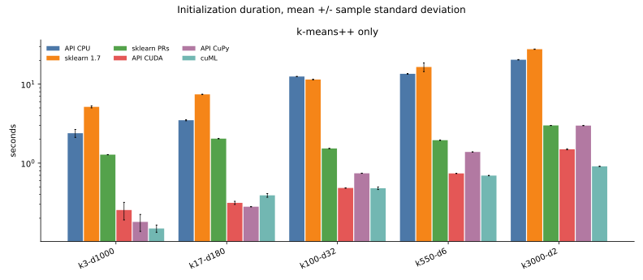
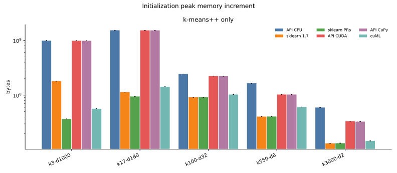
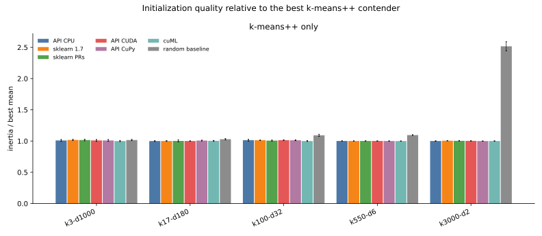

# 009 — k-means++ without Lloyd

This iteration times initialization alone on the five tasks from [008](../008-empty-reassignment-task-mix/report.md). Each contender draws its own k-means++ centers and stops. There is no Lloyd update, so empty-center relocation does not apply. The random-centroid baseline stays on the inertia plot. Complete observations are in [results.json](results.json).

105 fresh workers finished under the 60-second limit: five tasks, seeds 0 through 2, and seven contenders. Every recorded iteration count is 0.

## What was timed

The array-API contenders call [`kmeans_plusplus`](https://github.com/ogrisel/cursor-sandbox/blob/cursor/kmeans-lloyd-fusion-8896/kmeans_lloyd/src/kmeans_lloyd/iteration.py#L491-L533) in eager mode on PyTorch CPU, PyTorch CUDA, and CuPy. Stock scikit-learn 1.7.2 and the build with PRs 23 and 26 call `sklearn.cluster.kmeans_plusplus`. cuML 26.10 fits with `init="k-means++"`, `n_init=1`, and `max_iter=0`. That call still assigns labels after choosing centers. A second fit started from those centers repeats only the assignment, and the plotted cuML duration is the difference. `n_iter_` was 0 on all 15 cuML runs, and each center matched a data row.

Inertia is the mean squared distance to the nearest selected center, computed after the timer. GPU array-API peaks are allocator bytes above data already on the device. CPU peaks are fresh-process `VmHWM`. cuML peaks are 1 MiB nvidia-smi samples above data already on the device.

## Duration

The random baseline is omitted here. Copying the chosen rows takes less than a millisecond and would compress the axis.

| implementation | k3-d1000 | k17-d180 | k100-d32 | k550-d6 | k3000-d2 |
| --- | --- | --- | --- | --- | --- |
| API CPU | 2.39 s | 3.49 s | 12.49 s | 13.51 s | 20.37 s |
| sklearn 1.7 | 5.15 s | 7.42 s | 11.44 s | 16.48 s | 27.73 s |
| sklearn PRs | 1.28 s | 2.04 s | 1.53 s | 1.95 s | 3.00 s |
| API CUDA | 0.25 s | 0.31 s | 0.48 s | 0.74 s | 1.50 s |
| API CuPy | 0.18 s | 0.28 s | 0.74 s | 1.38 s | 2.99 s |
| cuML | 0.15 s | 0.39 s | 0.48 s | 0.69 s | 0.91 s |

Sample standard deviations are small beside these means, with two exceptions: API CUDA at 3 clusters is 0.254 ± 0.064 s, and stock scikit-learn at 550 clusters is 16.48 ± 2.08 s.

cuML is the fastest initializer at 3, 100, 550, and 3000 clusters. CuPy leads at 17 clusters (0.280 s), just ahead of PyTorch CUDA (0.314 s) and cuML (0.390 s). The patched scikit-learn initializer is several times faster than stock and stays close to CuPy once the cluster count reaches 3000. Array-API CPU is faster than stock scikit-learn on four tasks and slower at 100 clusters.

Compared with the full fits in 008, initialization is a small slice of the low-cluster GPU runs and most of the high-cluster CPU runs. Stock scikit-learn's full fit at 3000 clusters averaged 27.26 s; the initializer alone averages 27.73 s, inside that earlier seed spread. Array-API CPU initialization at 3000 clusters takes 20.37 s, which is why adding Lloyd pushed those 008 runs past 60 s. cuML's 3-cluster full fit was 7.18 s, while initialization alone is 0.15 s, so that gap is Lloyd work.

## Memory

| implementation | k3-d1000 | k17-d180 | k100-d32 | k550-d6 | k3000-d2 |
| --- | --- | --- | --- | --- | --- |
| API CPU | 944 MiB | 1455 MiB | 232 MiB | 157 MiB | 57 MiB |
| API CUDA | 939 MiB | 1450 MiB | 213 MiB | 98 MiB | 32 MiB |
| API CuPy | 939 MiB | 1450 MiB | 212 MiB | 98 MiB | 31 MiB |
| sklearn 1.7 | 172 MiB | 109 MiB | 87 MiB | 39 MiB | 13 MiB |
| sklearn PRs | 35 MiB | 90 MiB | 87 MiB | 39 MiB | 13 MiB |
| cuML | 54 MiB | 136 MiB | 98 MiB | 58 MiB | 14 MiB |

The array-API peak on the two widest tasks is the feature tile inside the one-time row-norm. With a tile of 256 features, `k3-d1000` materializes about 950000 by 256 products, and `k17-d180` materializes the full 180-feature block. PyTorch and CuPy report nearly the same increment. Stock and patched scikit-learn, and cuML, stay under 180 MiB on every task.

## Quality

The quality axis is mean inertia divided by the best k-means++ mean on that task. The random baseline is included. Values are mean inertia per sample.

| implementation | k3-d1000 | k17-d180 | k100-d32 | k550-d6 | k3000-d2 |
| --- | --- | --- | --- | --- | --- |
| API CPU | 1911 | 291.8 | 31.51 | 1.086 | 0.02145 |
| API CUDA | 1912 | 292.0 | 31.53 | 1.086 | 0.02150 |
| API CuPy | 1911 | 294.1 | 31.48 | 1.086 | 0.02144 |
| sklearn 1.7 | 1926 | 292.0 | 31.49 | 1.087 | 0.02154 |
| sklearn PRs | 1924 | 292.5 | 31.30 | 1.087 | 0.02152 |
| cuML | 1893 | 292.9 | 31.08 | 1.085 | 0.02145 |
| random baseline | 1924 | 300.3 | 33.94 | 1.189 | 0.05396 |

At 3 clusters the data are isotropic Gaussian noise, and a random draw of 3 rows matches k-means++. The best mean is cuML at 1893 and the random baseline is 1924; the seed standard deviations are about 20, so those gaps sit inside the noise. From 17 clusters upward the baseline is worse: 2.9% at 17 clusters, 9.2% at 100, 9.6% at 550, and 2.52 times the best k-means++ inertia at 3000 clusters (0.05396 versus 0.02144).

The six k-means++ implementations land within about 1% of each other from 17 clusters upward. They do not share centers. Each backend consumes its own generator, and float32 reductions can change a later candidate, so PyTorch CPU, PyTorch CUDA, and CuPy are the same algorithm with small objective differences.

## Conclusions

- k-means++ without Lloyd finishes within 60 s for every contender, including array-API CPU at 3000 clusters (20.37 s).
- cuML has the fastest initializer on four of the five tasks. CuPy leads at 17 clusters. Patched scikit-learn is the fastest CPU initializer on every task.
- The array-API row-norm tile sets the memory peak on the wide tasks, about 0.94 GiB at 1000 features and 1.45 GiB at 2.1 million samples.
- On isotropic 3-cluster noise, random rows match k-means++. At 3000 clusters, k-means++ cuts the random-row inertia by a factor of 2.52 before any Lloyd iteration.

Previous: [stochastic relocation and the full-fit task mix](../008-empty-reassignment-task-mix/report.md). Next: [farthest relocation and scalable initialization](../010-scalable-initialization/report.md). Index: [journal](../index.md).
