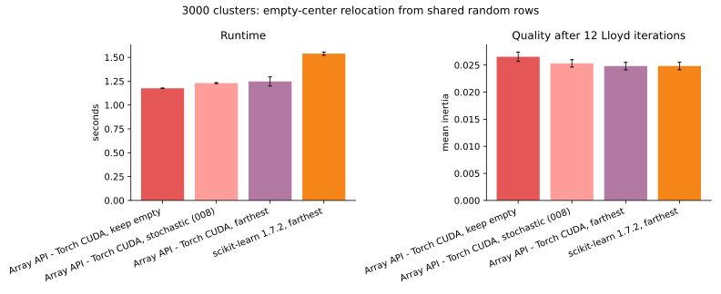
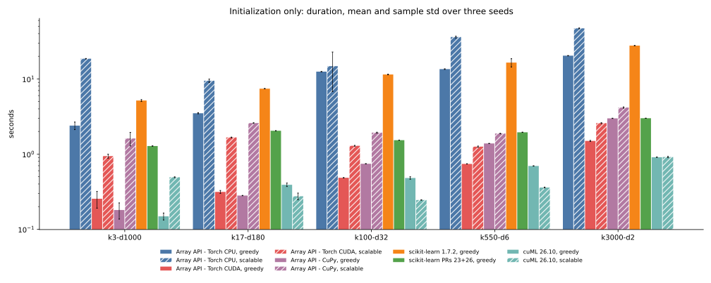
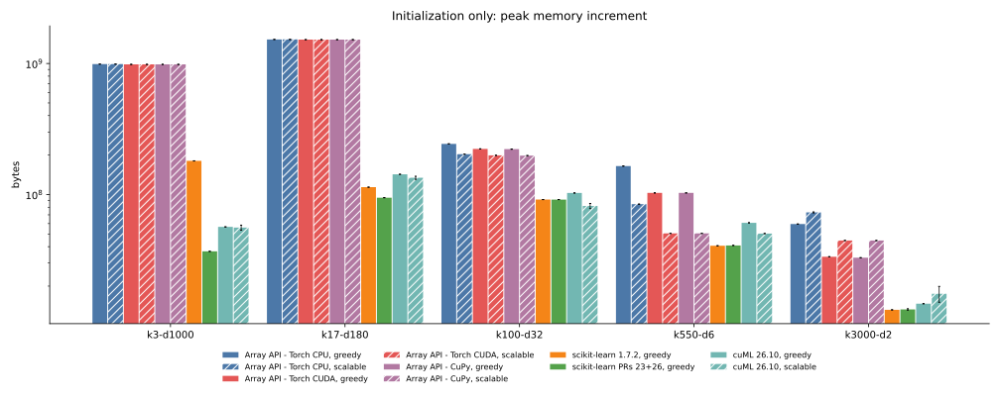
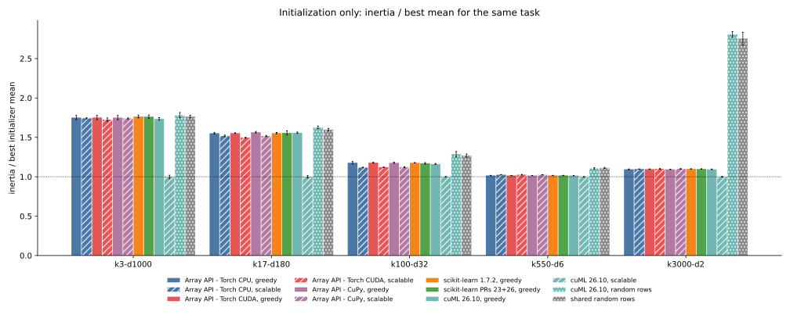

# 010 — farthest relocation and scalable initialization

This iteration replaces the array-API stochastic empty-center policy with
scikit-learn's deterministic farthest-point relocation, adds cuML's other
initializer choices, and implements a bounded-memory array-API k-means||
initializer. It consolidates the 105 initializer observations from
[009](../009-kmeans-plusplus-only/report.md), 75 new initializer observations,
and 9 farthest-relocation full fits in [results.json](results.json). Every new
worker finishes inside the 60-second limit.

## Changes

### Farthest-point empty-center relocation

`reassign_empty=True` now computes each sample's squared distance from its
assigned old center, chooses the farthest samples, subtracts each from its
donor sum and count, and installs it as a singleton empty center. This is the
unweighted dense policy in scikit-learn 1.7. The random generator is no longer
required for relocation.

On the quantized 3000-cluster task, the array-API implementation detects and
relocates 46 to 55 empty centers per run. PyTorch CUDA and CuPy return the same
inertia to the shown precision. The CPU result differs by at most 0.03% because
its float32 reductions have a different order.

| 3000 clusters, shared random rows | seconds | mean inertia |
| --- | --- | --- |
| Array API - Torch CUDA, keep empty | 1.176 ± 0.003 | 0.026543 ± 0.000863 |
| Array API - Torch CUDA, stochastic D² from 008 | 1.230 ± 0.005 | 0.025321 ± 0.000681 |
| Array API - Torch CUDA, farthest | 1.247 ± 0.048 | 0.024816 ± 0.000694 |
| scikit-learn 1.7.2, farthest | 1.538 ± 0.017 | 0.024833 ± 0.000694 |

Farthest relocation lowers inertia by 6.50% relative to keeping empty centers
and by 1.99% relative to the former stochastic policy. Its mean is 0.07% below
scikit-learn's; that gap is within float32 assignment and accumulation
differences. The policies now agree, whereas report 008 intentionally compared
different relocation rules.

### Array-API scalable k-means++

`scalable_kmeans_plusplus` implements a k-means||-style initializer:

1. choose one row uniformly;
2. run eight parallel D² rounds, drawing `2 * n_clusters` candidates per round;
3. assign every sample to the nearest candidate to obtain candidate weights;
4. reduce the weighted candidate pool to `n_clusters` rows with weighted
   greedy k-means++.

The fixed sampling budget follows cuML's documented
`oversampling_factor * n_clusters * 8` budget. Classical k-means|| samples
every point independently in each round; this implementation makes a
fixed-size weighted draw instead, which bounds the candidate pool and memory.
The final weighted reduction follows the k-means|| paper and always returns
rows of the input.

The same function runs through the Python array API on PyTorch CPU, PyTorch
CUDA, and CuPy. Tests cover deterministic sampling, source-row preservation,
option validation, both CUDA backends, and the NumPy-compatible namespace.

cuML 26.10 supports `k-means++`, `scalable-k-means++`, its `k-means||` alias,
and `random`. The alias is not duplicated in the plots because it selects the
same implementation. cuML's scalable output does not consist of input rows:
even with outer `max_iter=0`, its internal candidate consolidation refines the
centers. The resulting no-Lloyd inertia therefore measures the initializer
that cuML actually returns, but is not a row-selection-only comparison with
the array-API implementation.

## Initialization duration

All plots show means and sample standard deviations over seeds 0 through 2.
Each figure puts greedy k-means++ from 009 and the new scalable strategy on the
same axes: bar color identifies the implementation and hatching marks the
scalable initializer. Random initializers appear only on the quality figure.

| implementation | k3-d1000 | k17-d180 | k100-d32 | k550-d6 | k3000-d2 |
| --- | --- | --- | --- | --- | --- |
| Array API - Torch CPU, greedy | 2.39 s | 3.49 s | 12.49 s | 13.51 s | 20.37 s |
| Array API - Torch CPU, scalable | 18.57 s | 9.46 s | 14.77 s | 36.06 s | 47.09 s |
| scikit-learn 1.7.2, greedy | 5.15 s | 7.42 s | 11.44 s | 16.48 s | 27.73 s |
| scikit-learn PRs 23+26, greedy | 1.28 s | 2.04 s | 1.53 s | 1.95 s | 3.00 s |
| Array API - Torch CUDA, greedy | 0.25 s | 0.31 s | 0.48 s | 0.74 s | 1.50 s |
| Array API - Torch CUDA, scalable | 0.94 s | 1.67 s | 1.29 s | 1.26 s | 2.58 s |
| Array API - CuPy, greedy | 0.18 s | 0.28 s | 0.74 s | 1.38 s | 2.99 s |
| Array API - CuPy, scalable | 1.61 s | 2.58 s | 1.93 s | 1.88 s | 4.16 s |
| cuML 26.10, greedy | 0.15 s | 0.39 s | 0.48 s | 0.69 s | 0.91 s |
| cuML 26.10, scalable | 0.49 s | 0.27 s | 0.25 s | 0.36 s | 0.91 s |

cuML has no standalone Python initializer API. Its `max_iter=0` fit still
performs a trailing assignment. For greedy and scalable initialization, the
reported duration subtracts a second zero-iteration fit from the returned
centers. Random row selection is below that subtraction's timer noise. It is
not a timing contender and is left out of the duration and memory results.

The array-API scalable implementation is slower than its greedy initializer on
every task. It deliberately performs eight full-data parallel sampling rounds
and a weighted candidate reduction. On CUDA its cost remains 0.94 to 2.58 s
and all CPU runs remain under 48 s. cuML's scalable implementation is faster
than cuML greedy k-means++ from 17 through 550 clusters and ties it at 3000.

## Peak memory

| implementation | k3-d1000 | k17-d180 | k100-d32 | k550-d6 | k3000-d2 |
| --- | --- | --- | --- | --- | --- |
| Array API - Torch CPU, scalable | 944 MiB | 1455 MiB | 194 MiB | 81 MiB | 70 MiB |
| Array API - Torch CUDA, scalable | 939 MiB | 1450 MiB | 190 MiB | 48 MiB | 43 MiB |
| Array API - CuPy, scalable | 939 MiB | 1450 MiB | 189 MiB | 48 MiB | 43 MiB |
| cuML 26.10, scalable | 53 MiB | 128 MiB | 78 MiB | 48 MiB | 17 MiB |

The array-API row-norm feature tile still controls the two widest tasks, so
scalable and greedy memory are effectively identical there. Candidate and
label storage becomes visible at 3000 clusters: scalable uses about 43 MiB on
either array-API GPU versus 31 to 32 MiB for greedy initialization. cuML
scalable stays below 128 MiB.

Meters remain backend-specific: PyTorch and CuPy allocator increments above
device-resident input, CPU fresh-process `VmHWM`, and 1 MiB nvidia-smi samples
for cuML. cuML memory includes its trailing assignment and cannot be
subtracted.

## No-Lloyd quality

The plot divides each mean inertia by the best mean of all consolidated
initializers on that task, greedy, scalable, and random together. The dotted
line marks that best result. cuML random and the shared random-row baseline
appear only on this quality figure.

| implementation | k3-d1000 | k17-d180 | k100-d32 | k550-d6 | k3000-d2 |
| --- | --- | --- | --- | --- | --- |
| Array API - Torch CPU, greedy | 1911 | 291.8 | 31.51 | 1.086 | 0.02145 |
| Array API - Torch CPU, scalable | 1901 | 285.3 | 29.91 | 1.096 | 0.02151 |
| Array API - Torch CUDA, greedy | 1912 | 292.0 | 31.53 | 1.086 | 0.02150 |
| Array API - Torch CUDA, scalable | 1884 | 281.1 | 29.97 | 1.097 | 0.02157 |
| Array API - CuPy, greedy | 1911 | 294.1 | 31.48 | 1.086 | 0.02144 |
| Array API - CuPy, scalable | 1900 | 285.2 | 30.00 | 1.097 | 0.02156 |
| cuML 26.10, greedy | 1893 | 292.9 | 31.08 | 1.085 | 0.02145 |
| cuML 26.10, scalable | 1092 | 188.0 | 26.76 | 1.069 | 0.01960 |
| cuML 26.10, random | 1944 | 305.8 | 34.41 | 1.182 | 0.05502 |
| shared random rows | 1924 | 300.3 | 33.94 | 1.189 | 0.05396 |

Array-API scalable initialization improves on array-API greedy k-means++ by
2.2 to 3.7% at 17 clusters and 4.7 to 5.1% at 100 clusters. It is effectively
tied on the isotropic 3-cluster task and is about 1% worse at 550 clusters and
0.3 to 0.6% worse at 3000 clusters. More parallel candidates do not guarantee
a better seed after weighted reduction.

cuML scalable has the best objective on all five tasks. The largest gap is the
3-cluster, 1000-feature noise task, where its internally refined centers reach
1092 versus approximately 1900 for row-only initializers. That result should
not be read as a faster implementation of the same row-selection algorithm;
cuML's candidate consolidation returns non-row centers.
[011](../011-consolidated-benchmark/report.md#why-the-array-api-and-cuml-scalable-initializers-differ)
compares both implementations step by step and isolates the cause with an
ablation.

## Conclusions

- Array-API empty-center handling now follows scikit-learn's deterministic
  farthest-point policy and matches its 3000-cluster objective within 0.07%.
- The array-API k-means|| implementation is portable across PyTorch CPU/CUDA
  and CuPy and keeps every new run within the 60-second bound.
- Array-API scalable seeding improves no-Lloyd quality most clearly at 17 and
  100 clusters, but costs more time and does not improve every task.
- cuML scalable initialization is both fast and consistently best in
  no-Lloyd inertia, partly because its internal consolidation returns refined
  centers rather than dataset rows.
- Random selection remains useful as a quality baseline, not as a competitive
  initializer on the structured 3000-cluster task.

Previous: [k-means++ without Lloyd](../009-kmeans-plusplus-only/report.md).
Next: [consolidated benchmark](../011-consolidated-benchmark/report.md).
Index: [journal](../index.md).
