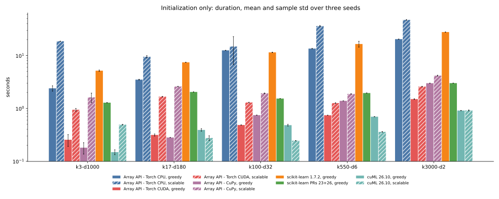
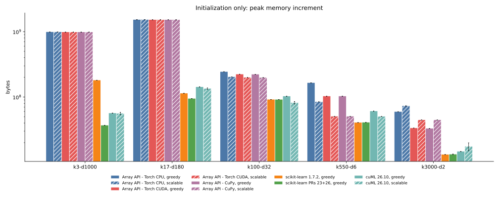
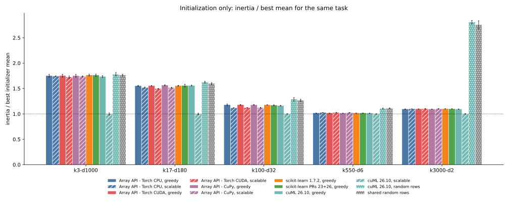
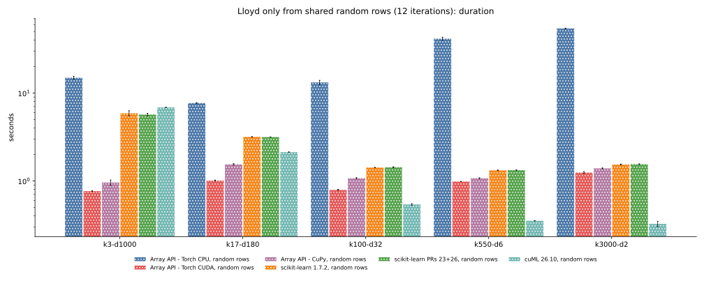
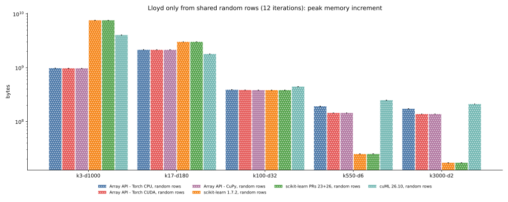
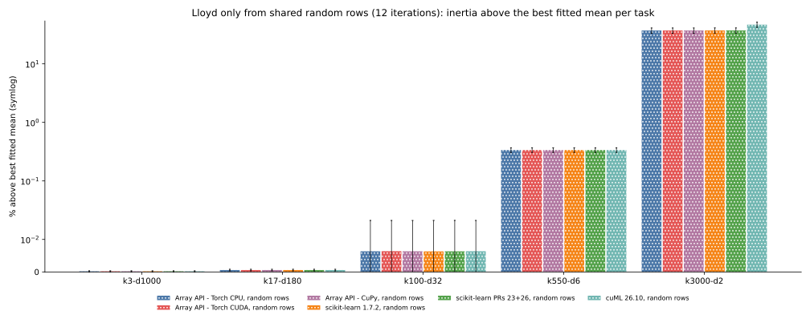
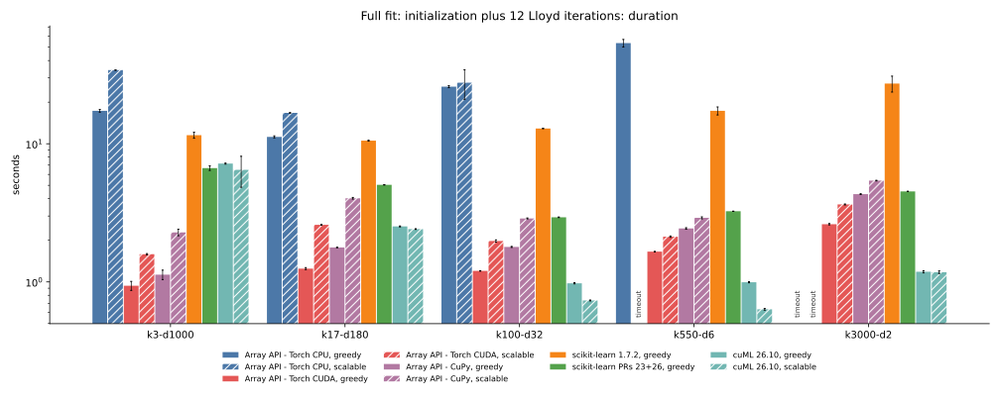
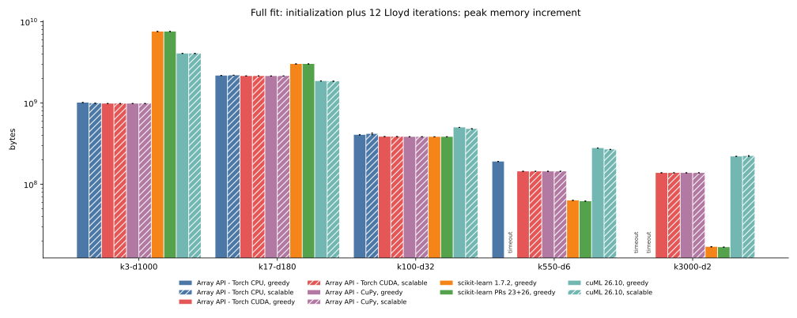
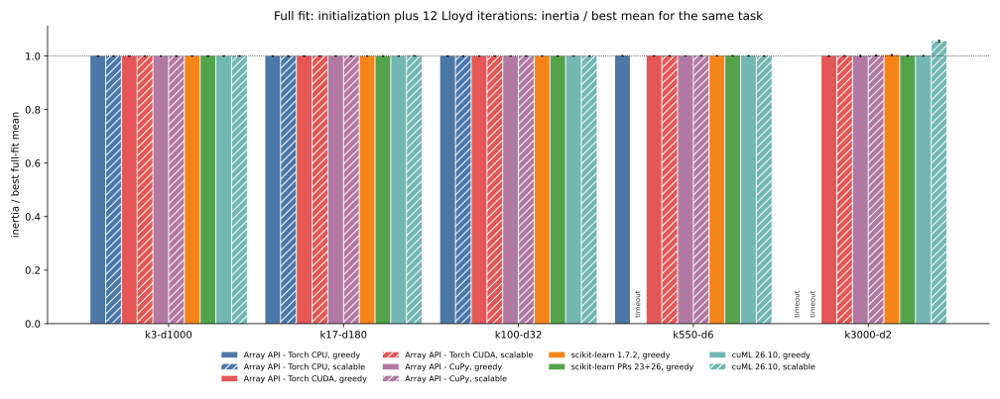

# 011 — consolidated benchmark: initialization, Lloyd, and full fit

This page gathers every current result for the five-task mix in one place:

1. initialization only, before any Lloyd iteration;
2. Lloyd only, 12 iterations from the same random data rows for everyone;
3. full fit, initialization followed by 12 Lloyd iterations.

[results.json](results.json) holds 570 rows. 195 are full-fit and Lloyd-only
rows from [008](../008-empty-reassignment-task-mix/report.md), excluding its
retired stochastic-relocation variants. 180 are initializer rows from
[009](../009-kmeans-plusplus-only/report.md) and
[010](../010-scalable-initialization/report.md). 195 are new rows: Lloyd-only
and full fits with the array-API farthest-point relocation, and full fits
started from scalable k-means++ for the array API and cuML.
[ablation.json](ablation.json) holds the 60-row scalable-init ablation
explained in the last section.

## Setup

- Tasks: `k3-d1000` (950000 Gaussian-noise samples, 1000 features),
  `k17-d180` (2100000 by 180), `k100-d32` (1500000 by 32), `k550-d6`
  (525000 by 6), and `k3000-d2` (135000 quantized samples from 300 blobs in 2
  dimensions). The task name gives the number of clusters and features.
- Contenders: the eager Python array-API implementation on PyTorch CPU
  (labelled Array API - Torch CPU), PyTorch CUDA (Array API - Torch CUDA), and
  CuPy (Array API - CuPy); stock scikit-learn 1.7.2; scikit-learn 1.10.dev0
  with PRs 23 and 26; and cuML 26.10 on an NVIDIA L4.
- Initializers: greedy k-means++, scalable k-means++ (k-means||), and random
  data rows. Array-API rows use scikit-learn's farthest-point empty-center
  relocation unless labelled "keep empty".
- Float32, TF32 disabled, `max_iter=12`, `tol=1e-8`, seeds 0 to 2, 4 CPU
  threads, and a hard 60-second limit per worker process. All values are
  seed means; figures add one sample standard deviation.
- Figures use one color per implementation; hatching marks scalable
  initialization and dots mark random rows. Random initializers appear only
  on quality figures because they are not timing contenders. Quality is mean
  inertia divided by the best mean for the same task and section, with a
  dotted line at 1. Duration and memory use a logarithmic axis because their
  values span more than a factor of ten; every quality ratio stays below a
  factor of three, so those axes stay linear.

## Initialization only

Initializer quality is the full-data mean inertia of the returned centers
divided by the best initializer mean on each task. That best is cuML
scalable on every task, for reasons analyzed below.

| configuration | k3-d1000 | k17-d180 | k100-d32 | k550-d6 | k3000-d2 |
| --- | --- | --- | --- | --- | --- |
| Array API - Torch CPU, greedy | 2.39 s | 3.49 s | 12.49 s | 13.51 s | 20.37 s |
| Array API - Torch CPU, scalable | 18.57 s | 9.46 s | 14.77 s | 36.06 s | 47.09 s |
| Array API - Torch CUDA, greedy | 0.25 s | 0.31 s | 0.48 s | 0.74 s | 1.50 s |
| Array API - Torch CUDA, scalable | 0.94 s | 1.66 s | 1.29 s | 1.25 s | 2.58 s |
| Array API - CuPy, greedy | 0.18 s | 0.28 s | 0.74 s | 1.38 s | 2.99 s |
| Array API - CuPy, scalable | 1.61 s | 2.58 s | 1.93 s | 1.88 s | 4.16 s |
| scikit-learn 1.7.2, greedy | 5.15 s | 7.42 s | 11.44 s | 16.48 s | 27.73 s |
| scikit-learn PRs 23+26, greedy | 1.28 s | 2.04 s | 1.53 s | 1.95 s | 3.00 s |
| cuML 26.10, greedy | 0.15 s | 0.39 s | 0.48 s | 0.69 s | 0.91 s |
| cuML 26.10, scalable | 0.49 s | 0.27 s | 0.24 s | 0.36 s | 0.91 s |

| configuration | k3-d1000 | k17-d180 | k100-d32 | k550-d6 | k3000-d2 |
| --- | --- | --- | --- | --- | --- |
| Array API - Torch CPU, greedy | 944 MiB | 1455 MiB | 232 MiB | 157 MiB | 57 MiB |
| Array API - Torch CPU, scalable | 944 MiB | 1455 MiB | 194 MiB | 80 MiB | 70 MiB |
| Array API - Torch CUDA, greedy | 939 MiB | 1450 MiB | 213 MiB | 98 MiB | 32 MiB |
| Array API - Torch CUDA, scalable | 939 MiB | 1450 MiB | 190 MiB | 48 MiB | 43 MiB |
| Array API - CuPy, greedy | 939 MiB | 1450 MiB | 212 MiB | 98 MiB | 31 MiB |
| Array API - CuPy, scalable | 939 MiB | 1450 MiB | 189 MiB | 48 MiB | 42 MiB |
| scikit-learn 1.7.2, greedy | 172 MiB | 109 MiB | 87 MiB | 39 MiB | 13 MiB |
| scikit-learn PRs 23+26, greedy | 35 MiB | 90 MiB | 87 MiB | 39 MiB | 13 MiB |
| cuML 26.10, greedy | 54 MiB | 136 MiB | 98 MiB | 58 MiB | 14 MiB |
| cuML 26.10, scalable | 53 MiB | 128 MiB | 78 MiB | 48 MiB | 17 MiB |

| configuration | k3-d1000 | k17-d180 | k100-d32 | k550-d6 | k3000-d2 |
| --- | --- | --- | --- | --- | --- |
| Array API - Torch CPU, greedy | 1.7505 | 1.5522 | 1.1778 | 1.0162 | 1.0943 |
| Array API - Torch CPU, scalable | 1.7415 | 1.5179 | 1.1177 | 1.0253 | 1.0974 |
| Array API - Torch CUDA, greedy | 1.7517 | 1.5536 | 1.1783 | 1.0162 | 1.0968 |
| Array API - Torch CUDA, scalable | 1.7255 | 1.4954 | 1.1202 | 1.0261 | 1.1002 |
| Array API - CuPy, greedy | 1.7505 | 1.5646 | 1.1766 | 1.0155 | 1.0936 |
| Array API - CuPy, scalable | 1.7401 | 1.5171 | 1.1212 | 1.0256 | 1.1000 |
| scikit-learn 1.7.2, greedy | 1.7645 | 1.5535 | 1.1768 | 1.0164 | 1.0991 |
| scikit-learn PRs 23+26, greedy | 1.7625 | 1.5559 | 1.1700 | 1.0167 | 1.0980 |
| cuML 26.10, greedy | 1.7341 | 1.5579 | 1.1617 | 1.0149 | 1.0942 |
| cuML 26.10, scalable | 1.0000 | 1.0000 | 1.0000 | 1.0000 | 1.0000 |
| cuML 26.10, random rows | 1.7805 | 1.6266 | 1.2860 | 1.1056 | 2.8067 |
| shared random rows | 1.7623 | 1.5976 | 1.2686 | 1.1121 | 2.7527 |

PyTorch CUDA greedy k-means++ is within a factor of 1.7 of cuML's greedy
initializer. The array-API scalable initializer costs 0.9 to 2.6 s on
PyTorch CUDA, more than its greedy counterpart on every task. cuML scalable
is faster than cuML greedy from 17 to 550 clusters and ties it at 3000. Torch CPU scalable
initialization needs 36 and 47 s at 550 and 3000 clusters.

The array-API row-norm feature tile dominates initializer memory on the two
widest tasks. cuML and scikit-learn measure memory differently (nvidia-smi and
`VmHWM`) and stay at or below 172 MiB.

All row-selecting initializers land within a few percent of each other, and
array-API scalable improves on greedy by 2 to 5% at 17 and 100 clusters. cuML
scalable is about 43% lower on the 3-cluster task and 35% lower on the
17-cluster task because it refines its candidate set with weighted Lloyd before
returning.

## Lloyd only from shared random rows

Every implementation starts from the same `k` random rows per seed, so this
section isolates the Lloyd kernel and its empty-center policy. Its quality
table divides each mean inertia by the best Lloyd-only mean for that task.
Full-fit results do not contribute to this denominator.

| configuration | k3-d1000 | k17-d180 | k100-d32 | k550-d6 | k3000-d2 |
| --- | --- | --- | --- | --- | --- |
| Array API - Torch CPU, random rows, keep empty | 15.37 s | 7.85 s | 12.88 s | 41.99 s | 52.64 s |
| Array API - Torch CPU, random rows | 14.92 s | 7.69 s | 13.20 s | 41.48 s | 54.23 s |
| Array API - Torch CUDA, random rows, keep empty | 0.76 s | 1.00 s | 0.80 s | 0.97 s | 1.18 s |
| Array API - Torch CUDA, random rows | 0.77 s | 1.01 s | 0.79 s | 0.98 s | 1.25 s |
| Array API - CuPy, random rows, keep empty | 0.98 s | 1.53 s | 1.04 s | 1.08 s | 1.33 s |
| Array API - CuPy, random rows | 0.96 s | 1.54 s | 1.07 s | 1.07 s | 1.39 s |
| scikit-learn 1.7.2, random rows | 5.88 s | 3.17 s | 1.42 s | 1.32 s | 1.54 s |
| scikit-learn PRs 23+26, random rows | 5.69 s | 3.16 s | 1.43 s | 1.33 s | 1.55 s |
| cuML 26.10, random rows | 6.85 s | 2.13 s | 0.54 s | 0.35 s | 0.32 s |

| configuration | k3-d1000 | k17-d180 | k100-d32 | k550-d6 | k3000-d2 |
| --- | --- | --- | --- | --- | --- |
| Array API - Torch CPU, random rows, keep empty | 935 MiB | 2058 MiB | 373 MiB | 184 MiB | 163 MiB |
| Array API - Torch CPU, random rows | 935 MiB | 2058 MiB | 373 MiB | 183 MiB | 164 MiB |
| Array API - Torch CUDA, random rows, keep empty | 928 MiB | 2052 MiB | 368 MiB | 138 MiB | 132 MiB |
| Array API - Torch CUDA, random rows | 928 MiB | 2052 MiB | 368 MiB | 138 MiB | 132 MiB |
| Array API - CuPy, random rows, keep empty | 928 MiB | 2051 MiB | 366 MiB | 138 MiB | 132 MiB |
| Array API - CuPy, random rows | 928 MiB | 2051 MiB | 366 MiB | 138 MiB | 132 MiB |
| scikit-learn 1.7.2, random rows | 7236 MiB | 2884 MiB | 366 MiB | 24 MiB | 16 MiB |
| scikit-learn PRs 23+26, random rows | 7231 MiB | 2884 MiB | 366 MiB | 24 MiB | 16 MiB |
| cuML 26.10, random rows | 3858 MiB | 1716 MiB | 424 MiB | 238 MiB | 202 MiB |

| configuration | k3-d1000 | k17-d180 | k100-d32 | k550-d6 | k3000-d2 |
| --- | --- | --- | --- | --- | --- |
| Array API - Torch CPU, random rows, keep empty | 1.0000 | 1.0000 | 1.0000 | 1.0000 | 1.0695 |
| Array API - Torch CPU, random rows | 1.0000 | 1.0000 | 1.0000 | 1.0000 | 1.0000 |
| Array API - Torch CUDA, random rows, keep empty | 1.0000 | 1.0000 | 1.0000 | 1.0000 | 1.0696 |
| Array API - Torch CUDA, random rows | 1.0000 | 1.0000 | 1.0000 | 1.0000 | 1.0000 |
| Array API - CuPy, random rows, keep empty | 1.0000 | 1.0000 | 1.0000 | 1.0000 | 1.0696 |
| Array API - CuPy, random rows | 1.0000 | 1.0000 | 1.0000 | 1.0000 | 1.0000 |
| scikit-learn 1.7.2, random rows | 1.0000 | 1.0000 | 1.0000 | 1.0000 | 1.0007 |
| scikit-learn PRs 23+26, random rows | 1.0000 | 1.0000 | 1.0000 | 1.0000 | 1.0007 |
| cuML 26.10, random rows | 1.0000 | 1.0000 | 1.0000 | 1.0000 | 1.0699 |

PyTorch CUDA is the fastest Lloyd implementation at 3 and 17 clusters, for
example 0.77 s against 6.85 s for cuML on the 1000-feature task. cuML is
fastest from 100 clusters up, at 0.54, 0.35, and 0.32 s. The array-API tiles
keep the peak increment near 0.9 GiB on the widest task, where scikit-learn
peaks at 7.1 GiB and cuML at 3.8 GiB.

Implementations agree to the shown precision on the four tasks without empty
clusters. Empty clusters only occur on the 3000-cluster task, with 46 to 55
empty-center events per run. There, farthest-point relocation sets the
Lloyd-only reference on Array API - Torch CPU. The other array-API backends
are within 0.002%, and scikit-learn is within 0.072%. Keeping empty centers
is about 6.96% worse; cuML ends 6.99% above the reference, consistent with
keeping its empty centers in place.

## Full fit

| configuration | k3-d1000 | k17-d180 | k100-d32 | k550-d6 | k3000-d2 |
| --- | --- | --- | --- | --- | --- |
| Array API - Torch CPU, greedy, keep empty | 17.46 s | 11.35 s | 25.84 s | 55.56 s | timeout |
| Array API - Torch CPU, scalable, keep empty | 37.30 s | 16.75 s | 23.55 s | timeout | timeout |
| Array API - Torch CPU, greedy | 17.31 s | 11.21 s | 25.88 s | 53.53 s | timeout |
| Array API - Torch CPU, scalable | 34.11 s | 16.73 s | 27.66 s | timeout | timeout |
| Array API - Torch CUDA, greedy, keep empty | 1.05 s | 1.32 s | 1.18 s | 1.64 s | 2.61 s |
| Array API - Torch CUDA, scalable, keep empty | 1.59 s | 2.59 s | 1.99 s | 2.13 s | 3.64 s |
| Array API - Torch CUDA, greedy | 0.94 s | 1.25 s | 1.20 s | 1.66 s | 2.62 s |
| Array API - Torch CUDA, scalable | 1.59 s | 2.59 s | 1.98 s | 2.13 s | 3.64 s |
| Array API - CuPy, greedy, keep empty | 1.62 s | 2.10 s | 1.84 s | 2.41 s | 4.27 s |
| Array API - CuPy, scalable, keep empty | 2.17 s | 4.06 s | 2.94 s | 2.90 s | 5.40 s |
| Array API - CuPy, greedy | 1.13 s | 1.77 s | 1.79 s | 2.44 s | 4.32 s |
| Array API - CuPy, scalable | 2.28 s | 4.03 s | 2.88 s | 2.91 s | 5.41 s |
| scikit-learn 1.7.2, greedy | 11.54 s | 10.53 s | 12.89 s | 17.30 s | 27.26 s |
| scikit-learn PRs 23+26, greedy | 6.66 s | 5.04 s | 2.94 s | 3.25 s | 4.52 s |
| cuML 26.10, greedy | 7.18 s | 2.52 s | 0.98 s | 0.99 s | 1.18 s |
| cuML 26.10, scalable | 6.48 s | 2.41 s | 0.73 s | 0.63 s | 1.18 s |

| configuration | k3-d1000 | k17-d180 | k100-d32 | k550-d6 | k3000-d2 |
| --- | --- | --- | --- | --- | --- |
| Array API - Torch CPU, greedy, keep empty | 963 MiB | 2071 MiB | 387 MiB | 182 MiB | timeout |
| Array API - Torch CPU, scalable, keep empty | 952 MiB | 2085 MiB | 402 MiB | timeout | timeout |
| Array API - Torch CPU, greedy | 964 MiB | 2077 MiB | 387 MiB | 182 MiB | timeout |
| Array API - Torch CPU, scalable | 948 MiB | 2090 MiB | 398 MiB | timeout | timeout |
| Array API - Torch CUDA, greedy, keep empty | 939 MiB | 2051 MiB | 368 MiB | 138 MiB | 132 MiB |
| Array API - Torch CUDA, scalable, keep empty | 939 MiB | 2051 MiB | 368 MiB | 138 MiB | 132 MiB |
| Array API - Torch CUDA, greedy | 939 MiB | 2051 MiB | 368 MiB | 138 MiB | 132 MiB |
| Array API - Torch CUDA, scalable | 939 MiB | 2051 MiB | 368 MiB | 138 MiB | 132 MiB |
| Array API - CuPy, greedy, keep empty | 939 MiB | 2051 MiB | 366 MiB | 138 MiB | 132 MiB |
| Array API - CuPy, scalable, keep empty | 939 MiB | 2051 MiB | 366 MiB | 138 MiB | 132 MiB |
| Array API - CuPy, greedy | 939 MiB | 2051 MiB | 366 MiB | 138 MiB | 132 MiB |
| Array API - CuPy, scalable | 939 MiB | 2051 MiB | 366 MiB | 138 MiB | 132 MiB |
| scikit-learn 1.7.2, greedy | 7225 MiB | 2884 MiB | 366 MiB | 60 MiB | 16 MiB |
| scikit-learn PRs 23+26, greedy | 7232 MiB | 2884 MiB | 366 MiB | 59 MiB | 16 MiB |
| cuML 26.10, greedy | 3882 MiB | 1778 MiB | 478 MiB | 266 MiB | 210 MiB |
| cuML 26.10, scalable | 3880 MiB | 1768 MiB | 458 MiB | 256 MiB | 213 MiB |

| configuration | k3-d1000 | k17-d180 | k100-d32 | k550-d6 | k3000-d2 |
| --- | --- | --- | --- | --- | --- |
| Array API - Torch CPU, greedy, keep empty | 1.0000 | 1.0000 | 1.0000 | 1.0013 | timeout |
| Array API - Torch CPU, scalable, keep empty | 1.0000 | 1.0000 | 1.0001 | timeout | timeout |
| Array API - Torch CPU, greedy | 1.0000 | 1.0000 | 1.0000 | 1.0013 | timeout |
| Array API - Torch CPU, scalable | 1.0000 | 1.0000 | 1.0001 | timeout | timeout |
| Array API - Torch CUDA, greedy, keep empty | 1.0000 | 1.0000 | 1.0001 | 1.0012 | 1.0022 |
| Array API - Torch CUDA, scalable, keep empty | 1.0000 | 1.0000 | 1.0000 | 1.0015 | 1.0016 |
| Array API - Torch CUDA, greedy | 1.0000 | 1.0000 | 1.0001 | 1.0010 | 1.0000 |
| Array API - Torch CUDA, scalable | 1.0000 | 1.0000 | 1.0001 | 1.0011 | 1.0005 |
| Array API - CuPy, greedy, keep empty | 1.0000 | 1.0000 | 1.0001 | 1.0008 | 1.0003 |
| Array API - CuPy, scalable, keep empty | 1.0000 | 1.0000 | 1.0001 | 1.0014 | 1.0025 |
| Array API - CuPy, greedy | 1.0000 | 1.0000 | 1.0001 | 1.0008 | 1.0003 |
| Array API - CuPy, scalable | 1.0000 | 1.0000 | 1.0001 | 1.0014 | 1.0025 |
| scikit-learn 1.7.2, greedy | 1.0000 | 1.0000 | 1.0000 | 1.0009 | 1.0040 |
| scikit-learn PRs 23+26, greedy | 1.0000 | 1.0000 | 1.0000 | 1.0013 | 1.0011 |
| cuML 26.10, greedy | 1.0000 | 1.0000 | 1.0000 | 1.0009 | 1.0011 |
| cuML 26.10, scalable | 1.0005 | 1.0011 | 1.0000 | 1.0000 | 1.0557 |

PyTorch CUDA with greedy k-means++ is the fastest full fit at 3 and 17
clusters, at 0.94 and 1.25 s against 7.18 and 2.52 s for cuML. cuML is
fastest from 100 clusters up, and cuML scalable improves its own greedy fit
to 0.73 s at 100 clusters and 0.63 s at 550 clusters. The array-API scalable
initializer adds 0.5 to 1.3 s to PyTorch CUDA fits and does not improve their
final objective. Torch CPU exceeds the 60-second limit at 3000 clusters
with either initializer and at 550 clusters with scalable initialization.

Twelve Lloyd iterations erase most initialization differences: every
configuration but one ends within 0.4% of the best. Neither k-means++ variant
produced an empty cluster, so keep-empty and farthest rows run the same
computation. Their small differences on PyTorch CUDA come from rows measured
in separate processes; seeded PyTorch CUDA draws are not bitwise
reproducible across processes, while the CuPy rows match exactly.

The exception is cuML scalable at 3000 clusters: it starts from the best
initializer objective but ends 5.6% above the best fit. Its centers are
neither empty nor duplicated. With 300 iterations cuML converges to 0.01903
to 0.01916 from scalable starts against 0.01807 to 0.01811 from greedy
starts, so this is a worse local optimum, not a slower convergence. The next
section traces it to cuML's unweighted candidate reduction.

## Why the array-API and cuML scalable initializers differ

Both implementations follow the same k-means|| outline. The table compares
them step by step; the cuML column follows `initScalableKMeansPlusPlus` and
`kmeansPlusPlus` in cuVS 26.10 `cpp/src/cluster/detail/kmeans.cuh`.

| step | Array API (`scalable_kmeans_plusplus`) | cuML 26.10 (cuVS) |
| --- | --- | --- |
| first center | one uniform row | one uniform row |
| number of rounds | always 8 | `min(8, ceil(log(psi)))` with `psi` the initial cost; 8 here |
| per-round sampling | fixed-size draw of `ceil(2k)` rows, proportional to D², with replacement, then deduplicated | independent Bernoulli draw of every not-yet-chosen row with probability `2k D²(x) / psi` |
| extra candidates | always adds `k` uniform rows | random rows only if fewer than `k` candidates |
| candidate weights | number of samples nearest to each candidate | same |
| reduction to `k` | weighted greedy k-means++, `2 + floor(log k)` trials | unweighted greedy k-means++, `2 + ceil(log k)` trials, ignoring the weights |
| refinement | none; returns data rows | weighted Lloyd (`kmeans_fit`) on the candidates, `max_iter=300`, `tol=1e-4`; returns non-row centers |

The candidate pools have similar sizes: 52, 290, 1700, 9328, and 46153
candidates on average from 3 to 3000 clusters. Two steps differ in substance:
cuML ignores candidate weights in its greedy reduction, then repairs that with
weighted Lloyd on the candidates. That recluster costs at most 0.19 s on the
largest pool in this array-API reproduction.

To separate the two effects, the ablation reuses one array-API candidate pool
per seed and swaps only the reduction step. The weighted Lloyd recluster
mirrors cuVS's defaults and convergence test. Each variant's centers are then
also refined by the benchmark's 12 farthest-relocation Lloyd iterations on the
full data. Rows come from
[ablate_scalable_init.py](https://github.com/ogrisel/cursor-sandbox/blob/82e5aaafe5f8fe5ef9abda54d59932a8b6390553/kmeans_lloyd/scripts/ablate_scalable_init.py)
on PyTorch CUDA; the cuML rows repeat the benchmark means.

| no-Lloyd inertia | k3-d1000 | k17-d180 | k100-d32 | k550-d6 | k3000-d2 |
| --- | --- | --- | --- | --- | --- |
| weighted greedy (array API) | 1879.8 | 282.17 | 30.025 | 1.0959 | 0.021579 |
| unweighted greedy | 1927.9 | 292.48 | 31.758 | 1.1536 | 0.022983 |
| unweighted greedy + weighted Lloyd (cuVS) | 1050.6 | 187.43 | 26.743 | 1.0688 | 0.019570 |
| weighted greedy + weighted Lloyd | 1148.0 | 184.62 | 26.763 | 1.0602 | 0.018508 |
| cuML 26.10 scalable | 1091.6 | 187.98 | 26.756 | 1.0692 | 0.019601 |

| after 12 Lloyd iterations | k3-d1000 | k17-d180 | k100-d32 | k550-d6 | k3000-d2 |
| --- | --- | --- | --- | --- | --- |
| weighted greedy (array API) | 998.87 | 176.53 | 25.917 | 1.0247 | 0.018097 |
| unweighted greedy | 998.87 | 176.53 | 25.917 | 1.0255 | 0.019082 |
| unweighted greedy + weighted Lloyd (cuVS) | 999.76 | 176.73 | 25.911 | 1.0239 | 0.019007 |
| weighted greedy + weighted Lloyd | 999.02 | 176.73 | 25.913 | 1.0228 | 0.018037 |
| cuML 26.10 scalable | 999.39 | 176.73 | 25.916 | 1.0238 | 0.019098 |

The ablation explains both discrepancies:

- The no-Lloyd quality gap comes from cuML's weighted Lloyd recluster.
  Applying that recluster to the array-API candidates reproduces cuML's
  initializer objective on all five tasks, for example 1050.6 against 1091.6
  at 3 clusters and 0.01957 against 0.01960 at 3000 clusters. The sampling
  differences, fixed-size versus Bernoulli draws and the extra uniform rows,
  are not what separates the two.
- The worse 3000-cluster full fit comes from the unweighted greedy step.
  Every unweighted variant ends near 0.0190 after Lloyd, like cuML, and every
  weighted variant ends near 0.0181, like greedy k-means++ on the full data.
  The recluster barely moves these final values. Without weights, k-means++
  treats each sampled candidate as one point. A plausible mechanism, not
  measured here, is that D² oversampling puts many candidates in sparse
  regions between the 300 blobs, so too many centers start there.
- Weighted greedy followed by weighted Lloyd is the best combination here.
  It has the best no-Lloyd objective at 550 and 3000 clusters and the best
  final objective at 550 and 3000 clusters. It would cost one extra weighted
  Lloyd run on at most 46153 candidates.

On the 3- and 17-cluster tasks, both reclustered variants and cuML end up to
0.11% above the fits started from unrefined rows. A better starting objective
does not guarantee a better 12-iteration fit.

## Conclusions

- The array API with PyTorch CUDA is the fastest full fit and Lloyd-only run
  at 3 and 17 clusters; cuML is fastest from 100 clusters up.
- Farthest-point relocation makes all three array-API backends match
  scikit-learn on the only task with empty clusters. Keeping empty centers
  and cuML end about 7% above the best Lloyd-only result on that task.
- After 12 Lloyd iterations initialization barely matters on four tasks;
  everything but cuML scalable at 3000 clusters ends within 0.4% of the best.
- cuML's scalable initializer looks best before Lloyd because it runs weighted
  Lloyd on its candidates. It ends worse at 3000 clusters because its greedy
  reduction ignores the candidate weights.
- Adding a weighted Lloyd recluster to the array-API scalable initializer,
  while keeping its weighted greedy reduction, is a cheap candidate for a
  better initializer.

Previous: [scalable initialization](../010-scalable-initialization/report.md).
Next: [source link audit](../012-source-link-audit/report.md).
Index: [journal](../index.md).
