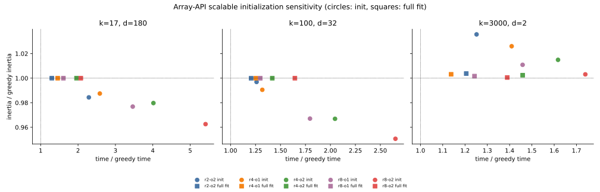
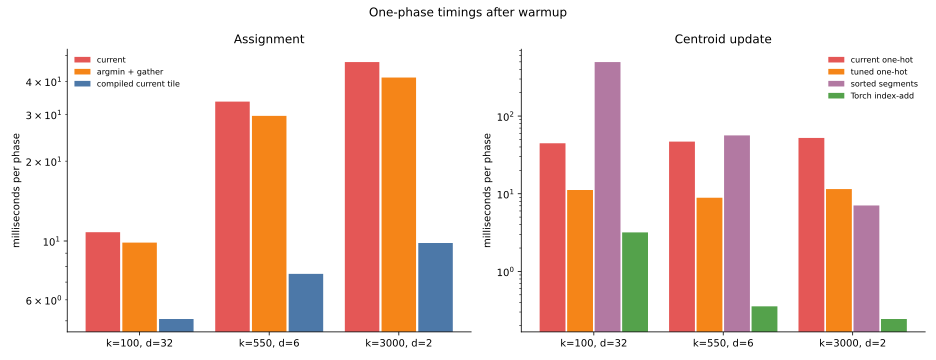
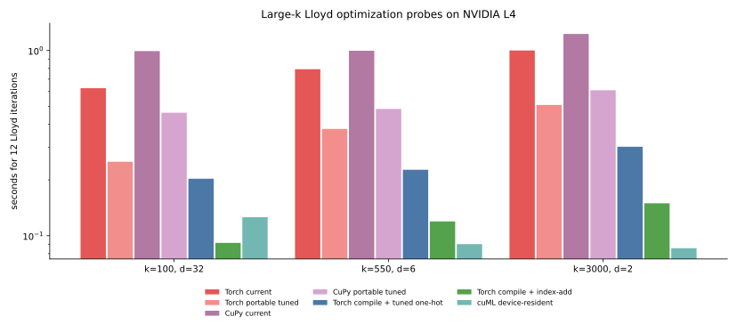

# 013 — why large-k cuML Lloyd wins, and what to optimize next

This iteration answers two questions raised by the consolidated results in
[011](../011-consolidated-benchmark/report.md):

1. Is the current array-API scalable k-means++ ever competitive with its
   greedy alternative?
2. Why does cuML overtake PyTorch CUDA in Lloyd iterations as `k` grows, and
   which changes have the best chance of closing that gap?

The short answers are:

- **No, not for these tasks and this single-start, 12-iteration workload.**
  Scalable initialization can lower inertia before Lloyd, but every tested
  configuration costs more than greedy k-means++, and Lloyd erases that
  quality advantage.
- **The large-`k` Lloyd gap is structural, not a faster GEMM.** cuVS fuses
  distance evaluation with the top-1 reduction and updates centroids with
  keyed reductions. The current array-API code materializes score tiles,
  reduces each tile twice, and builds about 400 one-hot membership tiles per
  iteration.
- **There is a clear path forward.** Portable tile and reduction changes
  roughly halve the 12-iteration time on both PyTorch and CuPy. A compiled
  PyTorch assignment plus a native keyed update is faster than the cuML times
  reported in 011, although device-resident cuML remains faster in the
  isolated kernel comparison.

## Experimental scope

All new GPU measurements run on the same NVIDIA L4 as 011, with float32 and
TF32 disabled. Times are medians of three measurements after warmup.

- The phase probes use the seed-0 shared random rows and time assignment and
  update independently.
- The portable end-to-end probe calls the production `fit_lloyd` for 12 fixed
  iterations on PyTorch and CuPy.
- The compiled and native-update controls use a small interchangeable-phase
  loop. They measure optimization potential, not a new public implementation.
- The cuML scaling probe passes a CuPy array to `KMeans.fit`, so data is
  already on the GPU. The 011 cuML rows instead pass a NumPy array and include
  host-to-device transfer, while the array-API timer starts after its transfer.
- Scalable-init sensitivity covers seeds 0 through 2 on `k17-d180`,
  `k100-d32`, and `k3000-d2`.

The drivers and raw data are
[`probe_lloyd_large_k.py`](https://github.com/ogrisel/cursor-sandbox/blob/b0a5d9bf758e6fcd39f554a25ccc0176379c032e/kmeans_lloyd/scripts/probe_lloyd_large_k.py),
[`probe_portable_lloyd.py`](https://github.com/ogrisel/cursor-sandbox/blob/b0a5d9bf758e6fcd39f554a25ccc0176379c032e/kmeans_lloyd/scripts/probe_portable_lloyd.py),
[`probe_cuml_lloyd_scaling.py`](https://github.com/ogrisel/cursor-sandbox/blob/b0a5d9bf758e6fcd39f554a25ccc0176379c032e/kmeans_lloyd/scripts/probe_cuml_lloyd_scaling.py),
[lloyd-probes.json](lloyd-probes.json),
[portable-results.json](portable-results.json), and
[scalable-sensitivity.json](scalable-sensitivity.json).

## Scalable k-means++ is dominated here

The figure plots each scalable configuration relative to greedy k-means++.
Circles are initialization alone; squares are initialization followed by 12
Lloyd iterations. A point is competitive only if it approaches the lower-left
corner `(1, 1)`.



`r4-o1`, for example, means four sampling rounds with oversampling factor 1.
The current default is `r8-o2`.

| init only | k17-d180 | k100-d32 | k3000-d2 |
| --- | --- | --- | --- |
| r2-o2 | 2.24x time, 0.9844x inertia | 1.26x time, 0.9969x inertia | 1.24x time, 1.0356x inertia |
| r4-o1 | 2.52x time, 0.9875x inertia | 1.32x time, 0.9905x inertia | 1.42x time, 1.0260x inertia |
| r4-o2 | 3.93x time, 0.9797x inertia | 2.05x time, 0.9669x inertia | 1.60x time, 1.0149x inertia |
| r8-o1 | 3.37x time, 0.9768x inertia | 1.80x time, 0.9671x inertia | 1.76x time, 1.0109x inertia |
| r8-o2 default | 5.31x time, 0.9626x inertia | 2.66x time, 0.9506x inertia | 1.72x time, 1.0031x inertia |

| full fit | k17-d180 | k100-d32 | k3000-d2 |
| --- | --- | --- | --- |
| r2-o2 | 1.32x time, 1.0000x inertia | 1.21x time, 0.9999x inertia | 1.20x time, 1.0037x inertia |
| r4-o1 | 1.47x time, 1.0000x inertia | 1.21x time, 0.9999x inertia | 1.14x time, 1.0032x inertia |
| r4-o2 | 1.92x time, 1.0000x inertia | 1.40x time, 1.0000x inertia | 1.43x time, 1.0024x inertia |
| r8-o1 | 1.61x time, 1.0000x inertia | 1.30x time, 1.0000x inertia | 1.24x time, 1.0017x inertia |
| r8-o2 default | 2.08x time, 1.0000x inertia | 1.65x time, 1.0000x inertia | 1.39x time, 1.0005x inertia |

The strongest initial gains are real: the default lowers pre-Lloyd inertia by
3.7% at 17 clusters and 4.9% at 100 clusters. They are not useful in this
workload. At 17 clusters, greedy initialization plus all 12 Lloyd iterations
already finishes in 1.25 s, less than the scalable initializer alone at
1.66 s. After Lloyd, every scalable result at 17 and 100 clusters agrees with
greedy within 0.01%, while taking 21% to 108% longer. At 3000 clusters,
scalable initialization is worse before and after Lloyd for every setting.

This does not disprove scalable k-means++ as an algorithm. Its intended
advantages are parallel and distributed candidate sampling, and it can matter
when one greedy D² pass per selected center is prohibitive. Those conditions
are absent from this single-GPU task mix. The present implementation should
remain experimental rather than become the default.

## Why cuML Lloyd gets faster as `k` grows

The 011 times include substantial fixed costs. Fitting cuML from a NumPy
array includes transfer to the GPU; the array-API timer starts after its data
is resident. Repeating the cuML measurement with a CuPy input exposes the
actual iteration cost:

| task | PyTorch current, 12 iterations | cuML from NumPy, 12 iterations | cuML from CuPy, 12 iterations | fitted PyTorch cost / iteration | fitted device-cuML cost / iteration |
| --- | --- | --- | --- | --- | --- |
| k100-d32 | 0.812 s | 0.615 s | 0.126 s | 48.8 ms | 8.6 ms |
| k550-d6 | 1.033 s | 0.511 s | 0.090 s | 67.7 ms | 6.1 ms |
| k3000-d2 | 1.407 s | 0.377 s | 0.086 s | 101.4 ms | 6.0 ms |

The fitted costs are slopes through `max_iter` 1, 4, and 12. cuML has a
higher fixed cost with NumPy input, which is why PyTorch wins the small-`k`
cases in 011. Once enough iterations or clusters amortize that cost, cuML's
much cheaper iteration dominates.

### Assignment

On the L4, cuVS always selects its fused path:
[`use_fused`](https://github.com/NVIDIA/cuvs/blob/v26.10.00/cpp/src/cluster/detail/kmeans_common.cuh#L60-L82)
selects it for compute capability major version 8, and the L4 is 8.9.
[`fusedDistanceNNMinReduce`](https://github.com/NVIDIA/cuvs/blob/v26.10.00/cpp/src/cluster/detail/minClusterDistanceCompute.cu#L30-L75)
computes distances and returns one
`KeyValuePair<label, distance>` per sample without materializing a distance
matrix. [Sample norms are computed
once](https://github.com/NVIDIA/cuvs/blob/v26.10.00/cpp/src/cluster/detail/kmeans.cuh#L819-L835)
before the iteration loop.

The array-API assignment makes a score tile, calls `argmin`, calls `min` over
the same tile, then merges that tile's result into a running minimum. The
current schedules are:

| task | assignment tiles | update membership tiles | assignment | update |
| --- | ---: | ---: | ---: | ---: |
| k100-d32 | 23 | 367 | 10.8 ms | 44.6 ms |
| k550-d6 | 27 | 387 | 33.6 ms | 47.0 ms |
| k3000-d2 | 36 | 396 | 47.3 ms | 52.3 ms |

The task arithmetic actually falls from about 4.8 billion multiply-add terms
at `k100-d32` to 0.81 billion at `k3000-d2`. PyTorch gets slower because the
low-dimensional GEMMs and hundreds of small reductions use the GPU poorly;
the work is no longer proportional to useful floating-point operations.

### Centroid update

cuVS passes the labels directly to
[`reduce_rows_by_key` and
`reduce_cols_by_key`](https://github.com/NVIDIA/cuvs/blob/v26.10.00/cpp/src/cluster/detail/kmeans_common.cuh#L523-L560)
for feature sums and cluster weights. Those are keyed (segmented) reductions:
for every row, add its feature vector into the bucket named by its label, and
add one into that bucket's count. No buffer proportional to `n_samples x
n_clusters` is ever materialized.

The [Python array API standard](https://data-apis.org/array-api/latest/)
has no such operation. It defines whole-array reductions (`sum`, `mean`,
`argmin`, ...) along an axis, but nothing that scatters contributions into
`n_clusters` buckets named by an arbitrary integer label array. Without a
keyed reduction, the only portable way to turn "sum rows that share a label"
into axis reductions is to make the label visible as an axis: build a
one-hot membership matrix and reduce along its sample axis. That is what
[`update_centroids_tiled`](https://github.com/ogrisel/cursor-sandbox/blob/92a3f4abba39d8a9a167e959debbdb5065c999f0/kmeans_lloyd/src/kmeans_lloyd/iteration.py#L288-L355)
does, one `(tile_n, tile_k)` tile at a time:

```python
# kmeans_lloyd/src/kmeans_lloyd/iteration.py, inside update_centroids_tiled
ids = xp.arange(k1 - k0, dtype=labels.dtype, device=_device(X)) + k0
membership = xp.astype(labels[:, None] == ids[None, :], X.dtype)  # (tile_n, tile_k)
counts = xp.sum(membership, axis=0)
sums = xp.matmul(xp.matrix_transpose(membership), X)              # (tile_k, n_features)
```

`labels[:, None] == ids[None, :]` is the only portable stand-in for a
scatter: it is a whole-array comparison that happens to encode "which bucket
does this row belong to" as a dense `0`/`1` matrix, which `matmul` can then
reduce. Every one of the roughly 400 tiles per iteration recomputes this
matrix and immediately discards it; none of that `tile_n x tile_k` work
represents a cluster that could not have been added to directly.

PyTorch (and CuPy, through its own non-standard API) does expose the keyed
reduction cuVS uses, just not through the array API. `Tensor.index_add_` adds
rows of `X` into `sums` at the row positions given by `labels`, in one
launch, with no intermediate matrix:

```python
# kmeans_lloyd/scripts/probe_lloyd_large_k.py, update_index_add
def update_index_add(X, labels, old):
    """Torch control for a native scatter-based centroid update."""
    sums = torch.zeros_like(old)
    sums.index_add_(0, labels, X)
    counts = torch.bincount(labels, minlength=old.shape[0]).to(X.dtype)
    return torch.where(
        counts[:, None] == 0,
        old,
        sums / torch.clamp(counts[:, None], min=1),
    )
```

This is not a drop-in replacement inside the array-API code path. `index_add_`
is a `torch.Tensor` method, not an `array_api_compat` function, so calling it
means branching on the concrete backend instead of writing one function that
runs unchanged on PyTorch, CuPy, and NumPy. CuPy has its own equivalent,
`cupyx.scatter_add(sums, labels, X)`, with the same effect and the same
unbuffered-add semantics, but a different name and import path. NumPy's is
`np.add.at(sums, labels, X)`, slower than either because it is not
vectorized on CPU. None of the three is exposed by the array API standard, so
today's single code path cannot reach any of them without an
`if xp is torch: ... elif xp is cupy: ... else: ...` fork, which is what the
["add an explicit centroid-update hook"](#2-add-an-explicit-centroid-update-hook)
recommendation below proposes to isolate behind one optional callable rather
than scatter throughout `update_centroids_tiled`.

The effect of avoiding the one-hot matrix entirely is large. Measured on the
same three large-`k` probes, with labels and final centers validated against
the current tiled implementation:

| update phase, 12 iterations of the probe loop | k100-d32 | k550-d6 | k3000-d2 |
| --- | ---: | ---: | ---: |
| current one-hot tiles (`k256`, `n4096`) | 44.6 ms | 47.0 ms | 52.3 ms |
| tuned one-hot tiles (`k100`/`k512`, `n16384`) | 11.2 ms | 8.9 ms | 11.5 ms |
| native `index_add_` | 3.18 ms | 0.36 ms | 0.24 ms |

Tuning the one-hot tile shape alone, with no backend-specific code, already
removes most of the gap: it launches about 25 tiles per iteration instead of
400, each doing more useful work per equality comparison. `index_add_`
removes the equality comparison altogether, and its cost falls as `k` grows
instead of rising, because the kernel's work is proportional to
`n_samples x n_features`, not to the number of one-hot tiles needed to cover
`n_clusters`. This is the mechanism behind the largest numbers in the
"Optimization probes" table below: the one-hot matrix is pure overhead that a
keyed reduction does not pay.

## Optimization probes



Three results stand out:

1. Replacing the second reduction with `argmin` plus
   `take_along_axis` is portable and saves 9% to 13% of assignment time.
2. Increasing the membership tile from 4096 by 256 to 16384 by up to 512
   cuts update time from 45–52 ms to 9–11 ms. It spends more memory per tile
   but launches far fewer tiles.
3. `torch.compile` cuts assignment to 5–10 ms. A native `index_add_` update
   takes 0.24–3.2 ms. Together they show that PyTorch itself is not the
   limitation; the portable schedule and missing keyed-reduction operation
   are.

The sorted-segment experiment is not a general replacement. It is fast only
at `k3000-d2`; it takes 56 ms at `k550-d6` and 496 ms at `k100-d32`, and
subtracting large cumulative sums increases the maximum center discrepancy
to between `1.7e-4` and `7.8e-4`.



| 12 iterations | k100-d32 | k550-d6 | k3000-d2 |
| --- | ---: | ---: | ---: |
| PyTorch current | 0.626 s | 0.793 s | 1.001 s |
| PyTorch portable tuned | 0.251 s | 0.377 s | 0.508 s |
| CuPy current | 0.992 s | 0.997 s | 1.228 s |
| CuPy portable tuned | 0.461 s | 0.484 s | 0.610 s |
| PyTorch compile + tuned one-hot | 0.203 s | 0.227 s | 0.302 s |
| PyTorch compile + native index-add | 0.091 s | 0.119 s | 0.150 s |
| cuML, device-resident input | 0.126 s | 0.090 s | 0.086 s |

The portable schedule is the strongest low-risk result. It is 2.0x to 2.5x
faster on PyTorch and 2.0x to 2.2x faster on CuPy. At 550 and 3000 clusters,
its peak allocator increment also falls from 138 and 132 MiB to 84 and
78 MiB on PyTorch, and to 80 and 74 MiB on CuPy. Final inertia changes by at
most `3.4e-5` relative.

Compilation plus the tuned one-hot update is 2.9x to 3.4x faster than the
current PyTorch schedule. The native-update control is 6.5x to 6.8x faster
and beats the cuML timings from 011. Device-resident cuML remains 1.3x faster
at 550 clusters and 1.7x faster at 3000 clusters, consistent with its fully
fused assignment and keyed update.

## Recommended next steps

The order matters: land the portable win first, then add optional backend
acceleration without making the portable implementation harder to reason
about.

### 1. Land the portable schedule

- Change the assignment tile to obtain labels with `argmin` and gather the
  selected score with `take_along_axis`, rather than reducing the score tile
  a second time.
- Use 16384 sample rows and up to 512 centroid columns for the GPU one-hot
  update. Use 128 centroid columns for low-dimensional, large-`k` assignment.
- Keep the existing schedule on CPU. Express the GPU choice as one documented
  memory-budget heuristic rather than backend-name conditionals.
- Re-run all five tasks on PyTorch and CuPy, including empty-center relocation,
  before changing the default. The probe covers shared random starts but not
  every initializer path.

Expected result: about 2x faster Lloyd on both CUDA backends and lower peak
memory at large `k`, with no backend-specific operations.

### 2. Add an explicit centroid-update hook

Add an optional update callable to `lloyd_step`, `fit_lloyd`, and
`fit_kmeans`, analogous to the existing assignment `step` hook. Then provide
experimental controls using PyTorch `index_add_` and the CuPy equivalent,
while retaining the one-hot array-API fallback.

This is the highest-upside change: the PyTorch control is 14x to more than
200x faster than the current update phase. It also avoids the numerical
instability of the portable sort-and-prefix-sum experiment. A production fast
path needs tests for empty clusters, deterministic behavior, dtype handling,
and agreement across all three backends.

### 3. Cache a compiled PyTorch assignment

Compile the existing score-tile callable by shape and dtype, outside the Lloyd
loop. It preserves labels exactly in these probes and cuts assignment by 2.1x
to 4.8x. Keep compilation opt-in until compile latency, dynamic last-tile
shapes, and cache behavior are measured in complete user-facing fits.

The naive compiled broadcast-distance control is not a next step: it is slower
and changes 1506 labels at `k3000-d2` because its arithmetic and tie behavior
differ.

### 4. Reassess before writing a custom fused kernel

After the keyed update and compiled assignment, PyTorch reaches 0.15 s for
the 3000-cluster probe. Only then is it worth evaluating a Triton
distance-plus-top-1 kernel analogous to cuVS. Writing that kernel first would
optimize the smaller bottleneck while leaving the one-hot update untouched.

### 5. Keep scalable initialization experimental

- Keep greedy k-means++ as the default for this task class.
- Do not tune the number of rounds further: every 2-, 4-, and 8-round result
  is dominated after Lloyd.
- If a distributed or out-of-core workload is added, revisit scalable
  initialization under a fixed wall-time budget and include the weighted
  candidate Lloyd refinement identified in 011.
- Re-run this decision after Lloyd is optimized. Faster Lloyd makes the
  current scalable initializer's fixed overhead relatively larger, not
  smaller.

## Conclusion

The 011 result is not evidence that Python or PyTorch cannot compete with
cuML at large `k`. It identifies two missing execution strategies:
fused top-1 assignment and keyed centroid reduction. The portable code can
recover roughly half the gap with better tiles and one fewer reduction. A
compiled assignment and native keyed update recover most of the rest.

By contrast, no scalable-init setting tested here reaches the greedy
time-quality frontier after Lloyd. Improving Lloyd should take priority over
further scalable-seeding work in this PR.

Previous: [source-link audit](../012-source-link-audit/report.md).
Index: [journal](../index.md).
