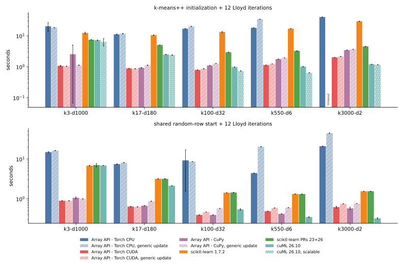
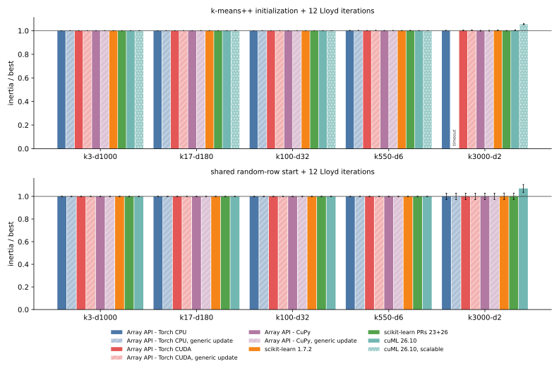
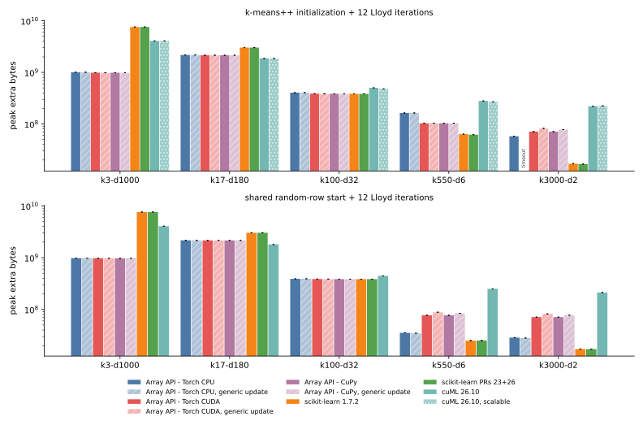
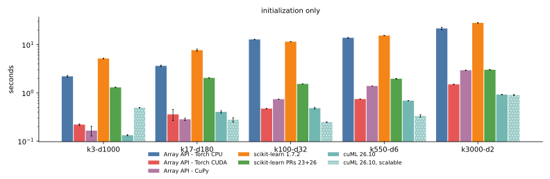

# 015 — native PyTorch and CuPy updates in the KMeans estimator

This entry adds backend-specific centroid updates to the portable `KMeans`
estimator from [014](../014-portable-array-api-kmeans/report.md) and reruns
the full five-task benchmark through the public estimator. PyTorch uses
`index_add_` plus `bincount`; CuPy uses `cupy.add.at` plus `bincount`. Every
other array API namespace keeps the portable one-hot update, and
`use_native_backends(False)` forces the portable path everywhere so that each
backend can be measured both ways on the same arrays.

The measured implementation is commit
[04848dd](https://github.com/ogrisel/cursor-sandbox/tree/04848dd752325d63aac8d33c37fca5de36900420/kmeans_lloyd):

- [`native_accumulate`](https://github.com/ogrisel/cursor-sandbox/blob/04848dd752325d63aac8d33c37fca5de36900420/kmeans_lloyd/src/kmeans_lloyd/backends.py#L37-L57)
  picks the backend callable, or `None` for the portable fallback;
- [`_torch_accumulate`](https://github.com/ogrisel/cursor-sandbox/blob/04848dd752325d63aac8d33c37fca5de36900420/kmeans_lloyd/src/kmeans_lloyd/backends.py#L60-L66)
  and
  [`_cupy_accumulate`](https://github.com/ogrisel/cursor-sandbox/blob/04848dd752325d63aac8d33c37fca5de36900420/kmeans_lloyd/src/kmeans_lloyd/backends.py#L69-L81)
  return per-cluster sums and counts;
- [`update_centroids_tiled`](https://github.com/ogrisel/cursor-sandbox/blob/04848dd752325d63aac8d33c37fca5de36900420/kmeans_lloyd/src/kmeans_lloyd/iteration.py#L292-L364)
  calls the callable when one is given, and shares the empty-cluster
  relocation with the portable path through
  [`_relocate_empty`](https://github.com/ogrisel/cursor-sandbox/blob/04848dd752325d63aac8d33c37fca5de36900420/kmeans_lloyd/src/kmeans_lloyd/iteration.py#L367-L384).

```python
def _torch_accumulate(X, labels, n_clusters):
    sums = torch.zeros((n_clusters, X.shape[1]), dtype=X.dtype, device=X.device)
    sums.index_add_(0, labels, X)
    counts = torch.bincount(labels, minlength=n_clusters).to(X.dtype)
    return sums, counts
```

Results: [fit-results.json](fit-results.json) (300 full-fit rows),
[init-results.json](init-results.json) (135 initializer rows),
[fit-first-run-array-api.json](fit-first-run-array-api.json) (the 180
array-API rows of the first run, superseded below), and the update crossover
probes [crossover-torch-cuda.json](crossover-torch-cuda.json) and
[crossover-cupy.json](crossover-cupy.json). The driver is
[bench_task_mix.py](https://github.com/ogrisel/cursor-sandbox/blob/7f1120258bb5dcc1144007f90a55a5f73cabcfb5/kmeans_lloyd/scripts/bench_task_mix.py),
the figures come from
[plot_estimator_benchmark.py](https://github.com/ogrisel/cursor-sandbox/blob/606a1591562223de1ec857624e5b90095354ea10/kmeans_lloyd/scripts/plot_estimator_benchmark.py),
and the crossover from
[probe_update_crossover.py](https://github.com/ogrisel/cursor-sandbox/blob/04848dd752325d63aac8d33c37fca5de36900420/kmeans_lloyd/scripts/probe_update_crossover.py).

## Setup

- Same five tasks, seeds, and limits as
  [011](../011-consolidated-benchmark/report.md): float32, TF32 disabled,
  `max_iter=12`, `tol=1e-8`, seeds 0 to 2, 4 CPU threads, a fresh process per
  run, and a 60-second limit per worker. One NVIDIA L4.
- Array-API rows call `KMeans(n_clusters=k, init=..., n_init=1).fit(X)` on a
  tensor or array already on the device. Each run therefore includes input
  validation, the Lloyd iterations, a final assignment, and an inertia pass.
  cuML and scikit-learn receive NumPy input as before, so cuML timings include
  the host-to-device copy.
- "generic update" rows run the same estimator with
  `use_native_backends(False)`.
- Two sections: greedy k-means++ followed by 12 Lloyd iterations, and 12
  Lloyd iterations from the same random data rows for every implementation.
  The shared-start section includes estimator overhead that 011's Lloyd-only
  rows did not have.
- Memory meters: PyTorch and CuPy pool peaks on CUDA, `VmHWM` on CPU, and
  nvidia-smi for cuML.
- Initializer rows are unchanged code and come from the first run.

## Two fixes found by the first run

The first full run, on commit
[f13c074](https://github.com/ogrisel/cursor-sandbox/tree/f13c0743ad47471ddc74d764dba8db3744ff400f/kmeans_lloyd),
exposed two problems. Both are fixed in 04848dd and every array-API row was
rerun.

**Finiteness check memory.** The estimator validated non-NumPy input with
`xp.all(xp.isfinite(X))`. CuPy fuses that into one kernel, but eager PyTorch
materializes a boolean array plus float temporaries as large as `X`. The
check is now
[`_all_finite`](https://github.com/ogrisel/cursor-sandbox/blob/04848dd752325d63aac8d33c37fca5de36900420/kmeans_lloyd/src/kmeans_lloyd/kmeans.py#L323-L338):
it tests column sums first and falls back to a tiled exact check only when a
sum is not finite, which also covers finite data whose sums overflow.

| k-means++ fit, peak extra memory | k3-d1000 | k17-d180 |
| --- | ---: | ---: |
| Torch CPU, first run | 6301 MiB | 2526 MiB |
| Torch CPU, final | 961 MiB | 2075 MiB |
| Torch CUDA, first run | 6342 MiB | 2523 MiB |
| Torch CUDA, final | 939 MiB | 2051 MiB |
| CuPy, both runs | 939 MiB | 2051 MiB |

**Atomic contention at few clusters.** On CUDA the scatter-add was slower than
the portable update on the 3-cluster, 1000-feature task: Torch CUDA k-means++
fits took 1.56 s against 1.08 s generic. With 950000 samples and 3 clusters,
each output address receives about 300000 atomic additions, while the one-hot
product is a cheap bandwidth-bound GEMM. The probe below times one update
with uniformly random labels on each task's data, sweeping `k`. Values are
generic time divided by native time; italic cells are shapes where the final
dispatch keeps the one-hot update.

| backend, samples x features | k=2 | k=3 | k=5 | k=8 | k=17 | k=32 | k=64 | k=100 |
| --- | ---: | ---: | ---: | ---: | ---: | ---: | ---: | ---: |
| Torch CUDA, 950000 x 1000 | *0.66x* | *0.54x* | *0.60x* | *0.79x* | *0.77x* | *0.89x* | 0.99x | 1.38x |
| Torch CUDA, 2100000 x 180 | *0.26x* | *0.42x* | *0.64x* | *1.07x* | 1.18x | 1.44x | 1.57x | 1.99x |
| Torch CUDA, 1500000 x 32 | 0.59x | 0.89x | 1.00x | 1.27x | 2.57x | 4.72x | 8.63x | 6.95x |
| Torch CUDA, 525000 x 6 | 4.70x | 5.26x | 6.09x | 5.94x | 7.77x | 6.85x | 10.81x | 13.81x |
| CuPy, 950000 x 1000 | *0.83x* | *0.78x* | *0.82x* | *0.86x* | 0.95x | 1.20x | 1.34x | 1.58x |
| CuPy, 2100000 x 180 | *1.25x* | 1.71x | 2.52x | 2.73x | 2.87x | 3.70x | 3.99x | 4.33x |
| CuPy, 1500000 x 32 | 3.25x | 4.73x | 7.35x | 6.08x | 11.82x | 15.71x | 16.31x | 18.19x |
| CuPy, 525000 x 6 | 6.64x | 7.02x | 8.00x | 7.24x | 9.53x | 8.92x | 13.55x | 19.24x |

The crossover depends on both `k` and the number of features `d`, and CuPy's
`add.at` tolerates contention better than PyTorch's `index_add_`. The final
dispatch keeps the one-hot update on CUDA when `16 * k < d` for PyTorch and
`64 * k < d` for CuPy. Its worst misses in this sweep are at 2 clusters:
PyTorch keeps the scatter-add at `d=32`, where it runs at 0.59x, and CuPy
keeps the one-hot update at `d=180`, where the scatter-add would be 1.25x
faster. On CPU the scatter-add won on every
task, so Torch CPU always uses it. In the benchmark, only `k3-d1000` falls on
the one-hot side, so its CUDA "native" and "generic" rows run the same code.

## Full fit after k-means++



| implementation | k3-d1000 | k17-d180 | k100-d32 | k550-d6 | k3000-d2 |
| --- | ---: | ---: | ---: | ---: | ---: |
| Array API - Torch CPU | 20.24 ± 6.30 s | 11.08 ± 0.17 s | 16.86 ± 0.17 s | 17.94 ± 0.14 s | 40.03 ± 0.54 s |
| Array API - Torch CPU, generic update | 18.23 ± 0.22 s | 11.74 ± 0.18 s | 20.06 ± 0.09 s | 34.15 ± 0.24 s | timeout |
| Array API - Torch CUDA | 1.07 ± 0.04 s | 0.88 ± 0.01 s | 0.79 ± 0.00 s | 1.14 ± 0.01 s | 2.00 ± 0.02 s |
| Array API - Torch CUDA, generic update | 1.04 ± 0.00 s | 0.86 ± 0.00 s | 0.86 ± 0.00 s | 1.23 ± 0.00 s | 2.14 ± 0.01 s |
| Array API - CuPy | 2.53 ± 2.46 s | 0.92 ± 0.01 s | 1.09 ± 0.01 s | 1.76 ± 0.01 s | 3.43 ± 0.03 s |
| Array API - CuPy, generic update | 1.12 ± 0.01 s | 1.11 ± 0.02 s | 1.27 ± 0.00 s | 1.93 ± 0.00 s | 3.64 ± 0.02 s |
| scikit-learn 1.7.2 | 12.29 ± 0.71 s | 10.52 ± 0.01 s | 13.22 ± 0.47 s | 16.91 ± 0.14 s | 29.24 ± 0.13 s |
| scikit-learn PRs 23+26 | 7.40 ± 0.05 s | 5.02 ± 0.00 s | 2.94 ± 0.02 s | 3.25 ± 0.02 s | 4.52 ± 0.01 s |
| cuML 26.10 | 7.18 ± 0.08 s | 2.50 ± 0.01 s | 0.98 ± 0.01 s | 1.01 ± 0.01 s | 1.20 ± 0.00 s |
| cuML 26.10, scalable | 6.38 ± 1.67 s | 2.39 ± 0.02 s | 0.73 ± 0.01 s | 0.64 ± 0.01 s | 1.16 ± 0.01 s |

Three cells have one slow seed, and the means above include it:

- CuPy `k3-d1000`: seed 0 took 5.38 s against 1.11 s for seeds 1 and 2. It
  was the first CuPy process after the code change and paid CuPy's one-time
  kernel compilation for the new validation reductions. A rerun with an empty
  `CUPY_CACHE_DIR` took 8.36 s, and 1.11 s once warm.
- Torch CPU `k3-d1000` (seed 2: 27.5 s against 16.6 s) and the shared-start
  Torch CPU `k100-d32` (seed 2: 18.1 s against 4.8 s): reruns of those exact
  cells took 16.5 s and 4.8 s, so these were transient host noise.



| implementation | k3-d1000 | k17-d180 | k100-d32 | k550-d6 | k3000-d2 |
| --- | ---: | ---: | ---: | ---: | ---: |
| Array API - Torch CPU | 1.0000 | 1.0000 | 1.0000 | 1.0013 | 1.0017 |
| Array API - Torch CPU, generic update | 1.0000 | 1.0000 | 1.0000 | 1.0013 | timeout |
| Array API - Torch CUDA | 1.0000 | 1.0000 | 1.0000 | 1.0007 | 1.0021 |
| Array API - Torch CUDA, generic update | 1.0000 | 1.0000 | 1.0001 | 1.0013 | 1.0034 |
| Array API - CuPy | 1.0000 | 1.0000 | 1.0001 | 1.0008 | 1.0000 |
| Array API - CuPy, generic update | 1.0000 | 1.0000 | 1.0001 | 1.0008 | 1.0000 |
| scikit-learn 1.7.2 | 1.0000 | 1.0000 | 1.0000 | 1.0009 | 1.0036 |
| scikit-learn PRs 23+26 | 1.0000 | 1.0000 | 1.0000 | 1.0013 | 1.0007 |
| cuML 26.10 | 1.0000 | 1.0000 | 1.0001 | 1.0008 | 1.0034 |
| cuML 26.10, scalable | 1.0005 | 1.0011 | 1.0000 | 1.0000 | 1.0554 |

Quality is mean inertia divided by the best mean in the same section. The
native and generic paths agree to the shown precision except where seeded
PyTorch CUDA k-means++ draws already differ across processes, as noted in
011; CuPy rows match exactly.



| implementation | k3-d1000 | k17-d180 | k100-d32 | k550-d6 | k3000-d2 |
| --- | ---: | ---: | ---: | ---: | ---: |
| Array API - Torch CPU | 961 MiB | 2075 MiB | 385 MiB | 156 MiB | 55 MiB |
| Array API - Torch CUDA | 939 MiB | 2051 MiB | 368 MiB | 98 MiB | 68 MiB |
| Array API - Torch CUDA, generic update | 939 MiB | 2051 MiB | 368 MiB | 98 MiB | 78 MiB |
| Array API - CuPy | 939 MiB | 2051 MiB | 366 MiB | 98 MiB | 68 MiB |
| Array API - CuPy, generic update | 939 MiB | 2051 MiB | 366 MiB | 98 MiB | 74 MiB |
| scikit-learn 1.7.2 | 7226 MiB | 2884 MiB | 366 MiB | 60 MiB | 16 MiB |
| scikit-learn PRs 23+26 | 7239 MiB | 2884 MiB | 366 MiB | 59 MiB | 16 MiB |
| cuML 26.10 | 3882 MiB | 1778 MiB | 478 MiB | 266 MiB | 210 MiB |
| cuML 26.10, scalable | 3880 MiB | 1768 MiB | 456 MiB | 256 MiB | 213 MiB |

The scatter-add removes the one-hot tile, which saves 6 to 10 MiB at 3000
clusters; elsewhere the assignment tiles dominate and memory is unchanged.

## Lloyd from shared random rows

| implementation | k3-d1000 | k17-d180 | k100-d32 | k550-d6 | k3000-d2 |
| --- | ---: | ---: | ---: | ---: | ---: |
| Array API - Torch CPU | 14.81 ± 0.43 s | 7.42 ± 0.13 s | 9.24 ± 7.68 s | 4.41 ± 0.01 s | 20.86 ± 0.15 s |
| Array API - Torch CPU, generic update | 16.30 ± 0.14 s | 8.09 ± 0.04 s | 8.56 ± 0.05 s | 20.34 ± 0.16 s | 44.45 ± 0.67 s |
| Array API - Torch CUDA | 0.89 ± 0.00 s | 0.64 ± 0.01 s | 0.39 ± 0.00 s | 0.49 ± 0.00 s | 0.62 ± 0.03 s |
| Array API - Torch CUDA, generic update | 0.89 ± 0.00 s | 0.63 ± 0.01 s | 0.46 ± 0.00 s | 0.59 ± 0.00 s | 0.75 ± 0.00 s |
| Array API - CuPy | 1.06 ± 0.05 s | 0.67 ± 0.00 s | 0.39 ± 0.00 s | 0.42 ± 0.00 s | 0.58 ± 0.04 s |
| Array API - CuPy, generic update | 1.00 ± 0.00 s | 0.87 ± 0.00 s | 0.58 ± 0.00 s | 0.60 ± 0.01 s | 0.76 ± 0.00 s |
| scikit-learn 1.7.2 | 6.79 ± 0.06 s | 3.17 ± 0.00 s | 1.42 ± 0.00 s | 1.32 ± 0.01 s | 1.54 ± 0.00 s |
| scikit-learn PRs 23+26 | 7.02 ± 0.63 s | 3.18 ± 0.02 s | 1.44 ± 0.01 s | 1.31 ± 0.01 s | 1.55 ± 0.01 s |
| cuML 26.10 | 6.88 ± 0.03 s | 2.12 ± 0.02 s | 0.54 ± 0.02 s | 0.35 ± 0.01 s | 0.32 ± 0.01 s |

Every implementation reaches the same objective within 0.07% on all tasks,
except cuML at 3000 clusters, which keeps empty centers and ends 6.99% above
the best, as in 011.

## Native speedup over the generic update

Generic time divided by native time, from the seed means above.

| backend, start | k3-d1000 | k17-d180 | k100-d32 | k550-d6 | k3000-d2 |
| --- | ---: | ---: | ---: | ---: | ---: |
| Torch CPU, k-means++ | 0.90x | 1.06x | 1.19x | 1.90x | generic times out |
| Torch CPU, shared rows | 1.10x | 1.09x | 0.93x | 4.61x | 2.13x |
| Torch CUDA, k-means++ | 0.97x (same code) | 0.98x | 1.09x | 1.08x | 1.07x |
| Torch CUDA, shared rows | 1.00x (same code) | 0.99x | 1.17x | 1.21x | 1.22x |
| CuPy, k-means++ | 0.44x (same code) | 1.21x | 1.16x | 1.10x | 1.06x |
| CuPy, shared rows | 0.94x (same code) | 1.29x | 1.47x | 1.43x | 1.31x |

The two Torch CPU cells below 1x come from the noisy seed-2 runs above:
without seed 2 they are 1.10x and 1.78x. The CuPy `k3-d1000` k-means++ cell
reflects the one-time kernel compilation.

## Comparison with 011

011 called the Lloyd loop directly, with the earlier tile schedule and the
one-hot update; 015 goes through the estimator with the tile schedule chosen
in 014 and the native update. Seed means, k-means++ full fit:

| implementation | k3-d1000 | k17-d180 | k100-d32 | k550-d6 | k3000-d2 |
| --- | ---: | ---: | ---: | ---: | ---: |
| Torch CPU, 011 | 17.31 s | 11.21 s | 25.88 s | 53.53 s | timeout |
| Torch CPU, 015 | 20.24 s | 11.08 s | 16.86 s | 17.94 s | 40.03 s |
| Torch CUDA, 011 | 0.94 s | 1.25 s | 1.20 s | 1.66 s | 2.62 s |
| Torch CUDA, 015 | 1.07 s | 0.88 s | 0.79 s | 1.14 s | 2.00 s |
| CuPy, 011 | 1.13 s | 1.77 s | 1.79 s | 2.44 s | 4.32 s |
| CuPy, 015 | 2.53 s | 0.92 s | 1.09 s | 1.76 s | 3.43 s |
| cuML 26.10 | 7.18 s | 2.50 s | 0.98 s | 1.01 s | 1.20 s |

The shared-start rows, 011 Lloyd-only against 015 estimator fit:

| implementation | k3-d1000 | k17-d180 | k100-d32 | k550-d6 | k3000-d2 |
| --- | ---: | ---: | ---: | ---: | ---: |
| Torch CUDA, 011 | 0.77 s | 1.01 s | 0.79 s | 0.98 s | 1.25 s |
| Torch CUDA, 015 | 0.89 s | 0.64 s | 0.39 s | 0.49 s | 0.62 s |
| CuPy, 011 | 0.96 s | 1.54 s | 1.07 s | 1.07 s | 1.39 s |
| CuPy, 015 | 1.06 s | 0.67 s | 0.39 s | 0.42 s | 0.58 s |
| cuML 26.10 | 6.88 s | 2.12 s | 0.54 s | 0.35 s | 0.32 s |

From 17 clusters up, most of the GPU gain over 011 comes from the tile
schedule: the shared-start generic rows are already 1.6x to 1.8x faster than
011. The native update adds another 1.2x to 1.5x from 100 clusters up. At 3 clusters,
015 is about 0.1 s slower because the estimator adds validation, a final
assignment, and an inertia pass over the 3.8 GB input.

## Initialization only

Greedy k-means++ does not use the centroid update, so these rows only check
that the initializer still matches 011.



| implementation | k3-d1000 | k17-d180 | k100-d32 | k550-d6 | k3000-d2 |
| --- | ---: | ---: | ---: | ---: | ---: |
| Array API - Torch CPU | 2.20 s | 3.62 s | 12.73 s | 13.79 s | 21.54 s |
| Array API - Torch CUDA | 0.22 s | 0.36 s | 0.47 s | 0.74 s | 1.49 s |
| Array API - CuPy | 0.16 s | 0.28 s | 0.74 s | 1.38 s | 2.93 s |
| scikit-learn 1.7.2 | 5.14 s | 7.65 s | 11.45 s | 15.34 s | 28.06 s |
| scikit-learn PRs 23+26 | 1.30 s | 2.04 s | 1.53 s | 1.96 s | 3.00 s |
| cuML 26.10 | 0.13 s | 0.40 s | 0.48 s | 0.69 s | 0.92 s |
| cuML 26.10, scalable | 0.49 s | 0.28 s | 0.25 s | 0.33 s | 0.90 s |

Every row is within 0.2 s or 10% of 011. Quality and memory are in
[init-quality.svg](init-quality.svg) and [init-memory.svg](init-memory.svg);
they repeat 011's conclusions.

## Conclusions

- The native PyTorch and CuPy updates are now the default for those
  namespaces, with the portable update kept for every other namespace and for
  wide CUDA inputs with few clusters.
- On CUDA, the native update speeds up k-means++ fits by 1.06x to 1.21x and
  shared-start fits by 1.17x to 1.47x, from 17 clusters up on CuPy and from
  100 clusters up on PyTorch. Assignment now dominates the remaining time.
- Torch CPU gains the most: 1.9x on the 550-cluster k-means++ fit, 4.6x on
  its shared-start fit, and the 3000-cluster k-means++ fit now finishes in
  40 s instead of timing out.
- PyTorch CUDA and CuPy now beat cuML's shared-start Lloyd at 100 clusters
  (0.39 s against 0.54 s) and stay faster at 3 and 17 clusters. cuML remains
  faster at 550 and 3000 clusters, by 1.2x to 1.9x. For k-means++ fits, cuML
  greedy is faster at 550 and 3000 clusters and cuML scalable from 100
  clusters up; greedy initialization alone costs 0.5 to 2.9 s on the
  array-API backends there.
- Two estimator-level fixes came out of the first run: a finiteness check
  without input-sized temporaries, which recovers 5.3 GiB of PyTorch memory
  on the widest task, and a backend-specific `k`-versus-`d` crossover for the
  scatter-add.

Previous: [portable array-API KMeans](../014-portable-array-api-kmeans/report.md).
Next: [GEMM versus broadcast distances](../016-gemm-vs-broadcast-distances/report.md).
Index: [journal](../index.md).
