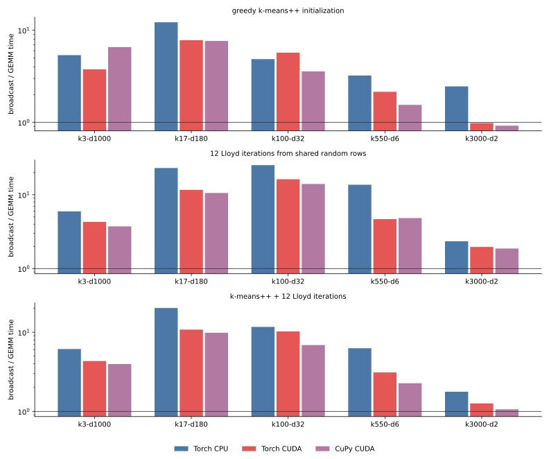
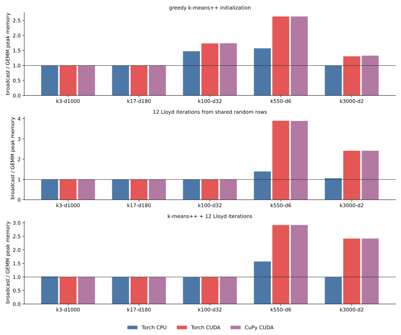
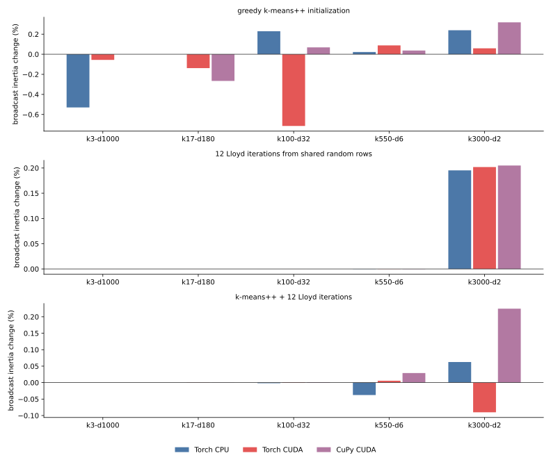

# 016 — GEMM versus broadcast distances across KMeans phases

This experiment replaces the Gram-identity distance

```python
||x - c||² = ||x||² + ||c||² - 2 x @ c.T
```

with direct broadcasting

```python
sum((x[:, None, :] - c[None, :, :]) ** 2, axis=-1)
```

in greedy k-means++ initialization, Lloyd iterations from shared centers, and
the full fit. The comparison covers PyTorch CPU, PyTorch CUDA, and CuPy CUDA.
The centroid update is unchanged: every row uses the native update from
[015](../015-native-backend-estimator-benchmark/report.md), so only distance
evaluation differs.

The implementation and driver are pinned to commit
[c7b001e](https://github.com/ogrisel/cursor-sandbox/tree/c7b001e720798ebc5e48bb5bcba2ed760d4bac2b/kmeans_lloyd):

- [`broadcast_scores_argmin`](https://github.com/ogrisel/cursor-sandbox/blob/c7b001e720798ebc5e48bb5bcba2ed760d4bac2b/kmeans_lloyd/src/kmeans_lloyd/iteration.py#L257-L268)
  is the broadcast equivalent of the GEMM tile step;
- [`broadcast_distances_to_candidates_tiled`](https://github.com/ogrisel/cursor-sandbox/blob/c7b001e720798ebc5e48bb5bcba2ed760d4bac2b/kmeans_lloyd/src/kmeans_lloyd/iteration.py#L907-L928)
  supplies broadcast distances to greedy k-means++;
- [`kmeans_plusplus`](https://github.com/ogrisel/cursor-sandbox/blob/c7b001e720798ebc5e48bb5bcba2ed760d4bac2b/kmeans_lloyd/src/kmeans_lloyd/iteration.py#L519-L568)
  uses the selected distance for the first center too;
- [`_broadcast_tile_n`](https://github.com/ogrisel/cursor-sandbox/blob/c7b001e720798ebc5e48bb5bcba2ed760d4bac2b/kmeans_lloyd/scripts/bench_distance_formulations.py#L40-L49)
  bounds each 3D difference tile;
- [`worker`](https://github.com/ogrisel/cursor-sandbox/blob/c7b001e720798ebc5e48bb5bcba2ed760d4bac2b/kmeans_lloyd/scripts/bench_distance_formulations.py#L191-L250)
  measures one fresh-process row.

[results.json](results.json) contains all 270 final rows. [tables.md](tables.md)
contains every raw mean, standard deviation, and ratio.

## Setup

- The five tasks from 011–015: `k3-d1000`, `k17-d180`, `k100-d32`,
  `k550-d6`, and `k3000-d2`; float32; three seeds; 4 CPU threads; TF32
  disabled; `max_iter=12`; `tol=1e-8`; one NVIDIA L4.
- `init`: greedy k-means++ only. Quality is mean squared distance from every
  sample to its nearest returned center. This quality pass is outside the
  measured time and memory.
- `lloyd`: 12 iterations from the same random data rows for both formulas,
  followed by a final assignment and direct assigned-distance inertia.
- `fit`: greedy k-means++ followed by the same Lloyd measurement.
- GEMM uses the tuned estimator schedule. Broadcast uses the same centroid
  tile but reduces the sample tile enough to cap
  `(tile_n, tile_k, n_features)` at 128 MiB. Without this cap, the estimator's
  widest CUDA GEMM tile could request tens of GiB as a broadcast
  temporary. The cap applies to the difference tensor; eager evaluation can
  briefly retain its squared tensor too.
- GPU workers warm the selected distance primitive before measurement. CPU
  input is fully loaded before the `VmHWM` baseline. CUDA memory is the
  backend allocator peak above its baseline.
- The initial suite used a 60 s worker cap. The 30 censored CPU broadcast
  rows were selectively rerun with 240 s, and the two longest repetitions
  with 360 s. Every final row completed; the longest call took 237.0 s.

## Time



Values are broadcast mean divided by GEMM mean. Less than 1 favors broadcast.

| phase and backend | k3-d1000 | k17-d180 | k100-d32 | k550-d6 | k3000-d2 |
| --- | ---: | ---: | ---: | ---: | ---: |
| init, Torch CPU | 5.37x | 12.20x | 4.86x | 3.22x | 2.46x |
| init, Torch CUDA | 3.76x | 7.80x | 5.70x | 2.14x | **0.98x** |
| init, CuPy CUDA | 6.56x | 7.65x | 3.57x | 1.55x | **0.92x** |
| Lloyd, Torch CPU | 5.96x | 23.01x | 25.18x | 13.67x | 2.34x |
| Lloyd, Torch CUDA | 4.28x | 11.64x | 16.22x | 4.67x | 1.96x |
| Lloyd, CuPy CUDA | 3.73x | 10.56x | 14.01x | 4.83x | 1.87x |
| fit, Torch CPU | 6.14x | 20.22x | 11.67x | 6.27x | 1.77x |
| fit, Torch CUDA | 4.32x | 10.79x | 10.24x | 3.11x | 1.26x |
| fit, CuPy CUDA | 3.96x | 9.85x | 6.88x | 2.27x | 1.06x |

GEMM wins 43 of 45 phase/backend/task comparisons. The exceptions are only
initializer-only at 3000 clusters and 2 features: broadcast takes 1.41 s
against 1.43 s on Torch CUDA and 2.68 s against 2.92 s on CuPy. At two
features, direct subtraction is cheap, and k-means++ compares only 10
candidates per round; avoiding the norm and matrix-product setup narrowly
wins.

Lloyd and full fit still favor GEMM at that endpoint because assignment
compares 128-centroid tiles rather than the initializer's 10 candidates.
Even there, the gap contracts to 1.87–1.96x for Lloyd and 1.06–1.77x for
full fit. The worst region is the middle of the task mix: at 17–100 clusters,
broadcast Lloyd is 10.6–25.2x slower, and full fit is 6.9–20.2x slower.

For scale, full-fit raw means are:

| backend and method | k3-d1000 | k17-d180 | k100-d32 | k550-d6 | k3000-d2 |
| --- | ---: | ---: | ---: | ---: | ---: |
| Torch CPU, GEMM | 17.33 s | 11.56 s | 17.89 s | 18.72 s | 41.81 s |
| Torch CPU, broadcast | 106.30 s | 233.77 s | 208.75 s | 117.36 s | 74.09 s |
| Torch CUDA, GEMM | 0.92 s | 0.75 s | 0.67 s | 1.01 s | 1.87 s |
| Torch CUDA, broadcast | 3.99 s | 8.13 s | 6.89 s | 3.14 s | 2.36 s |
| CuPy CUDA, GEMM | 1.01 s | 0.84 s | 1.02 s | 1.71 s | 3.42 s |
| CuPy CUDA, broadcast | 4.01 s | 8.27 s | 7.03 s | 3.88 s | 3.63 s |

## Memory



| phase and backend | k3-d1000 | k17-d180 | k100-d32 | k550-d6 | k3000-d2 |
| --- | ---: | ---: | ---: | ---: | ---: |
| init, Torch CPU | 1.00x | 1.00x | 1.47x | 1.57x | 0.99x |
| init, Torch CUDA | 1.00x | 1.00x | 1.73x | 2.63x | 1.31x |
| init, CuPy CUDA | 1.00x | 1.00x | 1.74x | 2.63x | 1.33x |
| Lloyd, Torch CPU | 1.00x | 1.00x | 1.00x | 1.40x | 1.06x |
| Lloyd, Torch CUDA | 1.00x | 1.00x | 1.00x | 3.90x | 2.42x |
| Lloyd, CuPy CUDA | 1.00x | 1.00x | 1.00x | 3.89x | 2.42x |
| fit, Torch CPU | 1.02x | 1.00x | 0.99x | 1.57x | 0.99x |
| fit, Torch CUDA | 1.00x | 1.00x | 1.00x | 2.92x | 2.42x |
| fit, CuPy CUDA | 1.00x | 1.00x | 1.01x | 2.92x | 2.42x |

Broadcast never gives a material memory saving. On the wide tasks, input-sized
row-norm and assignment buffers set the peak, hiding the bounded broadcast
tile. At 550 clusters and 6 features, where those buffers are small, broadcast
raises CUDA peak memory from 74 to 286–287 MiB for Lloyd (3.9x), and from 98
to 286 MiB for full fit (2.9x). At 3000 clusters and 2 features it raises full
fit from 68 to 164 MiB (2.4x).

The near-1.0 CPU ratios include `VmHWM` measurement granularity and retained
allocator effects. The apparent 0.99x values are noise, not broadcast
allocating less.

## Quality



The distance formulas are mathematically equivalent but not bitwise
equivalent in float32. Greedy k-means++ feeds distances into weighted random
sampling, so roundoff can select different centers and change initializer
quality in either direction:

- broadcast initializer inertia ranges from 0.71% lower to 0.32% higher than
  GEMM across all measured cells;
- from shared centers, the first four Lloyd tasks agree within 0.0004%;
- the quantized 3000-cluster task ends 0.20% higher with broadcast from shared
  centers on all three backends, because small score differences alter ties
  and subsequent empty-center relocation;
- after full fit, broadcast ranges from 0.09% lower to 0.22% higher. There is
  no consistent quality advantage for either formula.

| full-fit broadcast inertia change | k3-d1000 | k17-d180 | k100-d32 | k550-d6 | k3000-d2 |
| --- | ---: | ---: | ---: | ---: | ---: |
| Torch CPU | 0.0000% | -0.0001% | -0.0018% | -0.0377% | +0.0626% |
| Torch CUDA | 0.0000% | -0.0004% | +0.0011% | +0.0057% | -0.0902% |
| CuPy CUDA | 0.0000% | +0.0002% | +0.0012% | +0.0291% | +0.2246% |

Every Lloyd and full-fit run executes all 12 iterations, so these quality
differences are not caused by different convergence iteration counts.

## Conclusion

- Keep GEMM as the default distance formulation on CPU and CUDA. It is faster
  in every Lloyd and full-fit cell, usually by a large factor, and uses equal
  or less peak memory.
- Direct broadcast is competitive only for initializer-only work with
  extremely low feature dimension: at `k3000-d2` it is 2% faster on Torch
  CUDA and 8% faster on CuPy. That narrow win does not survive the Lloyd
  phase and does not justify a second production path.
- Broadcast is not a memory optimization even with a strict 128 MiB tile cap.
  Its eager 3D intermediates raise measured CUDA peaks by as much as 3.9x.
- Quality is effectively neutral: formulation roundoff perturbs stochastic
  initialization and quantized ties, but final inertia stays within 0.23%.

Previous: [native backend updates in the estimator](../015-native-backend-estimator-benchmark/report.md).
Next: [GEMM cancellation fallback](../017-gemm-cancellation-fallback/report.md).
Index: [journal](../index.md).
