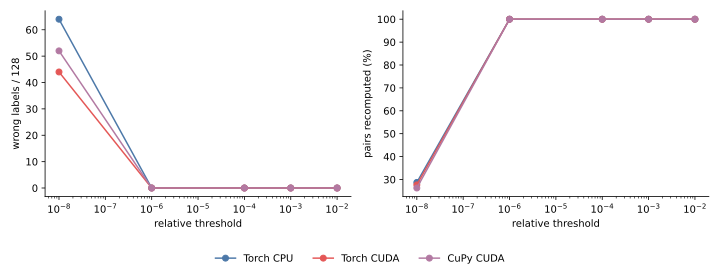
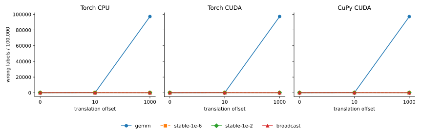
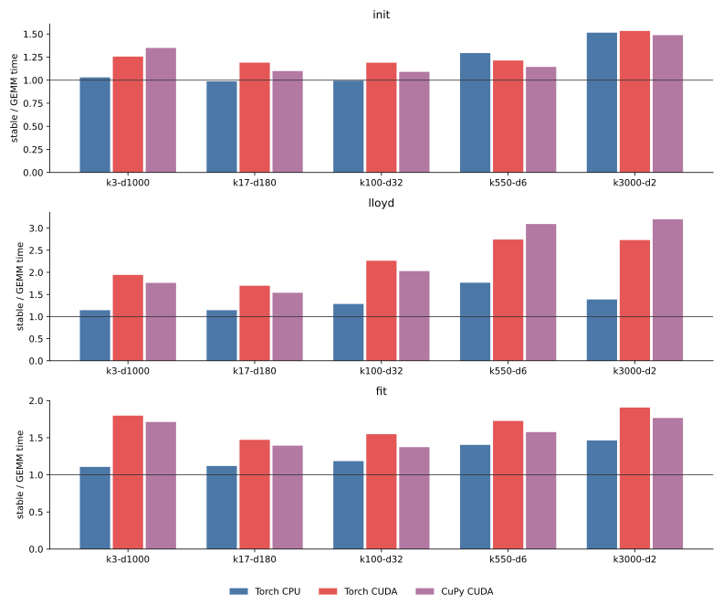
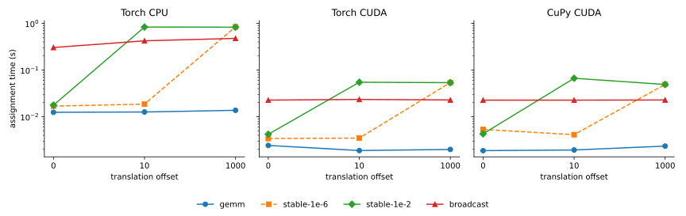

# 017 — Catastrophic cancellation and a direct-distance fallback

The GEMM identity

```python
||x - c||² = ||x||² + ||c||² - 2 x @ c.T
```

subtracts three large, rounded terms when `x` and `c` are close but far from
the origin. The result can be zero, negative, or large enough to change the
nearest center even though the true squared distance is small. Clamping the
result to zero removes negative distances but does not recover the lost
precision.

This experiment evaluates the safeguard from
[cakedev0/scikit-learn#23](https://github.com/cakedev0/scikit-learn/pull/23):
if the GEMM result is less than a dtype-specific fraction of
`||x||² + ||c||²`, recompute that pair directly as `sum((x - c)²)`.
The referenced Cython implementation uses
[`1e-2` for float32 and `1e-8` for float64](https://github.com/cakedev0/scikit-learn/blob/7e26a5c37e1fa8031bef7da0ee43b633b07c8b9b/sklearn/cluster/_k_means_common.pyx#L171-L186)
and applies the check inside its
[pairwise loops](https://github.com/cakedev0/scikit-learn/blob/7e26a5c37e1fa8031bef7da0ee43b633b07c8b9b/sklearn/cluster/_k_means_common.pyx#L241-L265).

The array-backend prototype is pinned to commit
[`3ca8690`](https://github.com/ogrisel/cursor-sandbox/tree/3ca8690e2abc5fe3da3bded3c34d6ca2a4cf06e8/kmeans_lloyd):

- [`stable_gemm_distances`](https://github.com/ogrisel/cursor-sandbox/blob/3ca8690e2abc5fe3da3bded3c34d6ca2a4cf06e8/kmeans_lloyd/src/kmeans_lloyd/iteration.py#L271-L319)
  computes GEMM distances, gathers suspicious pairs, recomputes direct
  distances in bounded chunks, and scatters them back;
- [`stable_gemm_scores_argmin`](https://github.com/ogrisel/cursor-sandbox/blob/3ca8690e2abc5fe3da3bded3c34d6ca2a4cf06e8/kmeans_lloyd/src/kmeans_lloyd/iteration.py#L322-L338)
  uses the corrected matrix for assignment;
- [`stable_distances_to_candidates`](https://github.com/ogrisel/cursor-sandbox/blob/3ca8690e2abc5fe3da3bded3c34d6ca2a4cf06e8/kmeans_lloyd/src/kmeans_lloyd/iteration.py#L977-L988)
  applies the same correction to greedy k-means++;
- [the regression test](https://github.com/ogrisel/cursor-sandbox/blob/3ca8690e2abc5fe3da3bded3c34d6ca2a4cf06e8/kmeans_lloyd/tests/test_iteration.py#L157-L188)
  checks assignment and unique-center recovery far from the origin.

[results.json](results.json) contains the 135 ordinary stable-distance runs,
315 CPU/CUDA accuracy-probe rows, and 108 translated-assignment runs.
[tables.md](tables.md) contains the ordinary-workload time ratios and
recomputation rates.

## Setup

- Accuracy probe: 32 unique random rows repeated four times, 32 candidate
  centers, dimensions 2, 32, and 1000, translations from 0 through `1e5`,
  float32 and float64, and thresholds from `1e-8` through `1e-2`.
- Initialization regression: 10 unique two-dimensional rows repeated 50
  times, requesting all 10 centers with greedy k-means++.
- Translated assignment benchmark: 100,000 by 32 float32 rows, 100 centers,
  offsets 0, 10, and 1000, and three seeds.
- Ordinary workload benchmark: the five tasks and three phases from
  [016](../016-gemm-vs-broadcast-distances/report.md), using the `1e-2`
  float32 threshold.
- Backends: PyTorch CPU, PyTorch CUDA, and CuPy CUDA; four CPU threads; TF32
  disabled; one NVIDIA L4.
- Direct broadcast is the correctness reference. Timing and memory cover only
  the selected assignment implementation; reference calculation is outside
  measurement.

## Cancellation is a correctness problem

In the exact upstream-style float32 regression translated by `1e3`, plain
GEMM returns only 7 of 10 unique centers on CPU and 6 of 10 on both CUDA
backends. Stable GEMM returns all 10. At offsets `1e4` and `1e5`, plain GEMM
still returns only 3–6 centers while the fallback returns all 10.

| float32 k-means++, unique centers / 10 | offset `1e3` | offset `1e4` | offset `1e5` |
| --- | ---: | ---: | ---: |
| Torch CPU, GEMM | 7 | 3 | 5 |
| Torch CUDA, GEMM | 6 | 6 | 6 |
| CuPy CUDA, GEMM | 6 | 6 | 6 |
| every backend, stable | 10 | 10 | 10 |

The broader probe confirms that this is not limited to exact duplicates. At
offset `1e3`, plain float32 GEMM mislabels 104–124 of 128 rows depending on
dimension and backend; the `1e-2` fallback has zero errors. Float64 GEMM has
no label errors through offset `1e5` in this probe, although the safeguard
conservatively recomputes small residuals.



The threshold matters. `1e-8` is insufficient for float32. `1e-6` fixes the
small offset-`1e3` probe, but not the larger offset-10 benchmark below.
Cakedev0's `1e-2` threshold has zero label errors in every tested float32
case. Its conservatism is intentional: at offset 10 it marks all pairs in the
translated benchmark before cancellation becomes catastrophic.

## Assignment quality



| offset | plain GEMM wrong labels | stable `1e-6` | stable `1e-2` |
| ---: | ---: | ---: | ---: |
| 0 | 0 | 0 | 0 |
| 10 | 96–99 | 100–106 | 0 |
| 1000 | 97,141–97,213 | 0 | 0 |

Ranges span the three backends after averaging three seeds. At offset 1000,
plain GEMM's direct-reference inertia is 1.63–1.64 times broadcast inertia.
Both stable thresholds match broadcast there because both recompute all
pairs. At offset 10, only `1e-2` is reliable.

Ordinary centered-like data does not expose a material quality regression:
stable versus plain GEMM full-fit inertia ranges from `-0.0031%` to
`+0.1411%`. As with [016](../016-gemm-vs-broadcast-distances/report.md),
initializer roundoff can alter stochastic center selection, so exact inertia
equality is not expected.

## Time



On ordinary workloads, only about 0–3 pairs per million trigger in the first
four tasks. The quantized `k3000-d2` task triggers roughly 0.5% of pairs.
Despite sparse recomputation, detecting indices and gathering/scattering them
has visible eager-execution overhead:

| phase | Torch CPU stable / GEMM | Torch CUDA | CuPy CUDA |
| --- | ---: | ---: | ---: |
| initialization | 0.99–1.51x | 1.19–1.53x | 1.09–1.49x |
| Lloyd | 1.14–1.77x | 1.70–2.74x | 1.54–3.20x |
| full fit | 1.11–1.46x | 1.47–1.91x | 1.37–1.77x |

The fallback remains much faster than full broadcast when triggers are sparse.
For centered 100,000 by 32 assignment, stable `1e-2` takes 17.7 ms on CPU,
4.2 ms on Torch CUDA, and 4.3 ms on CuPy, versus 304, 22.7, and 22.7 ms for
broadcast.



The Python pair fallback loses that advantage when the trigger is dense:

| offset 1000 | GEMM | stable `1e-2` | bounded broadcast |
| --- | ---: | ---: | ---: |
| Torch CPU | 13.7 ms, wrong | 828.5 ms | 477.1 ms |
| Torch CUDA | 2.0 ms, wrong | 53.7 ms | 22.9 ms |
| CuPy CUDA | 2.4 ms, wrong | 49.1 ms | 22.8 ms |

When every pair triggers, gather/scatter stable GEMM is 1.7–2.3 times slower
than bounded broadcast, in addition to paying for the now-discarded GEMM.

## Memory

For centered translated-benchmark data, CUDA peak increments are 52–54 MiB
for GEMM, 83–86 MiB for stable GEMM, and 261 MiB for bounded broadcast. Sparse
fallback therefore keeps most of GEMM's memory advantage.

When all pairs trigger, the selected-pair index arrays and gathered rows raise
stable GEMM to 376–380 MiB, above broadcast's 261 MiB. On ordinary tasks,
stable/GEMM peak ratios range from measurement-noise-level equality up to
1.61x. Input storage dominates several large tasks, hiding smaller temporary
differences.

## Recommendation

The fallback fixes a real, severe, translation-dependent correctness failure.
Clamping GEMM distances is not enough, and `1e-6` is not a robust float32
threshold. Retain cakedev0's `1e-2` float32 and `1e-8` float64 criteria.

The current Python gather/scatter prototype is suitable evidence, not the
preferred production shape:

1. Use pair-selective direct recomputation while the suspicious fraction is
   low, preserving GEMM's time and memory advantages.
2. If a tile has a high suspicious fraction, discard its GEMM result and
   recompute the whole tile with bounded direct broadcast. This avoids large
   index and gathered-row buffers.
3. Prefer a backend-fused implementation longer term. Cakedev0's Cython loop
   tests and repairs each pair in place, avoiding the eager indexing overhead
   measured here.

Centering dense training data before fitting reduces the risk, as in
scikit-learn's estimator, but it is not a complete API-level solution:
standalone k-means++ and precomputed or externally supplied centers still need
stable distances.

Previous: [GEMM versus broadcast distances](../016-gemm-vs-broadcast-distances/report.md).
Index: [journal](../index.md).
