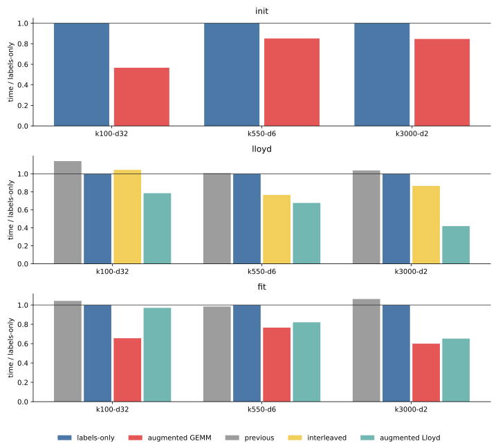
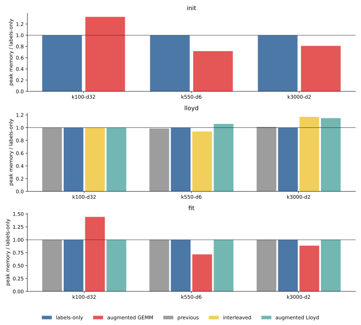
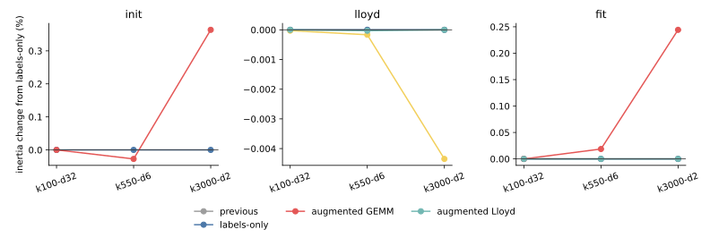

# 018 — Backend-neutral CPU optimization experiments

The previous CPU benchmark left the Python array-API estimator 3.4–13.5 times
slower than cakedev0's Cython implementation, depending on phase and task.
This iteration tests how much of that gap can be recovered without adding a
backend-specific compiled kernel. The experiments intentionally leave the
catastrophic-cancellation repair from
[017](../017-gemm-cancellation-fallback/report.md) aside so that dispatch,
tiling, and buffer costs can be isolated.

The implementation and benchmark are pinned to commit
[`6c25822`](https://github.com/ogrisel/cursor-sandbox/tree/6c25822d4beb6671e335a8f64af109b8aa7a8eac/kmeans_lloyd):

- [`gemm_labels`](https://github.com/ogrisel/cursor-sandbox/blob/6c25822d4beb6671e335a8f64af109b8aa7a8eac/kmeans_lloyd/src/kmeans_lloyd/iteration.py#L257-L260)
  removes the winning-score gather when assignment needs labels only;
- [`assign_homogeneous_tiled`](https://github.com/ogrisel/cursor-sandbox/blob/6c25822d4beb6671e335a8f64af109b8aa7a8eac/kmeans_lloyd/src/kmeans_lloyd/iteration.py#L405-L451)
  folds the center norms into an augmented matrix product;
- [`lloyd_step_interleaved`](https://github.com/ogrisel/cursor-sandbox/blob/6c25822d4beb6671e335a8f64af109b8aa7a8eac/kmeans_lloyd/src/kmeans_lloyd/iteration.py#L642-L761)
  assigns and accumulates one sample tile at a time;
- [`_row_norm_and_variance`](https://github.com/ogrisel/cursor-sandbox/blob/6c25822d4beb6671e335a8f64af109b8aa7a8eac/kmeans_lloyd/src/kmeans_lloyd/iteration.py#L1215-L1231)
  computes two input statistics in one feature-tiled pass;
- [`hierarchical_weighted_draw`](https://github.com/ogrisel/cursor-sandbox/blob/6c25822d4beb6671e335a8f64af109b8aa7a8eac/kmeans_lloyd/src/kmeans_lloyd/iteration.py#L1299-L1336)
  prototypes cakedev0-style two-level sampling;
- [`worker`](https://github.com/ogrisel/cursor-sandbox/blob/6c25822d4beb6671e335a8f64af109b8aa7a8eac/kmeans_lloyd/scripts/bench_cpu_optimizations.py#L335-L381)
  measures each method in a fresh process.

[results.json](results.json) preserves all three exploratory iterations and
the final repeated run. [tables.md](tables.md) contains the compact timing
summary.

## Setup

- PyTorch CPU, float32, four CPU threads, three seeds, 12 Lloyd iterations,
  `tol=1e-8`, and a fresh process for every row.
- Three representative tasks: 1,500,000 by 32 with 100 clusters; 525,000 by
  6 with 550 clusters; and 135,000 by 2 with 3,000 clusters.
- Initialization measures greedy k-means++ only. Lloyd starts from the same
  saved rows. Full fit includes initialization and Lloyd.
- Quality is direct assigned-distance inertia, not the cancellation-prone
  GEMM score.
- Peak memory is the process high-water mark above the post-input baseline.
- The two wide tasks from the five-task suite were omitted because retaining
  an extra augmented copy would not preserve the required 20% host-memory
  headroom.

## Iteration 1 — reduce assignment bookkeeping

The first change recognizes the common case where every center fits in one
centroid tile. Assignment then needs only `argmin(GEMM scores)`: it does not
need to gather each winning score or merge running minima across center
tiles. This labels-only path is a safe default because it is mathematically
the same assignment and does not allocate a new input-sized buffer.

It gives modest Lloyd improvements: 12% at `k100-d32`, 1% at `k550-d6`, and
4% at `k3000-d2`. Larger score tiles are not a general solution. A
`1024 × all-k` tile occasionally helps at 550 clusters, but full-cluster
tiles at 3,000 clusters take 15–19 seconds, compared with about 12 seconds
for the existing `4096 × 256` schedule. More GEMM work per call does not
offset the cache pressure and much larger score matrix.

## Iteration 2 — move and combine work

Interleaving assignment and accumulation improves locality for the
low-dimensional tasks. It reduces Lloyd from 3.70 to 2.83 seconds at
`k550-d6` and from 11.05 to 9.57 seconds at `k3000-d2`, but regresses
`k100-d32` from 2.98 to 3.11 seconds. It is useful as an optional execution
shape, not a universal default.

Two ideas modeled on cakedev0 did not transfer well to eager array operations:

- Hierarchical weighted sampling is consistently slower than the backend's
  optimized full cumulative sum and changes the random-number stream.
- Combining row norms and feature variance into one Python-tiled traversal is
  slightly slower than separate backend reductions.

`torch.compile` also does not pay on these CPU workloads. Compilation costs
2.4–3.1 seconds, and the compiled callable remains slower than the augmented
GEMM path even when compilation time is excluded. The hook remains useful for
experimentation, but compilation should not be enabled by default.

## Iteration 3 — fold score arithmetic into GEMM

For assignment, the row norm is constant across centers, so the relevant
score is

```python
-2 X @ C.T + ||C||².
```

Appending a column of ones to `X` and appending `||C||²` to `-2 C` evaluates
that score with one matrix product. The augmented sample matrix is built once
and reused throughout initialization or Lloyd. This removes one multiply and
one add over every score tile while using only standard array-API operations.



The resulting mean times are:

| phase | task | previous or labels-only | augmented GEMM | speedup |
| --- | --- | ---: | ---: | ---: |
| initialization | k100-d32 | 5.778 s | 3.271 s | 1.77x |
| initialization | k550-d6 | 3.612 s | 3.077 s | 1.17x |
| initialization | k3000-d2 | 7.238 s | 6.129 s | 1.18x |
| Lloyd | k100-d32 | 3.399 s | 2.336 s | 1.46x |
| Lloyd | k550-d6 | 3.729 s | 2.502 s | 1.49x |
| Lloyd | k3000-d2 | 11.473 s | 4.631 s | 2.48x |
| full fit | k100-d32 | 8.056 s | 5.072 s | 1.59x |
| full fit | k550-d6 | 6.882 s | 5.355 s | 1.29x |
| full fit | k3000-d2 | 18.921 s | 10.695 s | 1.77x |

For `k3000-d2`, using standard k-means++ and augmented Lloyd takes 11.629
seconds, a 1.63x full-fit speedup while preserving the baseline initializer
exactly.

## Memory and quality



The augmented representation has a workload-dependent memory cost. At
`k100-d32`, initialization peak increment grows from 298 to 396 MiB and full
fit from 453 to 654 MiB. On the low-dimensional tasks it is neutral or lower
within process high-water-mark effects: full-fit increments change from 225
to 162 MiB at `k550-d6` and from 123 to 109 MiB at `k3000-d2`. Augmented
Lloyd alone adds about 6 MiB and 14 MiB on those two tasks.

This is not a free transformation: it retains another `(n, d + 1)` array.
A production dispatch needs an explicit memory budget, especially for the
omitted wide tasks. The Python array API offers neither an `out=` matrix
product nor a reusable output-buffer contract, so cakedev0-style score-buffer
reuse cannot be expressed portably.



At `k100-d32`, augmented full fit matches baseline inertia exactly across all
seeds. Mean inertia changes by +0.019% at `k550-d6` and +0.244% at
`k3000-d2`, because small initialization-score differences change weighted
sampling. Applying augmentation only to Lloyd preserves baseline
initialization and quality. Interleaving changes results only at small
reduction-order levels.

The augmented identity has the same catastrophic-cancellation issue as the
ordinary GEMM identity. It must eventually be combined with the selective
direct-distance repair and dense-trigger broadcast fallback recommended in
[017](../017-gemm-cancellation-fallback/report.md).

## Comparison with cakedev0

The CUDA benchmark host containing the cakedev0 PR 23+26 build was
unreachable for the final run. Therefore, this report does not claim a new
same-host comparison. Applying the measured local speedups to the historical
same-host gaps from [015](../015-native-backend-estimator-benchmark/report.md)
gives a projection, not a measurement:

| phase | projected optimized / cakedev0 range |
| --- | ---: |
| initialization | 4.7–6.1x |
| Lloyd | 2.3–5.5x |
| full fit | 3.6–5.4x |

The optimizations recover a meaningful 1.2–2.5x, but they do not close the
gap. Cakedev0 still benefits from OpenMP chunk parallelism, BLAS alpha/beta
into reusable buffers, fused top-1 and per-thread accumulation, and far fewer
Python dispatches. Matching it is likely to require a compiled fused CPU
kernel rather than more eager array-expression rearrangement.

## Recommendation

1. Keep the labels-only single-center-tile path as the production default.
2. Retain augmented GEMM as an experimental path until it has a memory-budget
   guard and cancellation-safe fallback.
3. Keep interleaving as a secondary low-dimensional option.
4. Do not adopt globally larger score tiles, hierarchical sampling,
   compilation, or fused Python-level statistics based on these results.
5. If CPU parity with cakedev0 is required, add a compiled fused assignment
   and accumulation hook while preserving the portable array-API fallback.

Previous: [GEMM cancellation fallback](../017-gemm-cancellation-fallback/report.md).
Next: [CPU and GPU optimization rerun](../019-cpu-gpu-optimization-rerun/report.md).
Index: [journal](../index.md).
