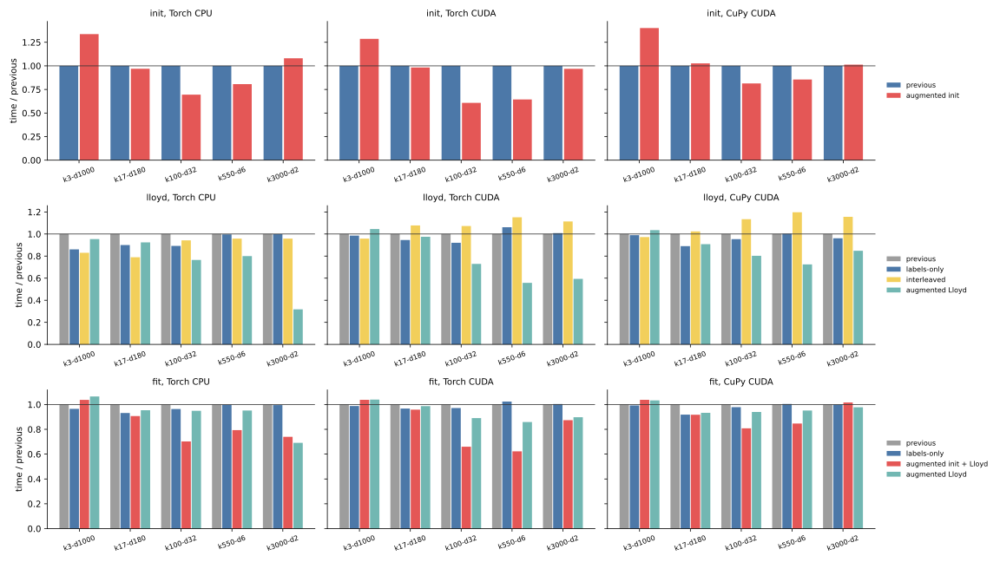
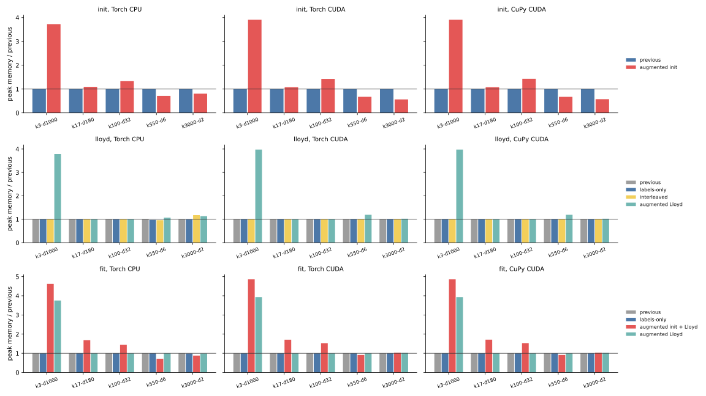
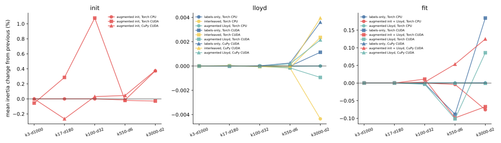

# 019 — Optimization impact on CPU and GPU, measured beside cakedev0

[018](../018-cpu-array-api-optimization/report.md) measured backend-neutral
optimizations only on a local CPU and could only project the remaining gap to
cakedev0's Cython implementation. Here the benchmark host is back. Every
method runs on Torch CPU, Torch CUDA, and CuPy CUDA across all five tasks.
Cakedev0's scikit-learn build runs on the same machine.

The measured code is commit
[`45199eb`](https://github.com/ogrisel/cursor-sandbox/tree/45199eb7cfe6653e6555b783843776be097907ae/kmeans_lloyd):

- [`assign_homogeneous_tiled`](https://github.com/ogrisel/cursor-sandbox/blob/45199eb7cfe6653e6555b783843776be097907ae/kmeans_lloyd/src/kmeans_lloyd/iteration.py#L405-L461)
  evaluates `-2 X Cᵀ + ||C||²` as one GEMM of `[X, 1]` and
  `[-2C, ||C||²]`, and gives zero coefficients to extra trailing columns;
- [`_tiles`](https://github.com/ogrisel/cursor-sandbox/blob/45199eb7cfe6653e6555b783843776be097907ae/kmeans_lloyd/scripts/bench_cpu_optimizations.py#L63-L99)
  keeps the estimator's device tile schedule on GPU for every method;
- [`_warm_gpu`](https://github.com/ogrisel/cursor-sandbox/blob/45199eb7cfe6653e6555b783843776be097907ae/kmeans_lloyd/scripts/bench_cpu_optimizations.py#L384-L390)
  runs the selected method on a small slice before timing;
- [`worker`](https://github.com/ogrisel/cursor-sandbox/blob/45199eb7cfe6653e6555b783843776be097907ae/kmeans_lloyd/scripts/bench_cpu_optimizations.py#L393-L450)
  measures one fresh-process row.

[results.json](results.json) contains the 450 final rows, the 75 first-run
rows replaced by reruns, and 45 cakedev0 rows. [tables.md](tables.md) has
every mean, standard deviation, ratio, memory peak, and inertia change.

## Setup

- One host: four CPU threads, 15 GiB RAM, and an NVIDIA L4. Float32, TF32
  disabled, three seeds, 12 Lloyd iterations, and `tol=1e-8`.
- The five tasks from 011–017: `k3-d1000`, `k17-d180`, `k100-d32`,
  `k550-d6`, and `k3000-d2`.
- `init` is greedy k-means++. `lloyd` starts from shared random rows and ends
  with a final assignment and inertia pass. `fit` is k-means++ followed by
  Lloyd. Array-API rows call these functions directly rather than the
  estimator.
- The methods compared are:
  - previous: the implementation before 018;
  - labels-only: skips the winning-score gather when every center fits in one
    center tile;
  - interleaved: assigns and accumulates one sample tile at a time;
  - augmented Lloyd: uses augmented GEMM only during Lloyd;
  - augmented init + Lloyd: also uses the augmented GEMM in k-means++ and
    reuses that matrix in Lloyd.
- CPU rows use 018's CPU tiles. GPU rows use the estimator's GPU tiles for
  every method, so only the formulation or loop shape changes.
- Cakedev0 uses `kmeans_plusplus` for initialization and
  `KMeans(n_init=1, algorithm="lloyd")` for Lloyd and full fit. Its Lloyd and
  fit rows therefore include estimator validation that the array-API rows do
  not.
- CPU memory is the `VmHWM` increment after loading the input. GPU memory is
  the allocator peak above the pre-call baseline.
- Host memory stayed above 6 GiB available, about 40% headroom, during the
  widest augmented runs.

## Iteration notes

The first full run had 10 cells with one 2–3× slower seed, the same transient
host noise seen in [015](../015-native-backend-estimator-benchmark/report.md).
All three seeds of those cells were rerun, and eight became stable. Two
remain noisy after rerun: Torch CPU previous Lloyd at `k3-d1000`
(16.5 ± 2.7 s) and augmented Lloyd at `k3000-d2` (6.6 ± 0.7 s).

The first run also exposed a CuPy-only regression: augmented init plus Lloyd
was 1.82× slower than previous at `k3-d1000`. K-means++ stores
`[X, 1, ||x||²]`, and Lloyd originally column-sliced that to `[X, 1]`. That
slice is a non-contiguous view. Timing one 950,000 by 1001 assignment pass
with three centers shows the effect:

| backend | strided `[X, 1]` view | full width, zero coefficient |
| --- | ---: | ---: |
| CuPy CUDA | 68.1 ms | 17.3 ms |
| Torch CUDA | 17.3 ms | 17.2 ms |

CuPy copies the strided operand before every matrix product; PyTorch passes
the stride to cuBLAS. `assign_homogeneous_tiled` now pads the center
coefficients with zeros instead of slicing samples. That changes CuPy full fit
from 1.672 to 0.953 s at `k3-d1000` and from 0.978 to 0.728 s at `k17-d180`.
The tables use the rerun after this fix.

## Time

Speedups over the previous implementation (greater than 1 is faster):

| phase and method | backend | k3-d1000 | k17-d180 | k100-d32 | k550-d6 | k3000-d2 |
| --- | --- | ---: | ---: | ---: | ---: | ---: |
| init, augmented | Torch CPU | 0.75x | 1.03x | 1.44x | 1.24x | 0.93x |
| init, augmented | Torch CUDA | 0.78x | 1.02x | 1.65x | 1.55x | 1.03x |
| init, augmented | CuPy CUDA | 0.71x | 0.97x | 1.23x | 1.17x | 0.99x |
| Lloyd, labels-only | Torch CPU | 1.16x | 1.11x | 1.12x | 1.00x | 1.00x |
| Lloyd, interleaved | Torch CPU | 1.20x | 1.27x | 1.06x | 1.04x | 1.04x |
| Lloyd, augmented | Torch CPU | 1.05x | 1.08x | 1.31x | 1.25x | 3.15x |
| Lloyd, augmented | Torch CUDA | 0.96x | 1.03x | 1.37x | 1.79x | 1.68x |
| Lloyd, augmented | CuPy CUDA | 0.97x | 1.10x | 1.25x | 1.38x | 1.18x |
| fit, augmented init + Lloyd | Torch CPU | 0.96x | 1.10x | 1.42x | 1.26x | 1.35x |
| fit, augmented Lloyd | Torch CPU | 0.94x | 1.05x | 1.05x | 1.05x | 1.45x |
| fit, augmented init + Lloyd | Torch CUDA | 0.96x | 1.04x | 1.52x | 1.61x | 1.14x |
| fit, augmented init + Lloyd | CuPy CUDA | 0.96x | 1.09x | 1.24x | 1.18x | 0.98x |

The augmented GEMM is the only change with large gains on every backend, and
those gains concentrate where the score tile dominates:

- Lloyd gains appear when the number of centers is at least the number of
  features: 1.25–3.15× on CPU, 1.37–1.79× on Torch CUDA, and 1.18–1.38× on
  CuPy. Removing the per-tile norm addition and scaling matters most when the
  `(tile_n, k)` score tile is much larger than the `(tile_n, d)` input tile.
  At `k3-d1000` and `k17-d180`, Lloyd changes by only 0.96–1.10×.
- Initialization loses 22–29% at `k3-d1000`: building the 3.8 GB
  augmented copy costs more than three cheap candidate scores save.
  At `k3000-d2`, the extra two columns double the GEMM width while each
  k-means++ round scores only 10 candidates, so the result is neutral or worse.
- Full fit follows the dominant phase. At `k3000-d2` on CPU, Lloyd is 3.15×
  faster, but initialization takes 21 s of the 40 s fit. Keeping the previous
  initializer and augmenting only Lloyd is best there (1.45×).

Labels-only assignment is a small CPU win (up to 1.16×) and neutral on GPU
(0.94–1.12×). Interleaving helps the two wide CPU tasks (1.20–1.27×) but
slows GPU Lloyd by 7–16% on the three larger-`k` tasks. Accumulating per sample
tile launches more small kernels than the batched update.

## Same-host comparison with cakedev0

Time divided by cakedev0 time; lower is better and less than 1 means faster
than cakedev0. "Best" is the fastest measured array-API method for each
task and phase.

| phase | row | k3-d1000 | k17-d180 | k100-d32 | k550-d6 | k3000-d2 |
| --- | --- | ---: | ---: | ---: | ---: | ---: |
| init | cakedev0 seconds | 1.237 | 1.928 | 1.494 | 1.919 | 2.994 |
| init | Torch CPU previous | 2.27x | 2.18x | 8.78x | 7.34x | 6.95x |
| init | Torch CPU best | 2.27x | 2.11x | 6.10x | 5.91x | 6.95x |
| Lloyd | cakedev0 seconds | 6.337 | 3.079 | 1.424 | 1.316 | 1.541 |
| Lloyd | Torch CPU previous | 2.60x | 2.55x | 3.84x | 3.85x | 13.49x |
| Lloyd | Torch CPU best | 2.16x | 2.02x | 2.94x | 3.09x | 4.29x |
| fit | cakedev0 seconds | 7.309 | 4.985 | 2.861 | 3.203 | 4.508 |
| fit | Torch CPU previous | 2.31x | 2.29x | 6.14x | 5.74x | 8.88x |
| fit | Torch CPU best | 2.23x | 2.07x | 4.31x | 4.55x | 6.14x |
| fit | Torch CUDA best | 0.10x | 0.12x | 0.13x | 0.17x | 0.34x |
| fit | CuPy CUDA best | 0.12x | 0.15x | 0.28x | 0.44x | 0.72x |

On CPU, the optimizations narrow the gap, most at large `k`. The worst full
fit moves from 8.88× to 6.14× slower than cakedev0, and the worst Lloyd case
from 13.49× to 4.29×. They do not close it: the best eager CPU method remains
2.1–7.0× slower for initialization, 2.0–4.3× for Lloyd, and 2.1–6.1× for full
fit. 018's projection, made from local speedups, differed from these
measurements by up to 37% in both directions.

On GPU, the array-API implementation was already faster than cakedev0 on the
host CPU. The augmented GEMM extends that lead: the best Torch CUDA full fit
is 2.9–10× faster than cakedev0, and the best CuPy fit is 1.4–8× faster.

## Memory

| peak increment (MiB) | k3-d1000 | k17-d180 | k100-d32 | k550-d6 | k3000-d2 |
| --- | ---: | ---: | ---: | ---: | ---: |
| Torch CPU fit, previous | 1008 | 2139 | 449 | 222 | 120 |
| Torch CPU fit, augmented init + Lloyd | 4656 | 3606 | 651 | 159 | 106 |
| Torch CPU fit, augmented Lloyd | 3786 | 2139 | 449 | 222 | 119 |
| Torch CUDA fit, previous | 939 | 2051 | 368 | 98 | 68 |
| Torch CUDA fit, augmented init + Lloyd | 4560 | 3509 | 563 | 90 | 70 |
| CuPy CUDA fit, augmented init + Lloyd | 4559 | 3509 | 561 | 90 | 70 |

The augmented matrix is one more input-sized array. At `k3-d1000`, it raises
full-fit peak memory from about 0.95 GiB to 4.5 GiB on every backend. That is
a poor trade at three centers, where it is also slower. On the low-dimensional
tasks the copy is small, and removing per-tile temporaries lowers
initialization peaks: 98 to 66 MiB on CUDA at `k550-d6`.

## Quality

Lloyd from shared starts agrees within 0.005% for every method and backend.
Augmented k-means++ changes floating-point rounding in the weighted sampling
distribution, so it can select different centers. Initializer quality changes
by −0.27% to +1.08%. Full-fit inertia changes by −0.10% to +0.13%. On Torch
CUDA, even mathematically equivalent labels-only full fits differ by
−0.09% to +0.18%, because Torch CUDA k-means++ draws are not reproducible
across processes (noted in [011](../011-consolidated-benchmark/report.md)).
No method shows a consistent quality regression. As discussed in
[017](../017-gemm-cancellation-fallback/report.md), the augmented
identity is as vulnerable to catastrophic cancellation as plain GEMM.

## Conclusion

- Augmented GEMM is worth a guarded production dispatch on CPU and GPU.
  "Augmented Lloyd when `k >= d`" chooses a non-losing option in all 15
  Lloyd cells, with 1.18–3.15× gains where it applies. It also needs a memory
  budget for the extra `(n, d + 1)` array and the selective cancellation
  repair from 017.
- Augmented initialization helps only at moderate dimensions with enough
  centers (`k100-d32` and `k550-d6`: 1.17–1.65×). It should not be the
  default for very wide or two-dimensional data.
- Labels-only assignment is a safe, small default. Interleaving should stay
  CPU-only and opt-in.
- On CPU, these backend-neutral changes recover up to 3.15× in Lloyd but
  remain 2.0–7.0× slower than cakedev0. Closing that gap needs a fused
  compiled kernel. On GPU, the eager array-API implementation is already
  1.4–10× faster than cakedev0 on the host CPU, and augmented GEMM adds up to
  1.79× more on Lloyd.
- CuPy needs contiguous matrix-product operands. Portable code should avoid
  column-sliced views in hot loops.

Previous: [backend-neutral CPU optimizations](../018-cpu-array-api-optimization/report.md).
Index: [journal](../index.md).
