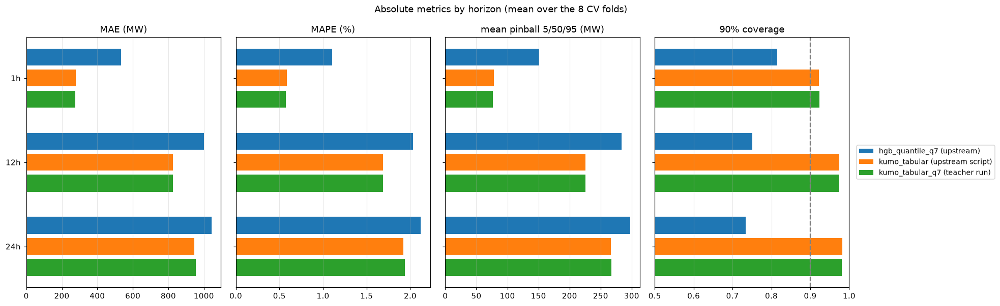
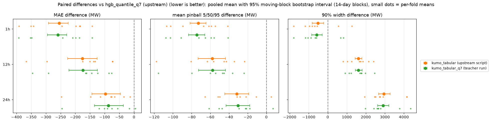
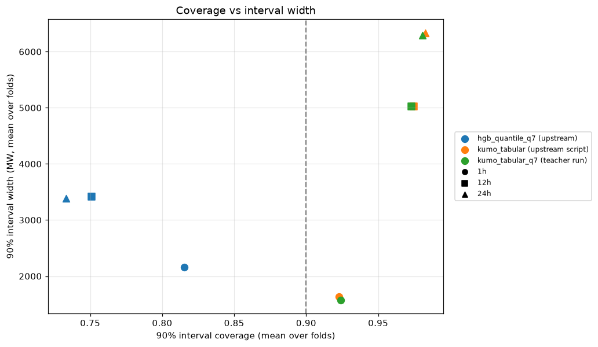
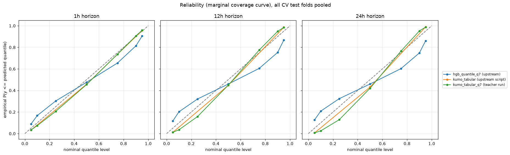
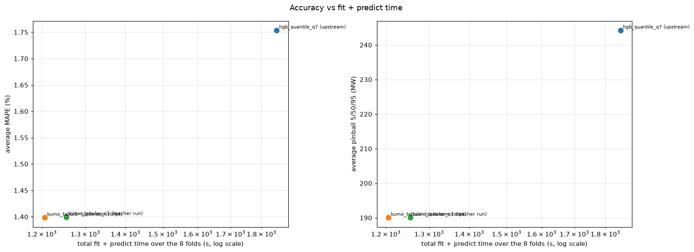
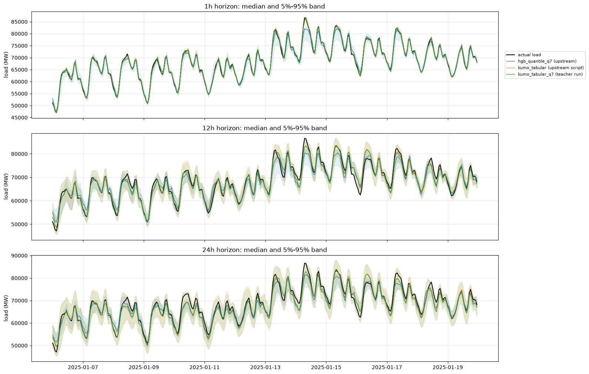

# 01: Reproduction of `kumo_tabular` and `hgb_quantile_q7`

Goal: re-run the two models of the latest
[skore-example-electricity-load report](https://probabl-ai.github.io/skore-example-electricity-load/model-comparison-forecast/cv_comparison_forecast/report.html)
(walk-forward CV with forecast weather, 8 folds of 13 weeks, horizons 1h / 12h /
24h) on the AWS L4 machine and check that the numbers match.

## Setup

- Upstream code: `probabl-ai/skore-example-electricity-load` at
  `2ef9e1cab09505e979e30eef90977c6ec7d736d1` ("add tabicl forecast", latest
  commit, 2026-11-05), installed editable in the pixi environment of this
  experiment (`kumo_distillation/pixi.toml`, Python 3.12, scikit-learn 1.9.1,
  skrub 0.11.0, polars 1.44.2, torch 2.15.0+cu132,
  `structured-data-models` at the upstream-pinned commit `78130b67`,
  Kumo-Tabular `large` weights `nvidia/Kumo-Tabular` revision `v1.0.1`).
- `hgb_quantile_q7`: upstream script, run on a 4-vCPU Intel Xeon VM:

  ```bash
  python upstream/scripts/model_comparison/cross_validate_models.py \
      --model hgb_quantile --quantiles 0.05 0.1 0.25 0.5 0.75 0.9 0.95 --tag q7 \
      --output_dir results/raw/reproduction
  ```

- `kumo_tabular`: upstream script, run on the AWS g6 machine (NVIDIA L4 24 GB,
  4-vCPU AMD EPYC 7R13, 15 GB RAM), with the 3 default quantiles and the full
  training history as context, as in the published run:

  ```bash
  python upstream/scripts/model_comparison/cross_validate_models.py \
      --model kumo_tabular --max_train_rows 0 --output_dir results/raw/reproduction
  ```

- `kumo_tabular_q7`: the same model (8 estimators, float16 autocast, full
  training set as context) called through Kumo-Tabular's cached
  `fit` / `predict` API by `scripts/gen_teacher.py`, for the 7 quantile levels
  of `hgb_quantile_q7`. These are the test predictions of the teacher used in
  the next iterations. Kumo-Tabular's ensemble members use unseeded random
  preprocessing upstream, so two runs differ slightly (mean absolute difference
  of the 1h medians between the two call paths: 27 MW on the last fold).

`scripts/check_folds.py` checks that the per-fold feature matrices built by
`scripts/folds.py` (used by all the later iterations) give exactly the same
HGB predictions as the upstream skrub DataOp on folds 0 and 7 (max abs
difference 0).

## Results

Pooled over the 8 CV folds (17,466 test rows per horizon). Upstream metric code
(`compare_predictions.compute_scores`); "pinball 5/50/95" is the mean pinball
loss over these 3 levels and horizons, "pinball q7" over the 7 levels.

| model | MAE avg | MAE 1h | MAE 12h | MAE 24h | MAPE avg (%) | pinball 5/50/95 avg | pinball q7 avg | d2 pinball avg | cov 90 avg | width 90 avg | cov 50 avg | fit+predict (s) |
|---|---:|---:|---:|---:|---:|---:|---:|---:|---:|---:|---:|---:|
| hgb_quantile_q7 (upstream) | 859 | 534 | 1001 | 1042 | 1.75 | 244 | 278 | 0.8595 | 0.766 | 2987 | 0.305 | 1851 |
| kumo_tabular (upstream script) | 683 | 279 | 825 | 945 | 1.40 | 190 | - | 0.8916 | 0.960 | 4333 | - | 1206 |
| kumo_tabular_q7 (teacher run) | 686 | 275 | 827 | 955 | 1.40 | 190 | 213 | 0.8918 | 0.959 | 4298 | 0.594 | 1255 |

Published values (same metrics, from the upstream report):

| model | MAE avg | MAE 1h | MAE 12h | MAE 24h | MAPE avg (%) | d2 pinball q0.05 / q0.5 / q0.95 | cov 90 avg | width 90 avg |
|---|---:|---:|---:|---:|---:|---|---:|---:|
| hgb_quantile_q7 (published) | 859.0 | 533.8 | 1001 | 1042 | 1.753 | 0.8179 / 0.8931 / 0.8674 | 0.7665 | 2987 |
| kumo_tabular (published) | 688.4 | 276.4 | 826.2 | 962.7 | 1.405 | 0.8526 / 0.9144 / 0.9075 | 0.9605 | 4313 |
| hgb_quantile_q7 (this run) | 859.0 | 533.8 | 1001.0 | 1042.4 | 1.753 | 0.8179 / 0.8931 / 0.8674 | 0.7665 | 2987 |
| kumo_tabular (this run) | 683.0 | 278.8 | 825.0 | 945.2 | 1.398 | 0.8531 / 0.9150 / 0.9066 | 0.9604 | 4333 |

- `hgb_quantile_q7` is reproduced exactly (deterministic CPU model, same
  data and code).
- `kumo_tabular` is reproduced within the run-to-run noise of its random
  ensemble preprocessing: average MAE 683 MW vs 688 MW published, same
  coverage and pinball-d2 to 3 decimals. The cached call path
  (`kumo_tabular_q7`) gives the same numbers (686 MW).
- Kumo-Tabular is 20% better than `hgb_quantile_q7` in MAE, twice better at
  1h, and its 90% intervals over-cover (0.96) while HGB's under-cover (0.77).
- Cost: 1,206 s of fit + predict for `kumo_tabular` on the L4 for the 8 folds
  (context encoding dominates), 1,851 s of CPU fit for `hgb_quantile_q7` on
  4 vCPUs.












