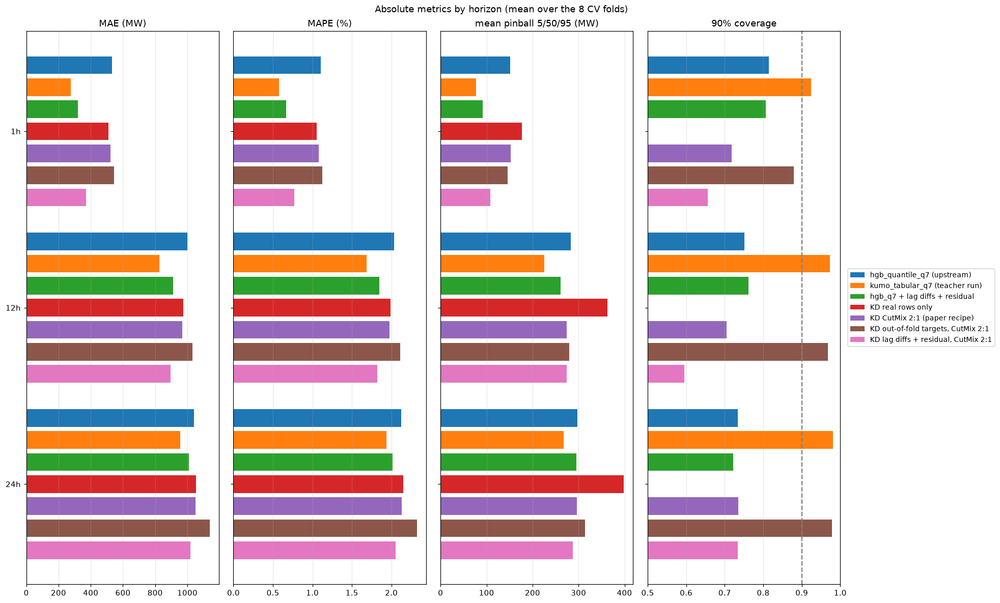
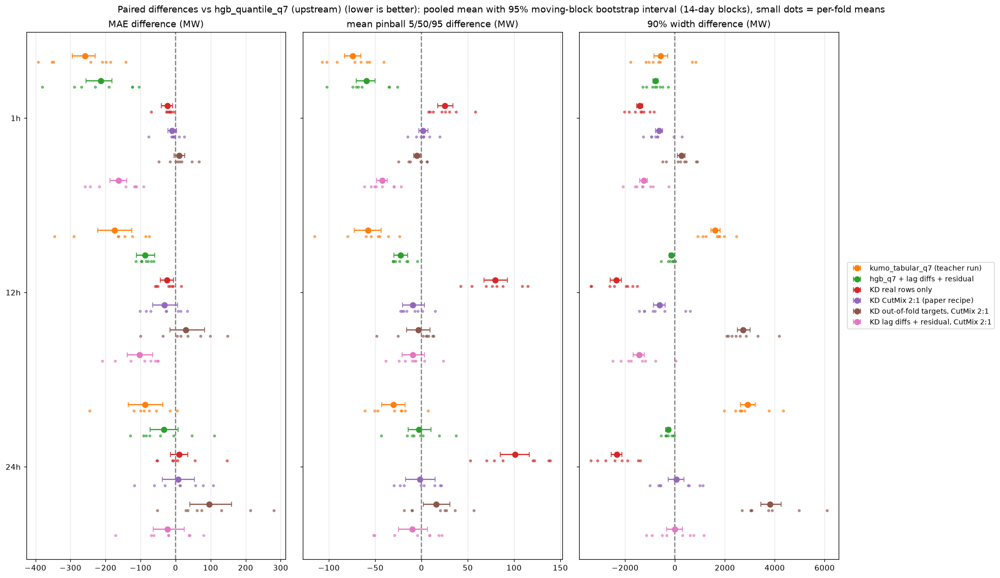
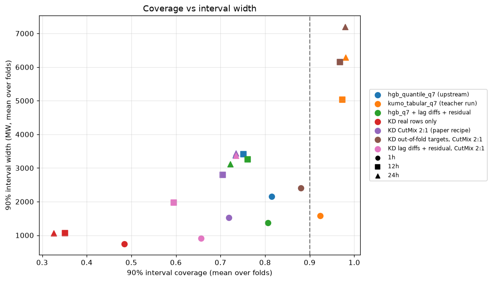
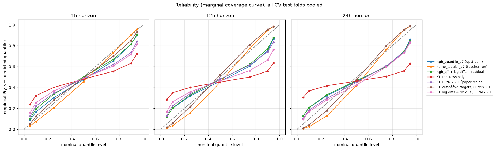
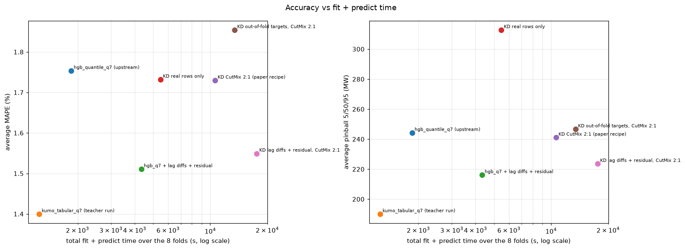
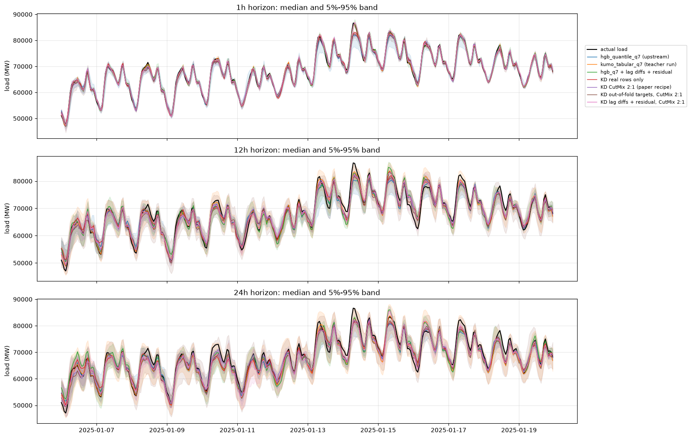
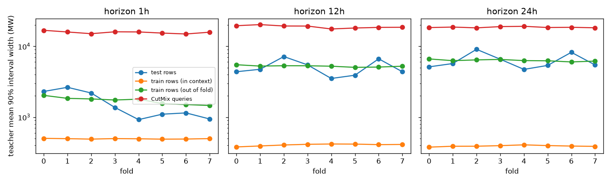

# 02: Distilling Kumo-Tabular into HGB quantile students

Goal: fit one `HistGradientBoostingRegressor(loss="squared_error")` per
quantile level (0.05, 0.1, 0.25, 0.5, 0.75, 0.9, 0.95) on the quantile
predictions of the Kumo-Tabular teacher of [iteration 01](../01-reproduction/report.md),
following [arXiv:2610.01435](https://arxiv.org/html/2610.01435), and see how
much of the gap between `hgb_quantile_q7` and `kumo_tabular` the students
close.

## Setup

- Teacher (`scripts/gen_teacher.py`, L4 GPU): for each of 12 walk-forward
  folds (the 8 evaluation folds plus 4 earlier folds used only for
  calibration) and each horizon, Kumo-Tabular (8 estimators, fp16, the full
  training set as context) predicts the 7 quantiles on the test rows, on the
  training rows, and on 4 x n_train CutMix queries. The students below use
  the first 2 x n_train of those queries.
- CutMix queries (`folds.cutmix`, paper appendix A): each feature of a
  synthetic row is copied, with probability 0.5, from one of two training
  rows drawn uniformly at random.
- Student (`scripts/distill.py`): one HGB per level, `squared_error` loss,
  learning rate 0.1, 31 leaves, `min_samples_leaf=20`, up to 3,000 iterations
  with early stopping (patience 100). Targets are the teacher quantiles only
  (no ground-truth labels). The synthetic-to-real ratio is 2:1, and the real
  and synthetic groups get the same total weight. The 7 predictions are
  sorted to remove quantile crossings.
- `hgb_q7 (this pipeline)` is the same student code trained on the labels
  with pinball loss and no synthetic rows. It checks that this pipeline
  matches the upstream `hgb_quantile_q7`.
- `hgb_q7 + lag diffs + residual` is the same label-trained model with two
  changes that came out of the probes. It appends differences between
  consecutive hourly load lags and `lag_h - lag_{24,48,168}`, which
  axis-aligned trees cannot form, and it regresses the target minus the load
  at prediction time (`lag_h`).
- `KD real rows only` drops the synthetic rows.
- `KD out-of-fold targets` replaces the teacher's predictions on its own
  training rows with blocked out-of-fold predictions
  (`scripts/gen_teacher_oof.py`: 4 contiguous blocks, each predicted with
  that block and 7 days on either side removed from the context). The
  synthetic rows still use the full-context teacher.

The fit+predict times of the distilled students add the L4 teacher time
(fit, plus predictions on the training rows and on the synthetic queries
actually used) to the student fit on 4 vCPUs.

One further student, out-of-fold targets combined with the lag-difference
features and the residual target, was stopped after 6 of the 12 folds. It is
not reported.

## Results (8 evaluation folds)

| model | MAE avg | MAE 1h | MAE 12h | MAE 24h | MAPE avg (%) | pinball 5/50/95 avg | pinball q7 avg | d2 pinball avg | cov 90 avg | width 90 avg | cov 50 avg | fit+predict (s) |
|---|---:|---:|---:|---:|---:|---:|---:|---:|---:|---:|---:|---:|
| hgb_quantile_q7 (upstream) | 859 | 534 | 1001 | 1042 | 1.75 | 244 | 278 | 0.8595 | 0.766 | 2987 | 0.305 | 1851 |
| kumo_tabular_q7 (teacher run) | 686 | 275 | 827 | 955 | 1.40 | 190 | 213 | 0.8918 | 0.959 | 4298 | 0.594 | 1255 |
| hgb_q7 (this pipeline) | 862 | 535 | 995 | 1056 | 1.76 | 243 | 277 | 0.8606 | 0.771 | 3012 | 0.309 | 3994 |
| hgb_q7 + lag diffs + residual | 747 | 320 | 913 | 1008 | 1.51 | 216 | 245 | 0.8742 | 0.763 | 2583 | 0.297 | 4336 |
| KD real rows only | 846 | 510 | 976 | 1053 | 1.73 | 313 | 341 | 0.7876 | 0.387 | 956 | 0.114 | 5466 |
| KD CutMix 2:1 (paper recipe) | 847 | 524 | 969 | 1049 | 1.73 | 241 | 273 | 0.8625 | 0.719 | 2584 | 0.286 | 10608 |
| KD out-of-fold targets, CutMix 2:1 | 905 | 544 | 1031 | 1139 | 1.85 | 247 | 275 | 0.8628 | 0.942 | 5256 | 0.543 | 13450 |
| KD lag diffs + residual, CutMix 2:1 | 763 | 371 | 897 | 1019 | 1.55 | 224 | 253 | 0.8699 | 0.662 | 2085 | 0.252 | 17580 |

Paired differences against `hgb_quantile_q7` use the upstream moving-block
bootstrap (14-day blocks). An interval that contains 0 is a difference the
bootstrap does not separate from noise.

- The pipeline's label-trained HGB matches the upstream script: MAE 862 MW
  against 859 MW, same coverage and pinball loss to 1 MW. Later gaps are not
  an artifact of rebuilding the features outside the skrub DataOp.
- The paper recipe closes about 7% of the MAE gap (847 vs 859 and 686) and
  about 8% of the 7-level pinball gap (273 vs 278 and 213). Its paired MAE
  intervals contain 0 at every horizon (1h: -10 MW, [-21, 2]). It
  under-covers more than `hgb_quantile_q7` (0.72 vs 0.77).
- Real rows only match that median (846 MW, and the 1h and 12h MAE intervals
  are below 0) and destroy the intervals: 90% coverage 0.39, mean width
  956 MW, 7-level pinball 341 MW. The CutMix rows are what puts the width
  back; they barely move the median.
- Out-of-fold targets do the opposite. Coverage rises to 0.94, close to the
  teacher's 0.96, and the median gets worse (905 MW; the 24h MAE interval is
  +97 MW, [40, 160]). The fold-0 probe below had ranked this variant first.
  That ranking does not survive the 8 folds.
- Lag differences and a residual target, trained on the labels, close 65% of
  the MAE gap (747 MW). The paired intervals are below 0 at 1h (-214 MW) and
  12h (-88 MW), and contain 0 at 24h. At 1h this is 320 MW, against 534 MW
  for the upstream HGB and 275 MW for the teacher.
- Distilling those same features from in-context teacher targets is worse
  than the labels: MAE 763 vs 747, 7-level pinball 253 vs 245, coverage 0.66
  vs 0.76. The 1h error is 371 vs 320 MW.

## Why the paper recipe does not transfer here

`scripts/teacher_diagnostics.py` compares the teacher on the test rows, on
its own (in-context) training rows, on the blocked out-of-fold training
rows, and on the CutMix queries. Averages over the 8 evaluation folds
([teacher_diagnostics.json](teacher_diagnostics.json)):

| horizon | test MAE | test width 90 | test cov 90 | in-context train MAE | in-context width 90 | in-context cov 90 | out-of-fold train MAE | out-of-fold width 90 | out-of-fold cov 90 | CutMix width 90 |
|---|---:|---:|---:|---:|---:|---:|---:|---:|---:|---:|
| 1h | 275 | 1577 | 0.924 | 51 | 494 | 0.998 | 319 | 1717 | 0.917 | 15765 |
| 12h | 827 | 5029 | 0.973 | 35 | 405 | 1.000 | 1074 | 5254 | 0.947 | 18933 |
| 24h | 955 | 6289 | 0.981 | 35 | 391 | 1.000 | 1245 | 6330 | 0.945 | 18613 |

1. **The teacher memorizes its context rows.** With the full training set as
   context it returns almost the label of each training row: median error
   35-51 MW, and intervals 3 to 16 times narrower than on test rows. The
   neighbours of a training row, one hour apart, are in the context with
   their labels. At test time the closest context row is at least 7 days
   away. Real-row targets are therefore close to the labels for the median
   and much too narrow for the tails. That is the coverage of 0.39 for
   `KD real rows only`.
2. **CutMix queries are far off the data manifold.** Mixing features of two
   random hours produces load lags, rolling statistics, weather forecasts and
   calendar columns that do not belong to one time point. The teacher answers
   with intervals 16-19k MW wide, 3 to 10 times the test width. Given half of
   the training weight, those targets widen the student, which is why the
   paper recipe has a better pinball loss than real rows only (273 vs 341)
   with the same median error.
3. **Out-of-fold teacher predictions do look like test predictions.** Their
   error, width and coverage match the test rows. They are honest targets.
   On the full CV they produce honest coverage (0.94) and a worse median
   (905 MW): the student does not turn the teacher's test-time quantile
   function into a better point forecast than pinball loss on the labels.

Two more structured query generators were run as teachers on fold 0:
CutMix over feature groups (lags, weather, calendar) and CutMix of two rows
at most 72 h apart. They reduce the teacher width on synthetic rows to
5.5-8.5k MW, still 1.5 to 3.5 times the test width. They were not used for a
full student.

## Fold 0, horizon 1h probes

Students fitted on fold 0 at 1h only (2,184 test rows; teacher MAE 368 MW),
with the default student hyperparameters. Predictions are in
`results/raw/probe`. These probes chose the full-CV variants above. They do
not, on their own, rank them: the out-of-fold variant was the best probe and
the worst full-CV median.

| student | real-row targets | synthetic ratio | residual target | MAE | pinball q7 | cov 90 | width 90 |
|---|---|---:|---|---:|---:|---:|---:|
| labels, pinball loss | labels | 0 | no | 567 | 198 | 0.68 | 1533 |
| labels, pinball loss | labels | 0 | yes | 605 | 218 | 0.60 | 1230 |
| KD | in-context teacher | 0 | no | 563 | 226 | 0.41 | 633 |
| KD | in-context teacher | 1 | no | 569 | 183 | 0.79 | 1882 |
| KD | in-context teacher | 2 | no | 571 | 188 | 0.76 | 1772 |
| KD | in-context teacher | 4 | no | 562 | 184 | 0.76 | 1808 |
| KD | in-context teacher | 0 | yes | 600 | 253 | 0.39 | 526 |
| KD | in-context teacher | 2 | yes | 547 | 181 | 0.75 | 1654 |
| KD | out-of-fold teacher | 0 | no | 585 | 195 | 0.71 | 1593 |
| KD | out-of-fold teacher | 2 | no | 576 | 176 | 0.86 | 2329 |

On this one fold, CutMix mostly changes the width, and the synthetic ratio
from 1 to 4 barely changes the median. The full CV then shows that the
median gains come from the lag-difference features trained on labels, not
from teacher supervision.
