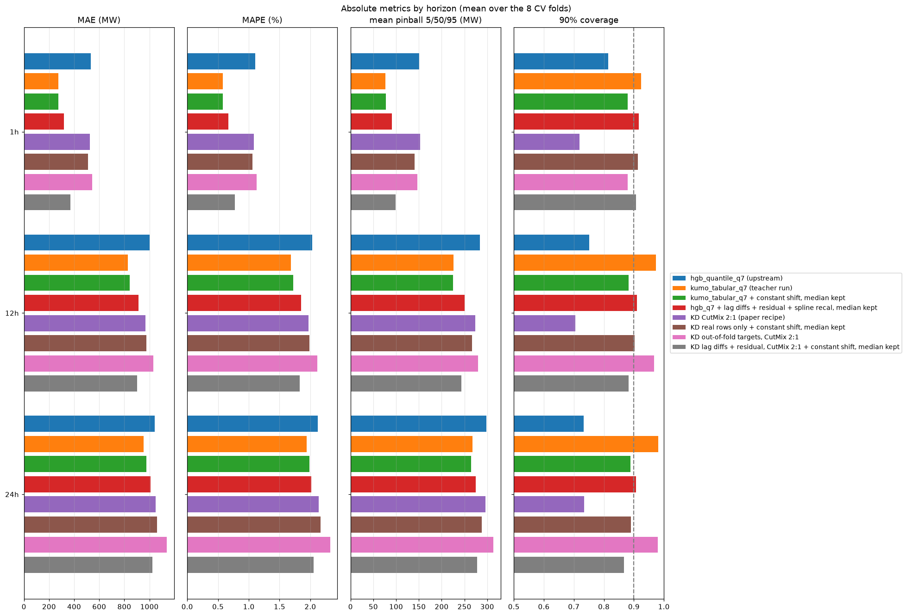
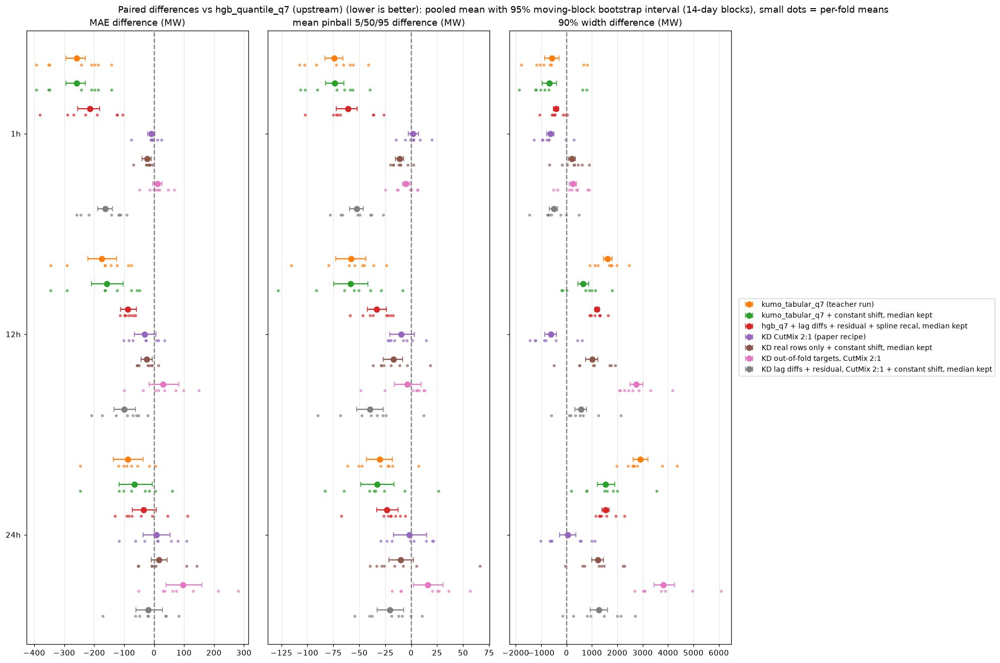
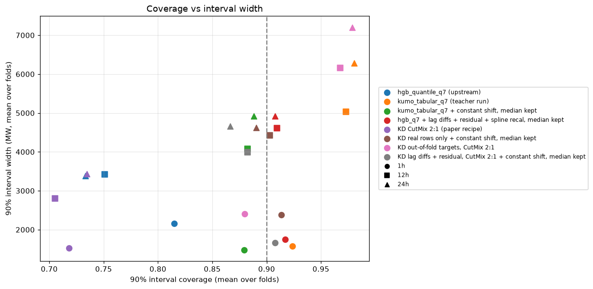
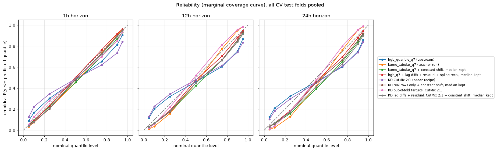
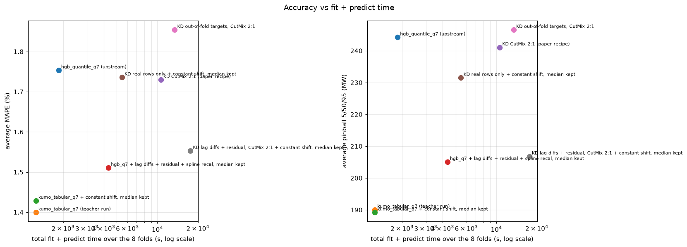
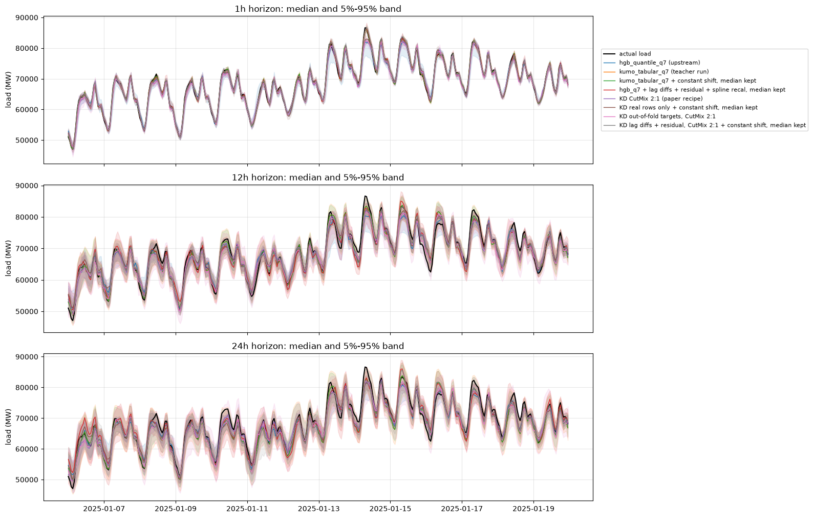

# 03: Post-hoc calibration

Goal: check whether shifting the quantiles after the fact helps the distilled
students, the label-trained HGB models, and the Kumo-Tabular teacher of
[iteration 02](../02-distillation/report.md).

## Method

`scripts/calibrate.py` recalibrates outer fold k from the predictions of
folds k-4 to k-1 (`folds.extended_splits`, `min_train_days=365`). It only
uses rows before the 7-day gap of fold k. Each of those models was trained
on data that precedes its own test block, so fold k does not leak into the
shift. This replaces the inner CV of the upstream `Recalibrator`, which
would re-run the teacher 4 more times per fold. Four variants:

- spline recal: the upstream `Recalibrator._fit_shift_model` (10 bins of the
  predicted value, residual quantile per bin, spline plus `RidgeCV`), per
  quantile level and horizon;
- constant shift: one shift per level, the empirical level-q quantile of the
  past residuals (conformalized quantile regression);
- median kept: the same two methods with the 0.5 level left unchanged.

The 7 corrected levels are then sorted. A large shift of the 0.25 or 0.75
level can move it past the median, so some "median kept" rows still change
the MAE by a few MW. The calibration fit itself is under 1 s per fold.

## Results (8 evaluation folds)

| model | MAE avg | MAE 1h | MAE 12h | MAE 24h | pinball 5/50/95 avg | pinball q7 avg | d2 pinball avg | cov 90 avg | width 90 avg | cov 50 avg |
|---|---:|---:|---:|---:|---:|---:|---:|---:|---:|---:|
| hgb_quantile_q7 (upstream) | 859 | 534 | 1001 | 1042 | 244 | 278 | 0.8595 | 0.766 | 2987 | 0.305 |
| kumo_tabular_q7 (teacher run) | 686 | 275 | 827 | 955 | 190 | 213 | 0.8918 | 0.959 | 4298 | 0.594 |
| kumo_tabular_q7 + spline recal | 820 | 291 | 1009 | 1158 | 212 | 239 | 0.8875 | 0.859 | 3209 | 0.445 |
| kumo_tabular_q7 + spline recal, median kept | 715 | 276 | 868 | 1003 | 194 | 227 | 0.8920 | 0.859 | 3210 | 0.460 |
| kumo_tabular_q7 + constant shift | 789 | 284 | 966 | 1116 | 204 | 229 | 0.8906 | 0.883 | 3492 | 0.469 |
| kumo_tabular_q7 + constant shift, median kept | 698 | 275 | 842 | 978 | 189 | 220 | 0.8945 | 0.883 | 3493 | 0.488 |
| hgb_q7 (this pipeline) | 862 | 535 | 995 | 1056 | 243 | 277 | 0.8606 | 0.771 | 3012 | 0.309 |
| hgb_q7 (this pipeline) + spline recal | 928 | 545 | 1093 | 1144 | 248 | 277 | 0.8645 | 0.902 | 4284 | 0.511 |
| hgb_q7 (this pipeline) + spline recal, median kept | 866 | 535 | 1002 | 1061 | 238 | 272 | 0.8670 | 0.902 | 4284 | 0.516 |
| hgb_q7 (this pipeline) + constant shift | 910 | 541 | 1063 | 1127 | 244 | 274 | 0.8659 | 0.906 | 4293 | 0.509 |
| hgb_q7 (this pipeline) + constant shift, median kept | 862 | 535 | 996 | 1057 | 236 | 270 | 0.8679 | 0.906 | 4293 | 0.515 |
| hgb_q7 + lag diffs + residual | 747 | 320 | 913 | 1008 | 216 | 245 | 0.8742 | 0.763 | 2583 | 0.297 |
| hgb_q7 + lag diffs + residual + spline recal | 768 | 320 | 945 | 1040 | 209 | 233 | 0.8845 | 0.911 | 3761 | 0.520 |
| hgb_q7 + lag diffs + residual + spline recal, median kept | 747 | 320 | 913 | 1008 | 205 | 232 | 0.8854 | 0.911 | 3761 | 0.520 |
| hgb_q7 + lag diffs + residual + constant shift | 764 | 320 | 936 | 1034 | 209 | 234 | 0.8833 | 0.913 | 3759 | 0.518 |
| hgb_q7 + lag diffs + residual + constant shift, median kept | 747 | 320 | 913 | 1008 | 206 | 233 | 0.8840 | 0.913 | 3759 | 0.518 |
| KD real rows only | 846 | 510 | 976 | 1053 | 313 | 341 | 0.7876 | 0.387 | 956 | 0.114 |
| KD real rows only + spline recal | 908 | 518 | 1067 | 1140 | 240 | 270 | 0.8697 | 0.899 | 3764 | 0.502 |
| KD real rows only + spline recal, median kept | 851 | 510 | 980 | 1062 | 230 | 265 | 0.8721 | 0.899 | 3764 | 0.505 |
| KD real rows only + constant shift | 895 | 516 | 1051 | 1120 | 239 | 270 | 0.8686 | 0.902 | 3810 | 0.504 |
| KD real rows only + constant shift, median kept | 848 | 510 | 976 | 1059 | 231 | 266 | 0.8705 | 0.902 | 3810 | 0.506 |
| KD CutMix 2:1 (paper recipe) | 847 | 524 | 969 | 1049 | 241 | 273 | 0.8625 | 0.719 | 2584 | 0.286 |
| KD CutMix 2:1 + spline recal | 956 | 557 | 1109 | 1202 | 249 | 279 | 0.8672 | 0.876 | 3839 | 0.465 |
| KD CutMix 2:1 + spline recal, median kept | 861 | 525 | 990 | 1067 | 234 | 269 | 0.8711 | 0.876 | 3839 | 0.479 |
| KD CutMix 2:1 + constant shift | 937 | 541 | 1086 | 1184 | 246 | 275 | 0.8676 | 0.888 | 3963 | 0.477 |
| KD CutMix 2:1 + constant shift, median kept | 852 | 524 | 976 | 1055 | 232 | 267 | 0.8712 | 0.888 | 3963 | 0.488 |
| KD out-of-fold targets, CutMix 2:1 | 905 | 544 | 1031 | 1139 | 247 | 275 | 0.8628 | 0.942 | 5256 | 0.543 |
| KD out-of-fold targets, CutMix 2:1 + spline recal | 973 | 565 | 1114 | 1240 | 253 | 283 | 0.8650 | 0.891 | 4236 | 0.480 |
| KD out-of-fold targets, CutMix 2:1 + spline recal, median kept | 901 | 544 | 1027 | 1131 | 241 | 275 | 0.8681 | 0.892 | 4237 | 0.497 |
| KD out-of-fold targets, CutMix 2:1 + constant shift | 950 | 556 | 1081 | 1215 | 249 | 278 | 0.8662 | 0.903 | 4447 | 0.498 |
| KD out-of-fold targets, CutMix 2:1 + constant shift, median kept | 902 | 543 | 1025 | 1138 | 241 | 273 | 0.8682 | 0.903 | 4447 | 0.511 |
| KD lag diffs + residual, CutMix 2:1 | 763 | 371 | 897 | 1019 | 224 | 253 | 0.8699 | 0.662 | 2085 | 0.252 |
| KD lag diffs + residual, CutMix 2:1 + spline recal | 856 | 389 | 1026 | 1154 | 223 | 248 | 0.8817 | 0.872 | 3345 | 0.463 |
| KD lag diffs + residual, CutMix 2:1 + spline recal, median kept | 772 | 371 | 912 | 1033 | 209 | 241 | 0.8852 | 0.872 | 3346 | 0.471 |
| KD lag diffs + residual, CutMix 2:1 + constant shift | 840 | 379 | 999 | 1141 | 219 | 246 | 0.8826 | 0.886 | 3438 | 0.476 |
| KD lag diffs + residual, CutMix 2:1 + constant shift, median kept | 765 | 371 | 901 | 1022 | 207 | 240 | 0.8857 | 0.886 | 3438 | 0.483 |

- Shifting the median from past-fold residuals adds 17 to 134 MW of MAE for
  every model. The level of the load drifts between the 13-week folds, so a
  past median bias does not carry to the next fold.
- With the median left alone, calibration is what fixes the under-covering
  HGB models. The collapsed real-rows student goes from coverage 0.39 and
  pinball 341 MW to coverage 0.90 and pinball 265 MW. The paper-recipe
  student goes from 273 to 267 MW and from coverage 0.72 to 0.89. The
  distilled lag-difference student goes from 253 to 240 MW and from coverage
  0.66 to 0.89. The label-trained lag-difference model goes from 245 to
  232 MW and from 0.76 to 0.91, with the MAE unchanged at 747 MW. For these
  HGB models the spline and the constant shift are within 2 MW of each other
  once the median is kept. The 240 MW of the calibrated distilled
  lag-difference student is the best pinball loss of any distilled model,
  and it stays behind the label-trained one (232 MW).
- The out-of-fold student is already over-covering (0.94). Calibration brings
  it to 0.89-0.90 and leaves both the MAE (about 901 MW) and the pinball
  loss (273-275 MW) essentially unchanged.
- Calibrating the teacher narrows its intervals (coverage 0.96 to 0.88 for
  the constant shift) and does not help. With the median kept, MAE goes from
  686 to 698 MW and the 7-level pinball loss from 213 to 220 MW. The
  5/50/95 pinball loss stays at 189-194 MW against 190 MW uncalibrated.
- Calibration does not change the ranking. The best model that is an HGB is
  the label-trained lag-difference model with the spline shift and the
  median kept: MAE 747 MW, 7-level pinball 232 MW, 90% coverage 0.91. The
  teacher remains ahead of it (686 MW, 213 MW) and ahead of every distilled
  student.

