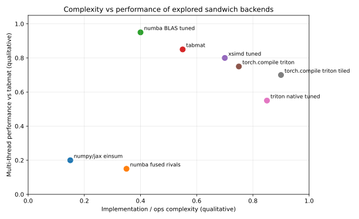

# Complexity vs performance (overview)

Qualitative map of the backends explored in this experiment. Axes are intentionally not quantitative — see [latest benchmarks](../05-latest-benchmarks/report.md) for measured speedups.

| Region | Examples | Lesson |
|---|---|---|
| Low complexity, low reward | NumPy / JAX einsum | Correct and clear; ~0.2× tabmat MT |
| Medium complexity, high reward | `numba_blas_tuned`, tabmat | Best ROI; beat or match tabmat |
| High complexity, mixed reward | Triton-CPU tiled compile | Wins tall/skinny MT; ops-heavy |

← [Journal index](../index.md)
