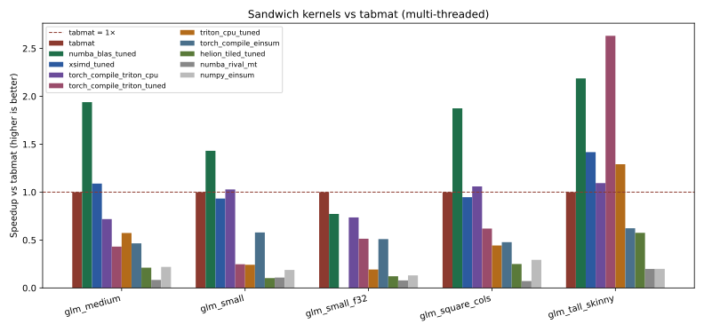
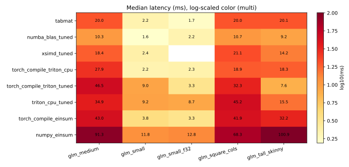
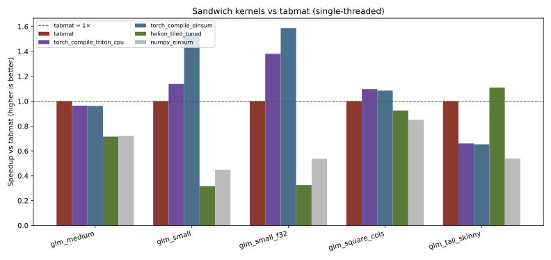
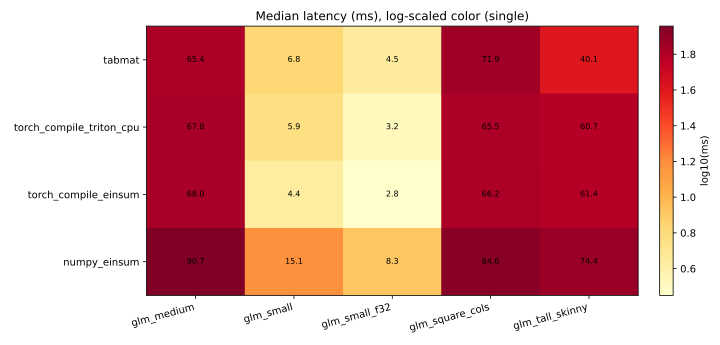

# Iteration 05 — Latest consolidated benchmarks

Latest ST/MT results from `artifacts/benchmark_results.json` (linux-amd64, 4 threads for MT). Plots regenerated by [`scripts/build_journal_assets.py`](https://github.com/ogrisel/cursor-sandbox/blob/cursor/sandwich-fused-kernels-000a/sandwich_fused_kernels/scripts/build_journal_assets.py).

Machine-readable summary: [benchmark_summary.json](benchmark_summary.json).

## Multi-threaded vs tabmat

### glm_small (50k×40 f64, 4 threads)

| kernel | median (ms) | vs tabmat |
|---|---:|---:|
| **numba_blas_tuned** | **1.55** | **1.43×** |
| torch_compile_triton_cpu | 2.16 | 1.03× |
| tabmat | 2.22 | 1.00× |
| xsimd_tuned | 2.38 | 0.93× |
| torch_compile_triton_tuned | 8.98 | 0.25× |
| triton_cpu_tuned | 9.19 | 0.24× |
| numba_rival_mt | 20.54 | 0.11× |

### glm_medium (140k×80 f64)

| kernel | median (ms) | vs tabmat |
|---|---:|---:|
| **numba_blas_tuned** | **10.33** | **1.94×** |
| xsimd_tuned | 18.39 | 1.09× |
| tabmat | 20.03 | 1.00× |
| torch_compile_triton_cpu | 27.88 | 0.72× |
| triton_cpu_tuned | 34.92 | 0.57× |

### glm_tall_skinny (320k×32 f64)

| kernel | median (ms) | vs tabmat |
|---|---:|---:|
| **torch_compile_triton_tuned** | **7.63** | **2.63×** |
| numba_blas_tuned | 9.18 | 2.19× |
| xsimd_tuned | 14.16 | 1.42× |
| triton_cpu_tuned | 15.54 | 1.29× |
| torch_compile_triton_cpu | 18.34 | 1.09× |
| tabmat | 20.07 | 1.00× |

### glm_square_cols (80k×120 f64)

| kernel | median (ms) | vs tabmat |
|---|---:|---:|
| **numba_blas_tuned** | **10.68** | **1.87×** |
| torch_compile_triton_cpu | 18.90 | 1.06× |
| tabmat | 20.02 | 1.00× |
| xsimd_tuned | 21.13 | 0.95× |

## Single-threaded vs tabmat

Selected ST winners from the same run: `torch_compile_einsum` / `torch_einsum` / `torch_compile_tiled_tuned` often beat or match tabmat; `torch_compile_triton_cpu` is competitive (~1.1–1.4× on several shapes). See the heatmaps above for the full picture.

## Source map for highlighted kernels

| Kernel | Implementation |
|---|---|
| `tabmat` | [`kernels/tabmat_baseline.py`](https://github.com/ogrisel/cursor-sandbox/blob/cursor/sandwich-fused-kernels-000a/sandwich_fused_kernels/kernels/tabmat_baseline.py) |
| `numba_blas_tuned` | [`tuned_kernels.py#L87`](https://github.com/ogrisel/cursor-sandbox/blob/cursor/sandwich-fused-kernels-000a/sandwich_fused_kernels/kernels/tuned_kernels.py#L87-L104) → [`_sandwich_kchunk_blas_impl`](https://github.com/ogrisel/cursor-sandbox/blob/cursor/sandwich-fused-kernels-000a/sandwich_fused_kernels/kernels/numba_kernels.py#L230-L258) |
| `xsimd_tuned` | [`tuned_kernels.py#L145`](https://github.com/ogrisel/cursor-sandbox/blob/cursor/sandwich-fused-kernels-000a/sandwich_fused_kernels/kernels/tuned_kernels.py#L145-L166) → [`xsimd_ext/sandwich_xsimd.cpp`](https://github.com/ogrisel/cursor-sandbox/blob/cursor/sandwich-fused-kernels-000a/sandwich_fused_kernels/xsimd_ext/sandwich_xsimd.cpp) |
| `torch_compile_triton_cpu` | [`triton_cpu_kernel.py#L326`](https://github.com/ogrisel/cursor-sandbox/blob/cursor/sandwich-fused-kernels-000a/sandwich_fused_kernels/kernels/triton_cpu_kernel.py#L326-L346) |
| `torch_compile_triton_tuned` | [`tuned_kernels.py#L250`](https://github.com/ogrisel/cursor-sandbox/blob/cursor/sandwich-fused-kernels-000a/sandwich_fused_kernels/kernels/tuned_kernels.py#L250-L273) → [`triton_cpu_kernel.py#L349`](https://github.com/ogrisel/cursor-sandbox/blob/cursor/sandwich-fused-kernels-000a/sandwich_fused_kernels/kernels/triton_cpu_kernel.py#L349-L372) |
| `triton_cpu_tuned` | [`tuned_kernels.py#L222`](https://github.com/ogrisel/cursor-sandbox/blob/cursor/sandwich-fused-kernels-000a/sandwich_fused_kernels/kernels/tuned_kernels.py#L222-L247) → [`sandwich_triton_cpu_native`](https://github.com/ogrisel/cursor-sandbox/blob/cursor/sandwich-fused-kernels-000a/sandwich_fused_kernels/kernels/triton_cpu_kernel.py#L180-L245) |
| `numba_rival_mt` | [`numba_kernels.py#L266`](https://github.com/ogrisel/cursor-sandbox/blob/cursor/sandwich-fused-kernels-000a/sandwich_fused_kernels/kernels/numba_kernels.py#L266-L269) |
| `numpy_einsum` | [`numpy_baseline.py#L25`](https://github.com/ogrisel/cursor-sandbox/blob/cursor/sandwich-fused-kernels-000a/sandwich_fused_kernels/kernels/numpy_baseline.py#L25-L39) |

## Practical recommendation

1. **Best ROI:** `numba_blas_tuned` — beats tabmat on most f64 MT shapes without exotic builds.
2. **Near-tabmat native:** `xsimd_tuned` when the C++ extension is built.
3. **Already on PyTorch:** `torch_compile_triton_cpu` (einsum) or ST `torch_compile_*`.
4. **Tall/skinny MT jackpot:** `torch_compile_triton_tuned` (pay for triton-cpu + autotune).
5. **Avoid for speed:** pure fused Numba rivals, JAX CPU, untuned Helion→Triton CPU.

← [Helion / Triton](../04-helion-triton/report.md) · [Journal index](../index.md)
